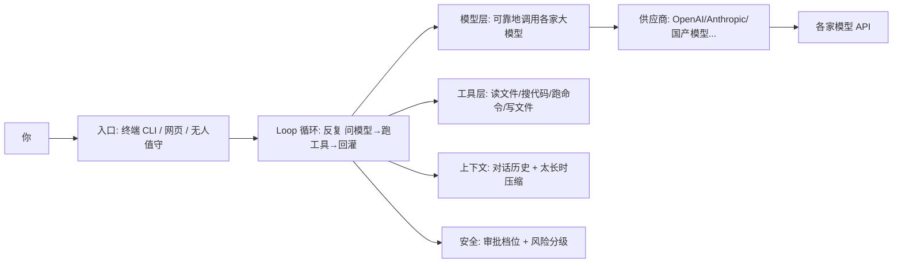

# 第 0 章：什么是 Agent Harness —— 一张先总后分的地图

你大概用过 ChatGPT 这类聊天 AI。有没有过这种念头：要是它能**直接动手**就好了——读一下我的项目文件、跑个测试、把那个 bug 改了、再把结果汇报给我？

光靠模型本身的 API 做不到。模型很聪明，但它是「被动」的：你问一句，它答一句，它碰不到你的电脑，也不记得上一轮之外的事。要在模型和「你的项目」之间架起这座桥，让模型从「会聊天」变成「能干活」，中间就得有层软件。这层软件，行话叫 **Agent Harness（智能体外壳 / 框架）**。

> 本系列会用一个真实的开源 AI 编程助手当参照，带你看这层外壳是怎么从零搭起来的。下面所有架构描述都来自它的技术文档，不凭印象。

## 1. 一句话说清：Harness 到底是啥（What）

Harness 这个词本意是「马具、框架」——把马和车绑在一起、让马能拉车的东西。放在 AI 这里，它就是**把「模型」和「你的电脑」绑在一起的那层框架**。

一个裸模型只有一张嘴。Harness 给了它三样东西：

- **手（工具 / Tools）**：能读文件、跑命令、写文件……也就是「能做事」。
- **记忆（上下文 / Context）**：记得聊过什么，以及东西太多时该忘掉哪些。
- **规矩（安全 / Security）**：不准它乱删你的文件、不准它碰你的密钥。

再配上一个**循环（Loop）**当引擎，反复「问模型 → 跑工具 → 把结果喂回去」，直到活干完。

少了 Harness，AI 是个聊天机器人；有了它，AI 是个能交活的工人。这就是本系列要拆解的全部。

## 2. 整体架构：它到底由哪些块拼成（What，总览）

把这个参照项目拆开看，真正干活的内核只有一份（叫 `core`），CLI 和网页界面都只是它的「壳」。内核里又能分成几块，它们的关系画成图是这样的：

别被图吓到，记住**最核心的三件套**就够了：**Loop / 工具 / 上下文**。其余几块（模型层、供应商、安全、入口）都是围着这三件套转的：

- **模型层 + 供应商**：模型层负责「可靠地」把 Loop 的话传给大模型（超时、重试、流式、限流），供应商负责屏蔽各家接口差异。没有它们，Loop 只能调一家、且一卡就死。
- **安全**：工具让 Agent 能删文件、跑命令，这太危险，所以得有审批档位和风险分级来兜着。没有它，Agent 一个 `rm -rf` 就能把项目删光。
- **入口**：同一份内核，可以包成终端命令行、网页、或无人值守脚本三种面孔。没有它，你就只能在代码里调。

## 3. 本系列怎么讲（How，先总后分）

整本书就是按「先让你看见全貌，再一块块拆开」来组织的。你已经在这张地图上了，后面每一章专门讲一块，顺序大致是：

| 章节 | 讲什么 | 它解决的真问题 |
| --- | --- | --- |
| 第 1 章 | 最小可用 Agent Loop | 消息进 → 流式输出 → 工具结果回灌 → 多轮终止 |
| 第 2 章 | 工具层设计 | 只读/写/执行怎么分级、工具怎么注册、结果怎么回传 |
| 第 3 章 | 模型层可靠性 | 流式 + 超时 + 静默看门狗 + 退避重试；已显示的字绝不重来 |
| 第 4 章 | 上下文与会话 | 聊天记录怎么落盘、太长怎么压缩、压缩失败不丢历史 |
| 第 5 章 | 供应商抽象 | 统一接口屏蔽各家差异（鉴权头 / 地址 / 上下文窗口） |
| 第 6 章 | 安全模型 | 审批三档、路径双层校验、凭据保护；审批才是真防线 |
| 第 7 章 | 进阶：子 Agent 与 Skills | 把活派给子 Agent 干，隔离与成本怎么护栏 |
| 第 8 章 | 评测 | 给 Agent 上门禁：任务集、基线对比、CI 接线 |
| 第 9 章 | 多形态交付 | 同一内核 → CLI / 无界面执行 / 网页客户端 |

> **本系列怎么搭（很重要）：累积式，不是各写各的。**
> 每一章都往**同一个 `harness/` 项目**里加一个文件，代码从简到全。第 1 章你写出「会问模型、会调工具、能多轮」的最小循环；第 2 章给它补工具分级；第 3 章把 `model.js` 换成真实流式 + 看门狗 + 重试（接口不变，循环一行不用改）；第 4 章加会话落盘；第 5 章加供应商抽象；第 6 章加审批三档与风险分级。**走到第 6 章，`node harness/run.js` 跑起来就是一个带护栏的简化 Harness。** 每章的「实现」段都是可以照抄、可以跑的最小代码，不是只贴源码引用。第 7/8 章是进阶与评测，超出「简化版」必需范围，可先跳过。

各章往 `harness/` 里加的东西一览：

| 章节 | 新增文件 | 这一步让简化 Harness 多什么能力 |
| --- | --- | --- |
| 第 0 章 | （导论，无代码） | 先有全貌地图 |
| 第 1 章 | `messages.js` / `model.js` / `tools.js` / `loop.js` | 会「问模型 → 调工具 → 多轮」的最小循环 |
| 第 2 章 | （扩展 `tools.js`） | 工具分级、注册表、结果回传格式 |
| 第 3 章 | 替换 `model.js` | 流式 + 超时 + 静默看门狗 + 退避重试 |
| 第 4 章 | `session.js` | 聊天记录落盘 + 压缩 |
| 第 5 章 | `provider.js` | 屏蔽各家接口差异 |
| 第 6 章 | `security.js` | 审批三档 + 风险分级（真防线） |
| 第 9 章 | `cli.js` | 终端入口 |

你看，第 1 章就是那台引擎，第 2~6 章是引擎周围的零件，第 7~9 章是进阶和交付。每一章都会像本章一样：先把概念讲明白，再讲它怎么转，最后讲「为什么非得这么设计」以及每个决定付出的代价。

> 可运行的 demo 在仓库 `demos/harness/`，与这张表逐行对应：零依赖，Node ≥ 18，`node xxx.js` 直接跑；各章正文里给出的就是这些文件的代码，可以照抄，也可以先跑一遍看效果。

## 4. 为什么非得是这三件套 + 外围（Why）

有人会问：不就是「调个 API 再跑个命令」吗，凭什么拆这么细？

- **不拆 Loop，Agent 干不满一轮。** 没有循环，模型答一句就结束，工具结果回不去，复杂任务做不完。Loop 是「能干活」和「只能聊天」的分水岭。
- **不拆工具与上下文，Agent 要么瞎干要么失忆。** 工具给能力，上下文管记忆；缺上下文，长任务会爆掉；缺工具分级，安全无从谈起。
- **不拆模型层和安全，生产环境活不过一周。** 网络天天出幺蛾子，没有可靠模型层就天天卡死；没有安全，一次误删就万劫不复。

把它们拆开、各自收敛成「一个纯函数 / 一个模块」，好处是：每一块都能单独测、单独换、单独讲——而这整本书，就是把这几块一块块摊开给你看。

## 5. 小结与下一章

**Agent Harness = 模型 + 三件套（Loop / 工具 / 上下文）+ 外围（模型层 / 供应商 / 安全 / 入口）。** 它是把「会聊天的模型」变成「能交活的工人」的那层框架。本章是总纲，后面是分说。

下一章（第 1 章）就从最核心、也最该先搞懂的那台引擎——**Agent Loop**——开始：它怎么转，以及为什么非得那么转。
