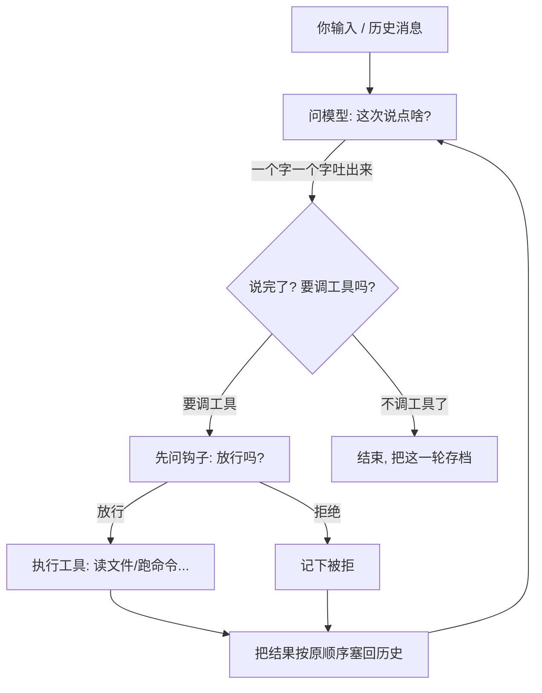

# 第 1 章：最小可用 Agent Loop —— 让 AI 真正「动手」的那层循环

先讲个场景。你让 AI 帮你改个 bug：「帮我看看 `main.ts` 里超时写成了多少。」

如果只是一个普通的聊天程序，AI 会回你一句「建议你打开文件看看」，然后就没了。它不会真去读那个文件，也不会根据你看到的内容继续往下干。

这一章要解决的，就是怎么让 AI 从「答一句」变成「干到底」。这个东西行话叫 **Agent Loop（智能体循环）**。在动手写代码之前，咱们先把几个词掰扯清楚——否则后面全是黑话，看着头疼。

## 1. 先搞懂三个词（What）

### 1.1 Agent 是什么

普通 AI（比如你平时聊天的那种）只会「说」。你问，它答，完事。

**Agent 是「会说 + 会动手」的 AI。** 除了聊天，它还能调用工具：读文件、搜代码、跑命令、写文件。你可以把它理解成：一个顾问，外加一双能直接操作你电脑的手。本章要搭的，就是这只「手」能稳定干活所需的骨架。

### 1.2 Loop 是什么

Agent 干活不是一步到位的。它是**反复**做一件事：问模型 → 模型可能要调工具 → 把工具结果喂回去 → 再问模型 → ……直到模型说「好了，不用再调了」。

这个「反复」的过程，就是一个循环（Loop）。你可以类比带新人干活：你交代一句，他做一步回来汇报，你再指示，周而复始，直到事办完。循环就是这套「汇报—指示」的自动化。

### 1.3 工具调用 和 流式输出 是什么

- **工具调用（tool call）**：模型在回复里不光说人话，还能夹一段「结构化指令」，比如「请读 `main.ts`」。程序看到这条指令，就去执行对应的工具，把结果交回去。注意：模型说的每一句「我要调工具」，都必须配一个「工具结果」，一一对应——这点后面要命地重要。
- **流式输出（streaming）**：模型不是憋半天一次性吐整段，而是**一个字一个字蹦出来**，像打字机。好处是用户不用干等。但有个隐患：字一旦蹦出来，就已经「发出去了」，后面如果出岔子，这些字不能假装没发过——这点给下一章埋个伏笔。

把这三个词串起来：**Agent 在一个 Loop 里，用流式输出和用户对话，期间靠工具调用去动手，再把结果喂回对话。** 这就是本章要落地的东西。

## 2. 它到底怎么转起来的（How）

把源码里无关的分支裁掉，主循环的核心逻辑就一句人话能说清：

> **反复「问模型 → 它要么说话、要么叫工具 → 工具结果按原顺序塞回历史 → 再问」，直到它不再叫工具为止。**

<!-- code-ref: packages/core/src/agent/loop.ts#L280-L294 -->
<!-- code-ref: packages/core/src/agent/loop.ts#L338-L380 -->

一轮内部的数据流向，画成图是这样的（看不懂图，直接看下面那句）：



每一轮结束，循环还会顺手做两件事：把这一轮**存一次档**，顺便看看上下文是不是太长了要压缩。存档要是失败也不打断本轮，但会记着「从这儿重新补」，免得漏一条或重复一条。

<!-- code-ref: packages/core/src/agent/loop.ts#L311-L336 -->

## 3. 实现：跟着写一个最小 Loop

前面讲的都是概念。下面用**零依赖的 Node ESM**（不需要 `npm install`，`node xxx.js` 就能跑）写一个能跑的最小 Loop。它先跑通「问模型 → 流式吐字 → 工具结果回灌 → 多轮终止 → 取消安全」这条主线；模型层先用 mock 顶上，第 3 章再换成真实流式 + 看门狗 + 重试，而且**换的时候 loop 一行都不用改**——这正是「模型层是独立 seam」这个设计的好处，后面第 4 节会展开。

### 3.0 落点：一套累积式代码

本系列是**累积式**的：后续每一章往同一个 `harness/` 目录里加一个文件，代码从简到全，走到第 6 章跑起来就是一个带审批护栏的简化 Harness。本章你写出这四个文件：

```
harness/
├── messages.js   # 消息与内容块的形状（assistant / toolCall / toolResult）
├── model.js      # callModel 接口（本章用 mock，第3章换真实实现）
├── tools.js      # 工具注册表 + 两个最小工具（read_file / exec）
└── loop.js       # 本章核心：runAgentLoop
```

### 3.1 `messages.js` —— 先定消息形状

协议里有个铁律，后面所有代码都绕着它转：**assistant 消息里的每个 toolCall，都必须有顺序一致的 toolResult 对应**。先把这几个块的形状钉死：

```js
// harness/messages.js
// 协议铁律：assistant 里的每个 toolCall，都必须有顺序一致的 toolResult 对应。

export const textBlock = (text) => ({ type: "text", text });

export const toolCallBlock = (id, name, args) => ({
  type: "toolCall",
  id,
  name,
  arguments: args,
});

export const toolResultBlock = (toolCallId, toolName, text, isError = false) => ({
  role: "toolResult",
  toolCallId,
  toolName,
  content: [textBlock(text)],
  isError,
  timestamp: Date.now(),
});
```

### 3.2 `model.js` —— 模型层的 seam

关键设计：**循环只认一个 `complete()` 接口**，不关心里面是 mock 还是真实 API。这样第 3 章把里面换成真实流式 + 看门狗 + 重试时，`loop.js` 完全不动。

```js
// harness/model.js  —— 第1章用 mock；第3章换成「真实流式 + 看门狗 + 重试」
// 关键 seam：complete({ systemPrompt, messages, tools, signal, onDelta })
import { textBlock } from "./messages.js";

export function createMockModel(scriptedTurns) {
  let i = 0;
  return {
    async complete({ signal, onDelta } = {}) {
      // 取消信号一上来就直接收尾，绝不假装成功
      if (signal?.aborted) {
        return { role: "assistant", content: [], stopReason: "aborted" };
      }
      const turn =
        scriptedTurns[i++] ??
        { content: [textBlock("我做完了，没有要调的工具。")], stopReason: "stop" };
      // 模拟流式：一个字一个字往外吐（真实实现见第3章）
      if (onDelta) for (const b of turn.content) if (b.type === "text") onDelta(b.text);
      return { role: "assistant", content: turn.content, stopReason: turn.stopReason };
    },
  };
}
```

### 3.3 `tools.js` —— 最小工具注册表

注册表只做两件事：按名字找到工具并 `execute`；告诉 loop 某个调用**能不能并发**。注意 `read_file` 标了 `concurrent: true`（只读，可并发），`exec` 标了 `false`（会改状态，必须串行）。

```js
// harness/tools.js
import { readFileSync } from "node:fs";
import { execSync } from "node:child_process";
import { toolResultBlock } from "./messages.js";

export function createToolRegistry(defs) {
  const map = new Map(defs.map((d) => [d.name, d]));
  return {
    // 工具失败也必须转成 toolResult（isError），绝不能直接抛——
    // 否则这一轮会以「缺结果」的非法序列落盘（见第4节决定五）。
    async execute(toolCall, signal) {
      const def = map.get(toolCall.name);
      if (!def) return toolResultBlock(toolCall.id, toolCall.name, `未知工具: ${toolCall.name}`, true);
      try {
        const out = await def.run(toolCall.arguments, signal);
        return toolResultBlock(toolCall.id, toolCall.name, out.text, out.isError ?? false);
      } catch (e) {
        return toolResultBlock(toolCall.id, toolCall.name, String(e?.message ?? e), true);
      }
    },
    canRunConcurrently(toolCall) {
      return map.get(toolCall.name)?.concurrent ?? false;
    },
  };
}

export const readFileTool = {
  name: "read_file",
  concurrent: true, // 只读 → 允许并发
  run: ({ path }) => ({ text: readFileSync(path, "utf8") }),
};

export const execTool = {
  name: "exec",
  concurrent: false, // 会改变状态 → 必须串行
  run: ({ command }) => ({ text: execSync(command, { encoding: "utf8" }) }),
};
```

### 3.4 `loop.js` —— 核心循环

这一段是本章正文。逐条对照第 4 节的五个决定：轮次上限 `MAX_TURNS=100`、只读并发上限 `MAX_CONCURRENT_TOOL_CALLS=8`、结果按原下标归位、只读并发/写串行、`beforeToolCall` 钩子、取消时给没跑完的 toolCall 补占位。

```js
// harness/loop.js
import { toolResultBlock } from "./messages.js";

export const MAX_TURNS = 100;               // 默认轮次护栏（防失控，见决定一）
export const MAX_CONCURRENT_TOOL_CALLS = 8;  // 只读批次并发上限（见决定三）

async function executeToolCall(toolCall, registry, signal) {
  return registry.execute(toolCall, signal);
}

export async function runAgentLoop({
  systemPrompt,
  messages,
  tools,        // 工具注册表
  model,        // 第1章是 mock，第3章换真实实现（接口不变）
  maxTurns = MAX_TURNS,
  beforeToolCall,
  signal,
}) {
  const context = [...messages];
  const newMessages = [];
  const ac = signal ?? new AbortController().signal;

  for (let turn = 1; turn <= maxTurns; turn++) {
    // 1) 问模型（流式：onDelta 实时吐字；已上屏的字绝不重来 —— 见第3章）
    const assistant = await model.complete({
      systemPrompt,
      messages: context,
      tools: [], // 第3章换成真实模型时，这里传工具 schema
      signal: ac,
      onDelta: (text) => process.stdout.write(text),
    });
    context.push(assistant);
    newMessages.push(assistant);

    // 2) 异常 / 取消 / 不再要工具 → 收尾
    if (assistant.stopReason === "aborted" || assistant.stopReason === "error") break;
    if (ac.aborted) break;
    const toolCalls = assistant.content.filter((b) => b.type === "toolCall");
    if (toolCalls.length === 0) break;

    // 3) 执行一批工具调用，结果按原始下标归位（决定二）
    const slots = new Array(toolCalls.length);
    let cursor = 0;
    while (cursor < toolCalls.length) {
      if (ac.aborted) break;
      const concurrent = tools.canRunConcurrently(toolCalls[cursor]);
      const batch = [];
      if (concurrent) {
        // 收集连续的可并发调用，凑一批（上限 8）一起跑（决定三）
        while (
          cursor + batch.length < toolCalls.length &&
          tools.canRunConcurrently(toolCalls[cursor + batch.length]) &&
          batch.length < MAX_CONCURRENT_TOOL_CALLS
        ) {
          batch.push(cursor + batch.length);
        }
      } else {
        batch.push(cursor); // 写操作：一次一个，串行
      }

      // 先问钩子（放行 / 拒绝 / 改写），再执行（决定四）
      await Promise.all(
        batch.map(async (index) => {
          const call = toolCalls[index];
          const decision = beforeToolCall ? await beforeToolCall(call) : { action: "allow" };
          if (decision.action === "block") {
            slots[index] = toolResultBlock(call.id, call.name, `被拒绝: ${decision.reason ?? ""}`, true);
            return;
          }
          const exec = decision.action === "rewrite" ? { ...call, arguments: decision.args } : call;
          slots[index] = await executeToolCall(exec, tools, ac);
        }),
      );
      // 把这一批结果按原下标归档：context 供下一轮回灌，newMessages 供落盘
      for (const index of batch) {
        context.push(slots[index]);
        newMessages.push(slots[index]);
      }
      cursor += batch.length;
    }

    // 4) 取消落在一半：给没结果的 toolCall 补占位，否则落盘是非法序列（决定五）
    toolCalls.forEach((tc, i) => {
      if (slots[i] === undefined) {
        const msg = ac.aborted ? "本轮已取消，该工具未执行" : "该工具未执行";
        slots[i] = toolResultBlock(tc.id, tc.name, msg, true);
        context.push(slots[i]);
        newMessages.push(slots[i]);
      }
    });

    if (ac.aborted) break;
  }

  return { newMessages };
}
```

### 3.5 跑起来，看发生了什么

把上面四个文件放好，再写一个驱动脚本，用 mock 模型「脚本化」两轮对话：第 1 轮让它读 `loop.js`，第 2 轮它读完结果说「好了」。

```js
// harness/run.js  —— 把上面四个文件跑起来（第1章版）
import { runAgentLoop } from "./loop.js";
import { createMockModel } from "./model.js";
import { createToolRegistry, readFileTool, execTool } from "./tools.js";
import { toolCallBlock, textBlock } from "./messages.js";

const model = createMockModel([
  // 第1轮：让模型读一个文件（stopReason 用 toolUse 表示「还要调工具」）
  { content: [toolCallBlock("c1", "read_file", { path: "harness/loop.js" })], stopReason: "toolUse" },
  // 第2轮：读完结果，模型说「好了，不用再调了」
  { content: [textBlock("已读到 loop.js，任务完成。")], stopReason: "stop" },
]);

const tools = createToolRegistry([readFileTool, execTool]);
const beforeToolCall = (call) => ({ action: "allow" }); // 第6章换成审批三档

const { newMessages } = await runAgentLoop({
  systemPrompt: "你是一个会读文件的助手。",
  messages: [],
  tools,
  model,
  beforeToolCall,
});

console.log("\n--- 本轮产生的消息 ---");
for (const m of newMessages) {
  if (m.role === "toolResult") {
    console.log(`[toolResult ${m.toolName}] ${m.content[0].text.slice(0, 50)}...`);
  }
}
```

运行：

```bash
cd harness && node run.js
```

预期输出（流式吐字那句会先打印在屏幕上，进度条位置取决于你的终端）：

```
已读到 loop.js，任务完成。   ← 模型第2轮说的（onDelta 实时吐出）
--- 本轮产生的消息 ---
[toolResult read_file] import { toolResultBlock } from "./messages.js";...
```

你刚刚走过的就是一条完整的最小 Loop：**模型要调工具 → 循环执行并把结果按序塞回 context → 再问模型 → 模型说「停」→ 退出**。第 2 轮模型能说出「已读到 loop.js」，正是因为第 1 轮的工具结果被正确地回灌进了 context。把 `mock` 换成真实模型、把 `read_file` 换成 `write_file`，它就能干真活了。

## 4. 为什么非得这么设计（Why）

光知道「它怎么转」不够。下面先用三个反例看看**不这么设计会出什么乱子**，再看五个具体的决定——每个决定都附上我们为此付出的代价。

### 4.1 不这么设计的下场

- **工具的结果回不去。** 模型说「我要读 `main.ts`」，你真读了、算出了内容。可下一轮你如果只把「用户最新一句话」发给模型，历史里根本没有「调用工具 → 拿到结果」这一步。模型会反复要求读同一个文件，直到对话塞爆。
- **多轮要么跑不满，要么停不下来。** 没有「轮」的概念，要么一次请求完就退出（复杂任务做不完），要么无限循环（模型一直调工具，永远不说「好了」）。
- **中途取消会弄坏存档。** 你按 Ctrl+C 不想让它跑了，它却已经在这一轮里说出了「我要读文件」，但磁盘记录里只有这一句、没有「读到了什么」。下次打开，程序一看记录残缺，直接报错把这局对话整废。

### 4.2 决定一：循环以「轮」为单位，默认最多 100 轮

每一轮 = 问一次模型 + 可能跑几次工具 + 把结果喂回去。跑满 100 轮还没完，就强行收尾。

**代价**：100 是为了防失控——模型钻进死循环一直调工具时，不能让它跑到天荒地老。但 100 其实大得离谱，正常任务 2 到 5 轮就结束，它只是个护栏。真有任务需要 100 轮以上才做完会被截断；遇到这种该去优化任务拆解，而不是把数字调大。

<!-- code-ref: packages/core/src/agent/loop.ts#L34-L59 -->

### 4.3 决定二：工具结果必须按原顺序归位，且每个调用都得有结果

模型是按位置来配对「我刚才叫了什么」和「得到了什么」的。所以不管工具是并发跑还是挨个跑，最后都得按原本的下标放回原位。

**代价**：并发跑完还得「乱序执行、顺序落盘」，多一层下标管理。换来一个铁的好处——存盘的记录永远合法，绝不出「叫了工具却没结果」这种让程序崩溃的残缺。

<!-- code-ref: packages/core/src/agent/loop.ts#L344-L345 -->
<!-- code-ref: packages/core/src/agent/loop.ts#L447-L479 -->

### 4.4 决定三：只读工具一起跑，会改东西的逐个来

模型常一口气叫好几个「读文件」类的操作。这些只读调用如果排队挨个跑，纯属浪费时间，干脆凑一批并发跑（上限 8 个）。但「写文件」「执行命令」这种会改变状态的，必须一个一个来，不然两个写操作同时落盘，谁生效全看运气。

**代价**：批次收集逻辑稍复杂。这里还有个坑：「只读」和「能不能并发」是两回事，源码里特意点名，曾经因为混在一起，出现过「能并发却还要确认」或「免确认却不该并发」的怪事。

<!-- code-ref: packages/core/src/agent/loop.ts#L482-L504 -->
<!-- code-ref: packages/core/src/agent/toolDispatch.ts#L30-L40 -->
<!-- code-ref: packages/core/src/agent/loop.ts#L435-L445 -->

### 4.5 决定四：「要不要执行这个工具」交给钩子，不写死在循环里

循环每要执行一个工具前，先问一个叫 `beforeToolCall` 的钩子：「放行？拒绝？还是改下参数再放行？」循环只认这三种回答，不关心「为什么」。

**代价**：这个钩子自己得健壮，它一旦抛错就按「拒绝」处理——宁可错杀，不可放过。但换来的好处是「安不安全」以后怎么变都好扩展（比如后来加的审批三档），而且 CLI、网页、无人值守模式全从同一个口子收口。

<!-- code-ref: packages/core/src/agent/loop.ts#L61-L67 -->

### 4.6 决定五：取消和「模型回空话」都要收成合法状态，绝不留半成品

取消可能落在两个时刻：模型刚说「我要调工具」时，或一批工具正跑到一半时。无论哪种，循环收尾时都会给**所有还没结果的工具调用补一个占位结果**（就是你刚写的 3.4 节第 4 步）。另外，模型偶尔会返回「什么都不说」的空回复，这种不能直接塞进历史，否则你看到的就是「敲了回车什么都没发生」。

**代价**：多写两个收尾函数。但换来存档永远能被重新打开——回到 4.1 那个坑：缺结果的记录落盘就是残缺，重新打开直接报废。

<!-- code-ref: packages/core/src/agent/loop.ts#L78-L97 -->
<!-- code-ref: packages/core/src/agent/loop.ts#L105-L128 -->
<!-- code-ref: packages/core/src/agent/loop.ts#L151-L157 -->
<!-- code-ref: packages/core/src/agent/loop.ts#L239-L248 -->

## 5. 踩过的坑（都是源码注释里的真事）

1. **工具调用缺结果 = 存档报废。** 取消落在一批工具跑到一半时，没跑完的调用若不补占位，存盘就成了残缺记录，重新打开直接被 API 拒绝。这是写这章最该先焊死的一道护栏。
2. **把「取消」当成了模型说的话。** 旧版本曾把取消时的报错（"This operation was aborted"）当成模型回复写进历史。结果你取消一次，记录里就多一条「模型说它被中止了」，无人值守模式还把它当失败上报。改法是：取消就是取消，正文留空，落盘时把这空壳丢掉。
3. **并发跑完顺序乱了。** 只读工具并发跑完，结果必须按下标归位，不能按「谁先跑完」塞——否则和模型的调用对不上，记录照样非法。
4. **空回复静默混进历史。** 上游偶尔返回空流，旧逻辑为不打断流式，把「无内容」记成正常结束。必须显式转成错误回复，否则用户看到的是「回车没反应」。

## 6. 配套 demo（待内容定稿后补充）

本章的 demo 将对应 `harness/` 累积项目第 1 章的四份文件（`messages.js` / `model.js` / `tools.js` / `loop.js`），演示「流式吐字 → 工具结果回灌 → 多轮终止」，以及「取消时补占位」。按你的要求，先不写 demo 实体文件，等正文风格敲定后再补；正文已给出可照抄的最小实现。

## 7. 小结与下一章

最小 Agent Loop 的本质，是把「消息、流式、工具回灌、终止、取消安全」这五个不变量焊在一起。其中**取消安全**（补占位、不存空壳）最不起眼，却最致命——它是 demo 最容易漏、真实环境最坑人的一环。

你大概已经注意到：循环里「问模型」那一行，在真实网络下会出无数幺蛾子——连不上、卡半天、服务器说「太频繁了你稍等」、读一半被掐断。下一章（模型层可靠性）就拆这层壳：**流式、超时、静默看门狗、退避重试，以及「已经吐给你半个答案就绝不再重来」这条反直觉的铁律。**
