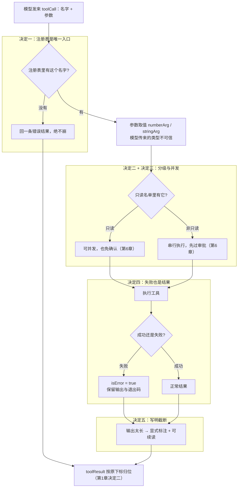

# 第 2 章：工具层设计 —— 给 AI 的「手」立规矩

第 1 章搭好的循环里，有一行代码被一句带过：「执行工具」。真要把这双手接上，问题立刻全冒出来：模型怎么知道你有哪些工具？它传来的参数能信吗？读文件读到一半是整个文件塞给它，还是截断？命令执行失败了，它怎么知道该修命令还是该放宽超时？

这一章就拆这一层：**注册表、只读分级、结果回传**。东西不难，但每条规矩背后都是一次真实的翻车。

## 1. 先搞懂三个词（What）

### 1.1 工具定义：给模型看的「名片」

模型并不知道你的电脑上有什么。它能看到的，只有每个工具的**名片**：叫什么名字、干什么用、要传什么参数。模型就是靠这张名片决定「这活儿该调哪个工具」。

名片上**不该有**的：工具的实现代码、它是不是只读、能不能并发——这些是程序内部的调度信息，塞给模型只会浪费上下文、甚至误导它。

### 1.2 工具结果：每次调用换回的「小票」

第 1 章立过一条铁律：模型说的每句「我要调工具」，都必须配一条「工具结果」。这一章要给小票定格式——尤其是**失败的时候小票长什么样**。

### 1.3 分级：只读的和会改东西的

同样是工具，「读文件」和「删文件」的吓人程度完全不同。分级就是给每个工具标一个性质：**只读**（不改任何状态）还是**会改东西**（写文件、跑命令）。它决定两件事：能不能和别的调用**同时跑**、要不要**先问过人**。

把三个词串起来：**注册表保管所有工具的名片和性质；模型按名片发起调用；注册表按分级调度执行；每次调用都换回一张格式规范的小票。** 这就是工具层的全部。

## 2. 它怎么转 + 为什么非这么转（How）

把源码里无关的分支裁掉，一次工具调用的生命周期是这样的——**每个标了「决定 N」的区块，就是下面 2.2 ~ 2.6 要展开的设计决策**：



先看**不这么设计会出什么乱子**：

- **名片和小票没个准形。** 模型传来的参数类型不可信——同一个字段有时给数字、有时给数字字符串，每个工具各写一套解析，规则慢慢就分叉了。结果没有统一格式，失败时有的抛异常、有的返回空串，循环那一头根本没法稳定处理。
- **只读名单各写一份。** 「哪些工具只读」这件事，注册表要标记、审批要白名单、并发要判定——三处各写一份的话，新增一个只读工具就会漏。漏在并发那边，「能并发却还要确认」；漏在审批那边，「免确认却不该并发」。
- **失败靠抛异常。** 异常一抛，这一轮就以「叫了工具却没结果」的非法序列落盘——正是第 1 章决定五焊死的那条底线。而且模型只看到一句报错，不知道该改命令还是该放宽超时。
- **截断偷偷丢内容。** 读大文件时悄悄砍掉后半段也不吭声，模型把半截当全文接着干活，结论全错还不自知。

### 2.2 决定一：注册表是唯一入口，给模型的只有「名片」

所有工具都登记在一张注册表里，模型侧只从 `definitions()` 这一个口子取名片——只有 `name` / `description` / `parameters` 三个字段，实现函数、只读标记这些内部信息**在源头就被剥掉**，想泄都泄不出去。

<!-- code-ref: packages/core/src/agent/tools/registry.ts#L41-L58 -->

**代价**：多一层间接——加个工具要先写定义再注册，不能随手一塞。换来两个铁的好处：其一，给模型的东西有了稳定形状，上下文里永远不会混进实现代码；其二，注册表成了「派生工具子集」的天然入口——第 7 章的子 Agent 要的正是「父集的子集」，从注册表派生而不是重建，才不会出现「子 Agent 拿到了父级没注册的工具」这种越权。

### 2.3 决定二：「哪些工具只读」只写一处

只读名单是**唯一事实来源**：一个常量数组，注册表的 `readOnly` 标记、审批的免确认白名单（第 6 章）、并发批次的收集判定，三处全部引用它。而且 `readOnly` 是在注册表统一按名单打标记的，不散落在各工具定义里。

<!-- code-ref: packages/core/src/agent/tools/registry.ts#L19-L39 -->

<!-- code-ref: packages/core/src/agent/tools/registry.ts#L165-L192 -->

**踩坑实录（源码注释里的真事）**：这个名单此前是各写一份的。三处各维护一份的结果是：**新增只读工具时必然遗漏**——要么并发判定不认识它（白白串行），要么审批白名单少了它（本可免确认的工具每次都要人点头）。后来收成一个常量，并由测试断言「注册表标记出来的只读集合」与名单逐项一致，防止再次漂移。

**代价**：多一个「集中定义」的动作。但换来的是一致性：改一处，三处同时生效，永远不会出现同一份名单的两个版本。

### 2.4 决定三：「只读」和「能并发」是两个开关

「只读」说的是**语义**（不改状态，顺带免确认）；「能并发」说的是**调度**（和别的调用同时跑会不会互相干扰）。源码里这两个是注册表上两个独立的字段，注释里明确警告**不要互相代替**：

<!-- code-ref: packages/core/src/agent/tools/types.ts#L8-L29 -->

**踩坑实录（源码注释里的真事）**：二者混用会造出两种分叉——把某个有副作用的工具塞进只读白名单，得到「能并发却还要审批」；反过来把读工具当非并发，白白丢掉并行收益。还有一层：`concurrent` 可以是**按参数判断的函数**而不是布尔——因为「能不能并发」有时取决于这一次传了什么参数（比如委派工具，只读委派能并发、带写权限的不能），只看工具名判不出来。

**代价**：注册表判定并发时要分三步走——只读恒可并发；**未注册的工具恒不可并发**（不知道的东西不让并发，是最安全的默认）；其余看工具自己的声明。

<!-- code-ref: packages/core/src/agent/tools/registry.ts#L103-L112 -->

### 2.5 决定四：失败也是结果，不是异常

工具执行失败（命令非零退出、文件不存在），**返回一条带 `isError` 标记的结果**，保留输出；绝不向上抛异常。异常一抛，这一轮就缺结果落盘——第 1 章决定五焊死的底线当场破了。

<!-- code-ref: packages/core/src/shared/protocol.ts#L83-L97 -->

**踩坑实录（源码注释里的真事）**：bash 工具早期版本里，超时和普通失败在结果里长得一模一样，模型只能看到一句 `Command failed`——它没法判断是该**放宽超时**还是该**修命令**，只能瞎猜。后来失败被分类进了结果（超时、被取消、非零退出各是各的），模型才知道往哪个方向调整。超时本身也有讲究：默认 30 秒、上限 10 分钟、下限 1 秒，超时后要把整个进程树收掉，宁可留个孤儿进程也不能把整个回合卡死。

<!-- code-ref: packages/core/src/agent/tools/bash.ts#L26-L30 -->

<!-- code-ref: packages/core/src/agent/tools/bash.ts#L52-L53 -->

同属「别信模型」的还有参数解析：模型传来的参数类型不可信，同一个字段有时给数字、有时给数字字符串。所以取值统一走两个小函数——字符串参数空串按没传处理，数字参数同时接受数字和数字字符串——免得每个工具各写一份、规则分叉。

<!-- code-ref: packages/core/src/agent/tools/args.ts#L3-L23 -->

**代价**：每个工具都要想清楚「失败时该保留什么」，比无脑 `throw` 多想一步。换来的是：循环那一头面对的永远是格式统一的小票，`isError` 一看便知，历史永远合法。

### 2.6 决定五：截断要「写明截断、可续读」

`read_file` 单次最多返回 2 000 行、20 000 字符；超过 5MB 的文件直接拒绝（读不完也读不动，改用检索更省上下文）。关键是截断的方式：**附上显式标注**——读到了第几行、全文多少行、用哪个参数继续读——绝不偷偷丢内容。

<!-- code-ref: packages/core/src/agent/tools/files.ts#L26-L44 -->

<!-- code-ref: packages/core/src/agent/tools/files.ts#L316-L331 -->

**踩坑实录（源码注释里的真事）**：这个上限曾经被整个取消过。结果读一个大文件，十万级字符直接塞进上下文——而上下文压缩要到**下一轮**才触发，救不回已经发出去的这个请求，钱花了、窗口爆了。后来才重新引入这套「带显式标注、可分页继续」的上限：模型看到标注，自己会用 `offset` 翻页接着读。

**代价**：截断逻辑要算准「本次返回第几到第几行、为什么截」，标注本身也占字符。换来的是：模型对「我拿到的是全文还是片段」永远有数，绝不会把半截当全文。

## 3. 实现：跟着写一个像样的工具层

第 1 章的 `tools.js` 是刻意简化的。这一章把它升级成真正的工具层——`messages.js` / `model.js` / `loop.js` **一行都不用动**：升级完 `node run.js` 还原样能跑，这就是第 1 章「注册表是循环和工具之间的 seam」的证明。

### 3.1 `tools.js` —— 注册表 + 分级 + 结果回传

```js
// harness/tools.js —— 第2章升级版（第1章简化版见上一章 3.3）
import { readFileSync, writeFileSync, statSync, openSync, readSync, closeSync } from "node:fs";
import { execSync } from "node:child_process";
import { toolResultBlock } from "./messages.js";

// ── 参数取值（决定四）：模型传来的参数类型不可信，统一走这两个函数 ──
export const stringArg = (value, fallback) =>
  typeof value === "string" && value.trim() ? value : fallback;

export const numberArg = (value, fallback) => {
  if (typeof value === "number" && Number.isFinite(value)) return value;
  if (typeof value === "string" && value.trim() !== "" && Number.isFinite(Number(value))) {
    return Number(value);
  }
  return fallback;
};

// ── 只读名单：唯一事实来源（决定二）。
// 同一个集合服务三件事：注册表 readOnly 标记、审批免确认白名单（第6章）、并发批次收集。
export const READ_ONLY_TOOL_NAMES = ["read_file", "grep", "glob"];
const READ_ONLY_TOOLS = new Set(READ_ONLY_TOOL_NAMES);

// ── read_file 的上限（决定五）：写明截断、可续读，绝不偷偷丢内容 ──
export const MAX_READ_CHARS = 20_000;          // 单次最大字符数（源码同款数字）
export const MAX_READ_LINES = 2_000;           // 单次最大行数
export const MAX_READ_BYTES = 5 * 1024 * 1024; // 超过直接拒绝：读不完也读不动

export function createToolRegistry(defs) {
  const map = new Map();
  for (const def of defs) {
    // readOnly 集中按名单标记，不散落在各工具定义里（决定二）。
    // concurrent 是另一个开关（决定三）：能不能同时跑，与「是否只读」无关。
    map.set(def.name, { ...def, readOnly: READ_ONLY_TOOLS.has(def.name) });
  }
  return {
    // 给模型看的「名片」：只有名字、说明、参数 schema，实现与标记不外泄（决定一）
    definitions() {
      return [...map.values()].map(({ name, description, parameters }) => ({ name, description, parameters }));
    },
    isReadOnly(name) {
      return map.get(name)?.readOnly === true;
    },
    // 未注册的工具恒 false：不知道的东西不让并发，是最安全的默认（决定三）
    canRunConcurrently(call) {
      if (this.isReadOnly(call.name)) return true;
      const rule = map.get(call.name)?.concurrent;
      return typeof rule === "function" ? rule(call.arguments ?? {}) : rule === true;
    },
    // 失败也是结果（决定四）：任何路径都返回 toolResult，绝不向上抛——
    // 抛出去这一轮就「缺结果」落盘，是非法序列（第1章决定五）。
    async execute(toolCall, signal) {
      const tool = map.get(toolCall.name);
      if (!tool) return toolResultBlock(toolCall.id, toolCall.name, `未知工具: ${toolCall.name}`, true);
      try {
        const out = await tool.run(toolCall.arguments ?? {}, signal);
        return toolResultBlock(toolCall.id, toolCall.name, out.text, out.isError ?? false);
      } catch (e) {
        return toolResultBlock(toolCall.id, toolCall.name, String(e?.message ?? e), true);
      }
    },
  };
}

// 读文件：带显式截断标注，模型看到标记可用 offset 继续读（决定五）
export const readFileTool = {
  name: "read_file",
  description: `读取文本文件。单次最多返回 ${MAX_READ_LINES} 行 / ${MAX_READ_CHARS} 字符，截断时附标注，可用 offset 继续读。`,
  parameters: { path: "string", offset: "number（可选，起始行，从 1 计）", limit: "number（可选，最多行数）" },
  concurrent: true, // 只读且可并发——两个开关都为真，但语义不同（决定三）
  run: ({ path, offset, limit }) => {
    const start = Math.max(1, Math.floor(numberArg(offset, 1)));
    const maxLines = Math.min(MAX_READ_LINES, Math.max(1, Math.floor(numberArg(limit, MAX_READ_LINES))));
    const stat = statSync(path);
    if (stat.size > MAX_READ_BYTES) {
      return {
        isError: true,
        text: `文件过大（${stat.size} 字节，上限 ${MAX_READ_BYTES}）：改用 grep / exec 检索更省上下文`,
      };
    }
    // 二进制嗅探：只读前 8KB 找空字节，不把整个文件读进内存
    const fd = openSync(path, "r");
    const head = Buffer.alloc(8_000);
    const headBytes = readSync(fd, head, 0, 8_000, 0);
    closeSync(fd);
    if (head.subarray(0, headBytes).includes(0)) {
      return { isError: true, text: "疑似二进制文件（前 8KB 含空字节）：不支持读取" };
    }
    const lines = readFileSync(path, "utf8").split("\n");
    const slice = lines.slice(start - 1, start - 1 + maxLines);
    let out = "", used = 0, count = 0;
    for (const line of slice) {
      const cost = Buffer.byteLength(line, "utf8") + 1;
      if (used + cost > MAX_READ_CHARS) break;
      out += line + "\n";
      used += cost;
      count++;
    }
    const lastLine = start + count - 1;
    if (count > 0 && lastLine < lines.length) {
      // 写明截断：读到了哪、共多少行、怎么继续——不偷偷丢内容
      out += `\n...[已截断：本次返回第 ${start}-${lastLine} 行（共 ${lines.length} 行），用 offset=${lastLine + 1} 继续读]`;
    }
    return { text: out };
  },
};

// 写文件：会改变状态 → 串行，且永远不在只读名单里
export const writeFileTool = {
  name: "write_file",
  description: "把文本写入文件（覆盖原内容）。会改变状态。",
  parameters: { path: "string", content: "string" },
  concurrent: false,
  run: ({ path, content }) => {
    writeFileSync(stringArg(path, ""), stringArg(content, ""), "utf8");
    return { text: `已写入 ${path}` };
  },
};

// 执行命令：会改变状态 → 串行。失败也是结果：保留输出与退出码（决定四）
export const execTool = {
  name: "exec",
  description: "执行 shell 命令并返回输出。会改变状态。",
  parameters: { command: "string" },
  concurrent: false,
  run: ({ command }) => {
    try {
      const out = execSync(stringArg(command, ""), { encoding: "utf8", stdio: ["ignore", "pipe", "pipe"] });
      return { text: out.trim() || "(无输出)" };
    } catch (e) {
      const detail = [e.stdout, e.stderr].filter(Boolean).join("\n").trim();
      return {
        isError: true,
        text: `命令失败（退出码 ${e.status ?? "?"}）：${detail || e.message}`.slice(0, 2_000),
      };
    }
  },
};
```

对着五个决定过一遍：`definitions()` 只放名片（决定一）；`READ_ONLY_TOOL_NAMES` 一处定义、注册时集中打标（决定二）；`readOnly` 与 `concurrent` 是两个字段、未注册恒不可并发（决定三）；`execute` 任何路径都返回结果、失败带 `isError`（决定四）；`read_file` 截断附标注、可 `offset` 续读（决定五）。

### 3.2 跑起来，看四出戏

```js
// harness/run-tools.js
import { createToolRegistry, readFileTool, writeFileTool, execTool, MAX_READ_LINES, unlinkSync } from "./tools.js";
import { writeFileSync } from "node:fs";

const registry = createToolRegistry([readFileTool, writeFileTool, execTool]);

// 戏1：给模型看的「名片」——只有 name / description / parameters（决定一）
console.log("── definitions()：模型看到的 ──");
for (const d of registry.definitions()) console.log(`- ${d.name}: ${d.description}`);

// 戏2：只读与可并发是两个开关，未注册的工具恒 false（决定三）
console.log("\n── canRunConcurrently ──");
for (const call of [
  { name: "read_file", arguments: {} },
  { name: "write_file", arguments: {} },
  { name: "exec", arguments: {} },
  { name: "no_such_tool", arguments: {} },
]) {
  console.log(`${call.name.padEnd(12)} → ${registry.canRunConcurrently(call)}`);
}

// 戏3：截断写明标注、可续读，绝不偷偷丢内容（决定五）
writeFileSync("big.txt", Array.from({ length: 3000 }, (_, i) => `第 ${i + 1} 行`).join("\n"));
const r1 = await registry.execute({ id: "a1", name: "read_file", arguments: { path: "big.txt" } });
const text = r1.content[0].text;
console.log("\n── read_file 读完 3000 行的大文件 ──");
console.log(`实际返回 ${text.split("\n").length - 1} 行内容（单次上限 ${MAX_READ_LINES}），结尾标注：`);
console.log(text.trimEnd().split("\n").slice(-1)[0]);
const cont = await registry.execute({ id: "a2", name: "read_file", arguments: { path: "big.txt", offset: 2001, limit: 3 } });
console.log(`offset=2001 续读 → ${cont.content[0].text.trimEnd().split("\n").join(" | ")}`);

// 戏4：失败也是结果，不是异常；未注册工具也不崩（决定四）
const bad = await registry.execute({ id: "b1", name: "exec", arguments: { command: 'node -e "process.exit(3)"' } });
console.log("\n── exec 退出码 3 ──");
console.log(`isError=${bad.isError}，回传给模型: ${bad.content[0].text}`);
const unknown = await registry.execute({ id: "b2", name: "no_such_tool", arguments: {} });
console.log(`未注册工具 → isError=${unknown.isError}，回传给模型: ${unknown.content[0].text}`);

unlinkSync("big.txt"); // 清理 demo 临时文件
console.log("\n（big.txt 已清理。registry 接口没变：node run.js 仍按第1章原样能跑。）");
```

运行：

```bash
cd demos/harness && node run-tools.js
```

预期输出（戏 3 返回的行数取决于每行字节数——**字符上限先到就算字符上限的**）：

```
── definitions()：模型看到的 ──
- read_file: 读取文本文件。单次最多返回 2000 行 / 20000 字符，截断时附标注，可用 offset 继续读。
- write_file: 把文本写入文件（覆盖原内容）。会改变状态。
- exec: 执行 shell 命令并返回输出。会改变状态。

── canRunConcurrently ──
read_file    → true
write_file   → false
exec         → false
no_such_tool → false

── read_file 读完 3000 行的大文件 ──
实际返回 1624 行内容（单次上限 2000），结尾标注：
...[已截断：本次返回第 1-1623 行（共 3000 行），用 offset=1624 继续读]
offset=2001 续读 → 第 2001 行 | 第 2002 行 | 第 2003 行 |  | ...[已截断：本次返回第 2001-2003 行（共 3000 行），用 offset=2004 继续读]

── exec 退出码 3 ──
isError=true，回传给模型: 命令失败（退出码 3）：Command failed: node -e "process.exit(3)"
未注册工具 → isError=true，回传给模型: 未知工具: no_such_tool

（big.txt 已清理。registry 接口没变：node run.js 仍按第1章原样能跑。）
```

戏 3 有个值得盯着的细节：文件明明有 3 000 行、行上限 2 000，实际却只返回了 1 623 行——因为**字符上限（20 000）先到了**。两道上限谁先到算谁的，这正是「上限是护栏不是配额」：它护的是上下文窗口，不是完整阅读体验。模型的正确反应是看到标注后拿 `offset` 翻页，而不是抱怨被截断。

## 4. 配套 demo

demo 在仓库的 `demos/harness/`，本章升级了 `tools.js`（第 1 章版见上一章 3.3）并新增驱动脚本 `run-tools.js`：

```bash
cd demos/harness
node run-tools.js   # 本章：名片 / 并发开关 / 写明截断 / 失败也是结果
node run.js         # 第1章的循环原样能跑——seam 没被这章的升级破坏
```

至此你的 `harness/` 里，工具这一层有了名片、小票和规矩。走到第 6 章再加审批，它就是完整护栏。

## 5. 小结与下一章

工具层的五条规矩：**注册表是唯一入口、只读名单只写一处、只读与并发是两个开关、失败也是结果、截断写明可续读**。每一条都在防一类真实事故——名单分叉、异常破坏历史、半截当全文。

工具这一侧稳了。但循环里还有一行在裸奔：「问模型」。真实网络下它会连不上、卡半天、被限流、读到一半被掐断——而最阴的是，流式的字已经吐给用户了，这时候失败该不该重来？下一章（模型层可靠性）拆这层壳：**两道计时、静默看门狗、指数退避，以及「已上屏的字绝不重试」这条反直觉的铁律。**
