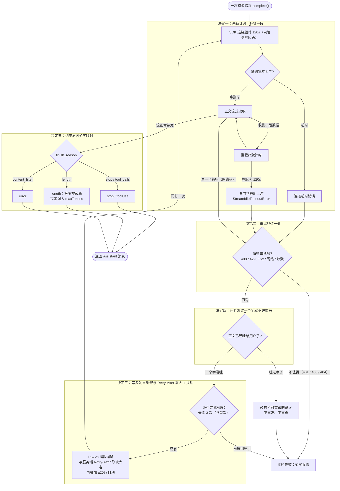

# 第 3 章：模型层可靠性 —— 让「说完一句话」变成有保证的事

第 1 章的循环里有一行代码，一直是一句带过：`await model.complete(...)`。第 2 章给「手」立了规矩，这一章回到这一行——它底下不是一次函数调用，是一条网络。

网络会让同一句请求有三种完全不同的死法：连接就建不起来、建起来之后没人说话、说话说到一半断了。而这一层壳的任务只有一个：**把「一次不可靠的远程调用」包装成「一次有明确结局的本地调用」**——要么拿到完整回复，要么拿到一条说得清原因、且不会重复计费、不会重复上屏的错误。

先把三个词讲清楚。

## 1. 先搞懂三个词（What）

### 1.1 两道计时：拨号有上限，接通后还得自己掐表

打客服电话有两段完全不同的等待。第一段是拨号：响到第三十声没人接，你会挂掉——这是**超时**。第二段更烦：接通了，对面却一片安静，你「喂、喂」几声没回应，只能自己掐表挂断。这两段是两道独立的计时，一道管「多久接通」，一道管「接通后多久没听到人说话」。

模型请求一模一样。SDK 的 `timeout` 管的是「连接 + 响应头」——响应头一到，它就交差、计时器就撤了（源码注释写明：openai 的 `fetchWithTimeout` 在 `fetch()` resolve 后的 `finally` 里就 `clearTimeout`，Anthropic SDK 同样）。而正文是流式一段段吐出来的，**此后「两段数据之间隔了多久」没有任何人在看**。

所以需要第二道计时，行话叫**静默看门狗（idle watchdog）**：每收到一段数据就重置计时，静默超过 `STREAM_IDLE_TIMEOUT_MS`（源码取 120 秒）就判定上游挂死、主动掐断这次请求。

<!-- code-ref: packages/core/src/agent/model/config.ts#L8-L18 -->

### 1.2 重试：占线就等会儿再拨，但要听对方说等多久

客服热线占线（HTTP 429 限流），你的做法是挂掉、过一会儿再拨。这里有三件事值得说清：

- **不是所有失败都值得再拨。** 密钥不对（401）、参数写错（400）、模型名不对（404），再拨一百次也是同一个结果。值得拨的是 408 超时、429 限流、5xx、网络类错误，以及被看门狗掐断的上游静默。
- **等多久有讲究。** 越试间隔越长（**指数退避**：1 秒 → 2 秒）；如果语音提示「请 20 秒后再拨」，你就得等 20 秒——自己 1 秒后又打进去，只是把占线搞得更严重。所以退避时长要和**服务端要求的等待时间（`Retry-After`）取较大者**。
- **别让所有人同时拨。** 在等待时长上再叠一个 ±20% 的随机抖动，否则同一批客户端会在同一毫秒一起重拨，正好形成尖峰把服务器再冲一次。

还有一条容易被忽略的前提：**重试只能有一处。** SDK 自己默认会重试 2 次，你在外面再包一层 3 次，两套叠起来就是 9 次请求——同一份 prompt 被反复发送、反复计费。

<!-- code-ref: packages/core/src/agent/model/retry.ts#L10-L17 -->

### 1.3 外发与结束原因：这一次到底「说到哪儿了」

流式输出的字是**边说边显示**的。所以一次请求结束时，你必须能回答两个问题。

第一个：**有没有字已经吐给用户了**（源码里叫 `emittedAny`）。这直接决定重试的边界——重试的单位是「一整次请求 + 读完整个流」，可 delta 是实时写终端的；再打一次，等于把同一段正文再播一遍，再收一次钱。像收银台已经打出一半的小票：重打一张不是「补全」，是两张小票、两次账。

<!-- code-ref: packages/core/src/agent/model/stream.ts#L124-L151 -->

第二个：**这一轮是怎么结束的**（`stopReason`）。正常说完是 `stop`，模型要求调工具是 `toolUse`，被输出上限截断是 `length`，用户取消是 `aborted`，上游出错是 `error`。这个值会落盘、会进状态栏——写错就等于把「答案被截断」说成「你取消了」。

把三个词串起来：**两道计时管「别卡死」，重试管「卡住了要不要再来一次」，外发状态与结束原因管「重来的边界」和「最后怎么跟用户交代」。** 这三件事全部收在 `complete()` 这一层壳里，循环本身一行都不用懂。

## 2. 它怎么转 + 为什么非这么转（How）

把源码里无关的分支裁掉，一次模型请求从发出到交回结果的路径是这样的——**每个标了「决定 N」的区块，就是下面 2.2 ~ 2.6 要展开的设计决策**：



> **人话版**：请求先过第一道计时（SDK 的连接超时）；拿到响应头后进正文，每来一段数据就给第二道计时（看门狗）续命，静默满 120 秒就掐断（决定一）。失败了先判「值不值得重试」（决定二），再判「有没有字已经上屏」（决定四）——上屏了就绝不重来，没上屏才进重试循环，等多久由退避与服务端要求取大再加抖动（决定三）。正文顺利读完则如实映射结束原因（决定五）。下面 2.2 ~ 2.6 逐条讲每个决定的代价和真实事故，第 3 节代码就是照这张图落地。

How 和 Why 放在一节，是因为每个设计选择的理由本来就和它「怎么转」长在一起；这些决定会被第 3 节的代码逐行落实，看代码时一眼能对上。

先看**不这么设计会出什么乱子**：

### 2.1 不这么设计的下场

- **字打到一半，光标永远停在那儿。** 连接建了、响应头也拿到了，之后上游因为滚动发布、负载均衡挂死、网络半开而不再发数据。SDK 的 120 秒早就撤了，正文阶段没有任何上限，于是本轮**永久卡住**；因为没抛错，重试逻辑也不会被触发。用户唯一能做的是 Ctrl+C。
- **重试把同一句话播了两遍，账单涨到三倍。** 两层重试叠成 9 次请求，prompt token 被反复计费；更糟的是正文已上屏之后重试——用户看到重复的半句，同一份 prompt 再算一次钱。
- **答案被截断，界面却说「已取消」。** 输出上限把回复切断，结束原因被映射成 `aborted`，落盘写「用户取消」，用户以为是自己手滑按了 Esc。

### 2.2 决定一：两道计时各管一段，SDK 管连接、看门狗管正文

看门狗是一个独立的小装置：自己持一个 `AbortController` 和一个可重置的 `setTimeout`，对外只暴露四样东西——`signal`（传给 SDK，让卡死的请求真的被掐断）、`touch()`（每收到一段数据就重置计时）、`timedOut()`（本次是不是被它掐的）、`dispose()`（收尾清干净）。正文的每个分片都调一次 `touch()`，收尾前再用 `timedOut()` 复核一次。

关键在于它是**第二道**，而不是替换第一道：两道都取 120 秒，是为了让头阶段的时限保持原样，只把此前完全没有上限的正文阶段纳入约束（源码注释给的就是这个理由）。

**代价**：多一个计时器，且调用方必须有 `dispose` 的责任心（在 `finally` 里清掉）。更反直觉的是这个计时器**刻意不能 `unref`**——源码注释写明：`unref` 会让「只剩这个计时器」的场景下事件循环提前判定为空，静默超时**永远不会触发**。也就是说，这里舒服的写法恰好是错的写法。

**踩坑实录（源码注释里的真事）**：看门狗把请求掐断之后，**流居然「干净地结束」了**——openai SDK 的流迭代器不抛错，`for await` 正常退出。结果是产出一条 `stopReason: "stop"` 的截断回复，比挂死还隐蔽：用户看到的是「模型说到一半就停了」，而不是任何错误。修法是收尾前**再显式判一次**「是不是被看门狗掐的」（源码里那一步叫 `assertStreamNotIdleTimedOut`）——只靠 `catch` 是不够的。

<!-- code-ref: packages/core/src/agent/model/stream.ts#L24-L64 -->

<!-- code-ref: packages/core/src/agent/model/stream.ts#L90-L122 -->

### 2.3 决定二：SDK 自带的重试必须关掉，重试只留一处

做法就一句话：构造客户端时显式 `maxRetries: 0`，重试全权交给应用层那一个 `withRetry`。

**代价**：退避、抖动、读 `Retry-After`、区分「用户取消」这些逻辑，全都得自己写、自己测；换 SDK 时还要重新确认这个开关有没有被改回默认。

**踩坑实录（源码注释里那笔账）**：SDK 默认 `maxRetries = 2`，应用层 3 次、SDK 2 次，两套叠加变成 `3 × 3 = 9` 次请求。每一次重试都会把提问（prompt token）再发一遍——**重复计费**，而且日志里看起来只是「慢」。

**深入一点**：判定「值不值得重试」必须**沿着 `cause` 链往里钻**（源码上限 5 层）。SDK 把 `fetch` 失败包成 `APIConnectionError` 之后，`status` 和 `code` **都是 `undefined`**，原始 errno 只挂在 `cause` 上。只看顶层字段的话，最常见的那类故障——「连不上 / 连接超时」——反而永远不会重试。同理，「用户取消」也得沿链识别，且不能只靠错误名：打包之后类名会被改成 `APIUserAbortError2` 之类，源码用的是模式匹配，而不是全等比较。

<!-- code-ref: packages/core/src/agent/model/retry.ts#L159-L194 -->

<!-- code-ref: packages/core/src/agent/model/errors.ts#L171-L195 -->

<!-- code-ref: packages/core/src/agent/model/errors.ts#L197-L242 -->

### 2.4 决定三：等多久 = 指数退避与服务端 Retry-After 取较大者，再加抖动

三步走：先算退避 `base × 2^(attempt-1)`（1 秒起）；再读服务端要求的等待时间（`retry-after-ms` 优先，其次 `retry-after`，可以是秒数或 HTTP 日期）；**取两者较大者**；最后乘一个 `0.8 ~ 1.2` 的随机因子。

**代价**：读这个头比想象中麻烦——它可能挂在 `Headers` 实例上，也可能挂在普通对象上，还可能是隔了好几层 `cause` 的那个对象上，所以要「沿链找第一个带 headers 的对象」；HTTP 日期分支还要处理时钟偏差。少写一层，这个头就等于没读。

**踩坑实录（源码注释里的真事）**：自己接管重试之后，有一版没读响应头里的等待时间。服务端说「20 秒后再来」，客户端 1 秒后就又撞上去——**反而加剧限流**。源码注释还点了一句更扎心的话：SDK 内置的重试本来是读这个头的，换成自己重试之后必须补上，否则是「接管了权力、丢了能力」。

**深入一点**：为什么是「取较大者」而不是「直接听服务端的」？因为服务端偶尔会给一个很小的值，或者给一个已经过期的时间点（时钟偏差），这时退避算出来的下限仍然应该保留。两边都不绝对可信，所以取更保守的那一个。

<!-- code-ref: packages/core/src/agent/model/retry.ts#L65-L102 -->

<!-- code-ref: packages/core/src/agent/model/retry.ts#L104-L119 -->

<!-- code-ref: packages/core/src/agent/model/retry.ts#L19-L26 -->

### 2.5 决定四：已经外发过一个字，这次失败就绝不重试

机制是「追踪 + 改判」：包一层 `onDelta`，被调用过就把 `emittedAny` 记为真；失败时如果已经外发过，就把「本来可重试」的错误**替换成**一个显式的不可重试错误（`PartialStreamInterruptedError`），而 `isRetryableError` 见到它直接返回 `false`。

**代价**：正文阶段一旦出岔子，只能认栽——给一条可操作的提示，不能悄无声息地重来。用户屏幕上会留着那半句话，这是主动接受的代价。

**踩坑实录（源码注释里的真事）**：这层的理由写得像一句账：重试的单元是「请求 + 读完整个流」，而 delta 是**实时写终端**的；再打一次会把同一段正文重复输出，并把同一份 prompt 再计费一次。这比直接失败更糟——失败至少诚实。

**深入一点**：只包「本来可重试」的失败。401 这类错误本来就该原样报出去，不能被「部分输出后中断」的文案盖住，否则你看到的是「输出到一半断了」，实际原因是密钥过期。另一个坑是「静默超时」与「用户取消」的区分：如果直接把 SDK 的 abort 错误抛出去，`isAbortError` 会把它当成用户取消——既不重试，界面还显示「模型调用已取消」，**把瞬时网络故障说成用户的操作**。源码为此专门定义了一个独立的错误类型，就是为了让这两条路在判定和文案上彻底分开。

<!-- code-ref: packages/core/src/agent/model/errors.ts#L115-L127 -->

<!-- code-ref: packages/core/src/agent/model/errors.ts#L134-L169 -->

### 2.6 决定五：结束原因如实映射，`length` 不许写成 `aborted`

映射规则本身很小：`tool_calls` / `function_call` → `toolUse`，`length` → `length`，`content_filter` → `error`，其余 `stop`。然后补一刀：如果映射结果是 `stop`、但 `content` 里确实带着工具调用，就改判成 `toolUse`。

**代价**：`stopReason` 会落盘、会出现在状态栏，映射错了不只是「这一屏显示不对」——**历史里的记录会一直错下去**，下次回放还是错的。

**踩坑实录（源码注释里的真事）**：`length` 曾被映射成 `aborted`。后果是：答案被输出上限截断时，用户看到的是「模型调用已取消」——而他根本没取消。正确做法是如实说「被截断了」，并提示可以把 `maxTokens` 调大。另外还有一桩更隐蔽的：Gemini 的 OpenAI 兼容层在**流式**下，即使只返回了工具调用，终止分片仍写 `finish_reason: "stop"`（非流式是 `tool_calls`）。内核虽然按 `content` 里有没有 toolCall 决定是否执行工具，但 `stopReason` 会落盘——记错了，「这一轮在等工具」看起来就像「模型说完了」。

**深入一点**：默认输出上限是 `DEFAULT_MAX_TOKENS = 8192`，源码注释写明原来那个 4096 很容易把长回答截断成 `max_tokens`。截断率高了，`length` 这个分支就不再是罕见情况，映射写错的代价也跟着放大。

<!-- code-ref: packages/core/src/agent/model/stream.ts#L229-L249 -->

<!-- code-ref: packages/core/src/agent/model/stream.ts#L282-L296 -->

<!-- code-ref: packages/core/src/agent/model/config.ts#L20-L26 -->

## 3. 实现：跟着写一个可靠性壳

本章往 `harness/` 里加两个模块加一个驱动脚本：`model-reliable.js`（把**任意**有 `complete()` 的模型包上可靠性壳）和 `flaky-model.js`（专出事故的假模型，只给 demo 用），以及 `run-reliable.js`（三出戏）。

**seam 承诺**：`loop.js`、`model.js`、`tools.js`、`messages.js` **一行都不动**。第 1 章的循环只认 `complete({ systemPrompt, messages, tools, signal, onDelta })` 这一个形状，而壳包完之后返回的仍然是同样的形状——所以「换掉模型层、循环不用改」这句承诺，在这一章兑现，不需要任何适配代码。壳是**套在**模型外面的一层，不是修改模型本身：`createMockModel` 保持原样，`withReliability(createMockModel(...))` 是一个新的、同样合规的 `complete()`。

### 3.0 落点：一套累积式代码

本系列是**累积式**的：每一章往同一个 `harness/` 目录里加文件，代码从简到全，走到第 6 章跑起来就是一个带审批护栏的简化 Harness。本章的增量：

```
harness/
├── messages.js        # 第1章：消息与内容块的形状
├── model.js           # 第1章：模型 seam（mock）—— 本章不动
├── tools.js           # 第2章：工具注册表 + 只读分级
├── loop.js            # 第1章：核心循环 —— 本章不动
├── model-reliable.js  # 本章新增：看门狗 + 重试器（套在任意模型外面）
├── flaky-model.js     # 本章新增：专出事故的假模型（demo 专用）
└── run-reliable.js    # 本章新增：三出戏的驱动脚本
```

`model-reliable.js` 和 `flaky-model.js` 此后不会被别的章节改动；`run-reliable.js` 是本章专用的观察脚本。

### 3.1 `model-reliable.js` —— 看门狗 + 重试器

一个文件两件事：`completeOnce` 负责「单次尝试 + 看门狗」，`withReliability` 负责「重试预算 + 已外发判定」。常量与源码一致（120s / 3 次 / 1s / ±20%），demo 里通过 `opts` 缩小，不改常量本身。

```js
// harness/model-reliable.js —— 第3章：给任意模型包上「可靠性壳」
// 真实常量来自源码 config.ts 与 retry.ts：
//   REQUEST_TIMEOUT_MS = 120_000 / STREAM_IDLE_TIMEOUT_MS = 120_000（两道独立计时）
//   MAX_REQUEST_ATTEMPTS = 3（含首次）/ RETRY_BASE_DELAY_MS = 1_000 / RETRY_JITTER_RATIO = 0.2
// demo 里把时长调小（见 run-reliable.js），方便肉眼看着触发。

export const STREAM_IDLE_TIMEOUT_MS = 120_000; // 源码：config.ts —— 正文静默上限
export const MAX_REQUEST_ATTEMPTS = 3;         // 源码：retry.ts —— 最多尝试 3 次（含首次）
export const RETRY_BASE_DELAY_MS = 1_000;      // 源码：retry.ts —— 首次退避 1s，之后 ×2
export const RETRY_JITTER_RATIO = 0.2;         // 源码：retry.ts —— ±20% 抖动

const sleep = (ms, signal) =>
  new Promise((resolve, reject) => {
    const t = setTimeout(resolve, ms);
    signal?.addEventListener(
      "abort",
      () => { clearTimeout(t); reject(new Error("等待重试时被用户取消")); },
      { once: true },
    );
  });

// 单次尝试：包一道「静默看门狗」。
// 它与 SDK 的连接超时是两道独立计时——SDK 只管到「拿到响应头」，
// 这里管的是「正文阶段两段数据之间隔了多久」。只要有数据就重置计时。
function completeOnce(inner, args, idleTimeoutMs) {
  return new Promise((resolve, reject) => {
    const attemptAc = new AbortController(); // 每次尝试一个独立信号，看门狗触发时掐断上游
    const onOuterAbort = () => attemptAc.abort(args.signal?.reason);
    args.signal?.addEventListener("abort", onOuterAbort, { once: true });

    let timer;
    const fireIdle = () => {
      const err = new Error("正文静默超时：两段数据之间隔了太久，判定上游挂死");
      err.kind = "stream_idle_timeout";
      attemptAc.abort(); // 关键：把卡死的上游真的掐断，不能只 reject 自己
      reject(err);
    };
    const bump = () => { clearTimeout(timer); timer = setTimeout(fireIdle, idleTimeoutMs); };
    bump(); // 计时从请求发出就开始——正文迟迟不来也算静默

    inner
      .complete({
        ...args,
        signal: attemptAc.signal,
        onDelta: (t) => { bump(); args.onDelta?.(t); }, // 有数据 → 重置计时
      })
      .then(
        (v) => { clearTimeout(timer); args.signal?.removeEventListener("abort", onOuterAbort); resolve(v); },
        (e) => { clearTimeout(timer); args.signal?.removeEventListener("abort", onOuterAbort); reject(e); },
      );
  });
}

function isRetryable(e) {
  if (e?.kind === "stream_idle_timeout") return true;             // 看门狗：上游装死
  if (e?.kind === "http") return e.status === 429 || e.status >= 500; // 限流 / 服务端错
  if (e?.kind === "network") return true;                          // 网络抖动 / 读一半被掐
  return false;                                                    // 其余（编程错误等）不重试
}

// 退避：1s → 2s 指数增长；与服务端 Retry-After 取较大者；再叠加 ±20% 抖动
export function backoffDelayMs(attempt, baseDelayMs, jitterRatio, retryAfterMs) {
  const expo = baseDelayMs * 2 ** (attempt - 1);
  const wait = Math.max(expo, retryAfterMs ?? 0);
  const factor = 1 - jitterRatio + Math.random() * jitterRatio * 2; // 0.8 ~ 1.2
  return Math.round(wait * factor);
}

/**
 * 把任意「有 complete() 的模型」包上可靠性壳：
 * - 看门狗：正文静默超时 → 掐断上游 → 记为可重试
 * - 重试：限流/5xx/网络错最多 3 次，指数退避 + Retry-After 取大 + 抖动
 * - 铁律：只要有一个字已经吐给用户（onDelta 调过），这次失败绝不重试
 */
export function withReliability(inner, opts = {}) {
  const idleTimeoutMs = opts.idleTimeoutMs ?? STREAM_IDLE_TIMEOUT_MS;
  const maxAttempts = opts.maxAttempts ?? MAX_REQUEST_ATTEMPTS;
  const baseDelayMs = opts.baseDelayMs ?? RETRY_BASE_DELAY_MS;
  const jitterRatio = opts.jitterRatio ?? RETRY_JITTER_RATIO;
  const log = opts.log ?? (() => {});

  return {
    async complete(args = {}) {
      const { signal } = args;
      let emitted = false; // 「已外发追踪器」：吐过一个字就绝不重试
      const onDelta = (t) => { emitted = true; args.onDelta?.(t); };

      for (let attempt = 1; attempt <= maxAttempts; attempt++) {
        try {
          return await completeOnce(inner, { ...args, onDelta }, idleTimeoutMs);
        } catch (e) {
          if (signal?.aborted) throw e; // 用户取消 ≠ 可重试故障，直接交出去
          if (emitted) {
            e.emitted = true; // 正文已部分上屏：重试会重复显示、重复计费，只能认栽
            throw e;
          }
          if (!isRetryable(e) || attempt === maxAttempts) throw e;
          const delay = backoffDelayMs(attempt, baseDelayMs, jitterRatio, e.retryAfterMs);
          log(`  [retry] 第 ${attempt} 次失败（${e.kind ?? e.message}），约 ${delay}ms 后重试`);
          await sleep(delay, signal);
        }
      }
    },
  };
}
```

几处和源码的对应关系值得点明：`completeOnce` 里 `attemptAc.abort()` 那一行对应「看门狗要真的掐断上游，不能只 reject 自己」；`withReliability` 里 `if (emitted) throw` 对应「已外发不重试」；`backoffDelayMs` 里的 `Math.max(expo, retryAfterMs ?? 0)` 对应「退避与服务端要求取较大者」。

一处**有意简化**：真实实现里「SDK 自带重试要关掉」发生在构造客户端时（`maxRetries: 0`）。demo 的假模型本来就没有内置重试，所以这条边界在代码里表现为「**只有 `withReliability` 这一层会重试**」——同样的一条规矩，只是少了那个要关的开关。

### 3.2 `flaky-model.js` —— 专出事故的假模型

真实项目里被包的 `inner` 是调真实 API 的流式模型；demo 用一个假模型**确定性地**复现三类故障，不依赖网络、不烧钱、每次跑结果一致。

```js
// harness/flaky-model.js —— 第3章 demo 专用：一个「专出事故」的假模型。
// 真实项目里，被包的 inner 就是调真实 API 的流式模型；demo 用它确定性复现三类故障。
import { textBlock } from "./messages.js";

const hangUntilAborted = (signal) =>
  new Promise((_, reject) => {
    signal?.addEventListener(
      "abort",
      () => reject(Object.assign(new Error("被看门狗掐断"), { kind: "stream_idle_timeout" })),
      { once: true },
    );
    // 不 resolve、不 reject：模拟「连接还在、正文永远不来」
  });

export function createFlakyModel(scenario) {
  let calls = 0;
  return {
    async complete({ signal, onDelta } = {}) {
      if (signal?.aborted) return { role: "assistant", content: [], stopReason: "aborted" };
      calls++;

      // 戏1「stall」：第一次调用一个字都不吐然后装死 → 看门狗掐断 → 重试第二次正常
      if (scenario === "stall" && calls === 1) {
        await hangUntilAborted(signal);
      }

      // 戏2「rate-limit」：前两次都回 429 并带上 Retry-After，第三次放行
      if (scenario === "rate-limit" && calls <= 2) {
        const err = new Error("HTTP 429 Too Many Requests");
        err.kind = "http";
        err.status = 429;
        err.retryAfterMs = 400; // 假装服务端要求「400ms 后再来」
        throw err;
      }

      // 戏3「mid-stream-drop」：先吐半句，然后连接被掐断 → 已外发，绝不重试
      if (scenario === "mid-stream-drop") {
        onDelta?.("这半句已经上屏了，");
        const err = new Error("正文读到一半连接被掐断");
        err.kind = "network";
        throw err;
      }

      return { role: "assistant", content: [textBlock("一切正常，任务完成。")], stopReason: "stop" };
    },
  };
}
```

`hangUntilAborted` 是这出戏的关键：它既不 resolve 也不 reject，只有信号被 abort 时才 reject——这正是「连接还在、正文永远不来」的那个状态，也是光靠 SDK 超时兜不住的那一段。

### 3.3 跑起来，看三出戏

```js
// harness/run-reliable.js —— 第3章 demo：三出戏，把可靠性壳的每条规矩演一遍。
// demo 把 120s/1s 缩小成 300ms/80ms 方便观察；真实常量见 model-reliable.js 顶部注释。
import { withReliability } from "./model-reliable.js";
import { createFlakyModel } from "./flaky-model.js";

const opts = { idleTimeoutMs: 300, baseDelayMs: 80, jitterRatio: 0.2, log: console.log };

// 戏1：静默装死 → 看门狗掐断 → 自动重试成功
{
  console.log("[戏1] 上游一个字不吐然后装死（300ms 静默上限）…");
  const model = withReliability(createFlakyModel("stall"), opts);
  const r = await model.complete({ onDelta: (t) => process.stdout.write(t) });
  console.log("\n[戏1] 看门狗 + 重试救回来了 →", r.content[0].text, "\n");
}

// 戏2：连续两次 429（Retry-After=400ms）→ 退避取大 + 抖动 → 第三次成功
{
  console.log("[戏2] 上游连续限流（429，要求 400ms 后再来）…");
  const model = withReliability(createFlakyModel("rate-limit"), opts);
  const r = await model.complete({});
  console.log("[戏2] 退避重试救回来了 →", r.content[0].text, "\n");
}

// 戏3：吐了半句才断 → 已外发 → 绝不重试，把错误交出去
{
  console.log("[戏3] 上游吐了半句才断线…");
  const model = withReliability(createFlakyModel("mid-stream-drop"), opts);
  try {
    await model.complete({ onDelta: (t) => process.stdout.write(t) });
  } catch (e) {
    console.log("\n[戏3] 已上屏 → 拒绝重试（否则重复显示、重复计费）→", e.message);
  }
}
```

运行：

```bash
cd demos/harness && node run-reliable.js
```

预期输出（**真实运行结果**；等待时间是 `实际时长 × 0.8~1.2` 的随机值，每次跑都不一样）：

```
[戏1] 上游一个字不吐然后装死（300ms 静默上限）…
  [retry] 第 1 次失败（stream_idle_timeout），约 77ms 后重试

[戏1] 看门狗 + 重试救回来了 → 一切正常，任务完成。

[戏2] 上游连续限流（429，要求 400ms 后再来）…
  [retry] 第 1 次失败（http），约 427ms 后重试
  [retry] 第 2 次失败（http），约 345ms 后重试
[戏2] 退避重试救回来了 → 一切正常，任务完成。

[戏3] 上游吐了半句才断线…
这半句已经上屏了，
[戏3] 已上屏 → 拒绝重试（否则重复显示、重复计费）→ 正文读到一半连接被掐断
```

三出戏正好把本章最要紧的三条规矩各演一遍：

- **戏 1** 是决定一 + 决定二：上游装死 300ms 后看门狗掐断，错误被分类成 `stream_idle_timeout`，落进「值得重试」，第二次尝试直接成功。注意它**一个字都没吐**——所以重试是安全的。
- **戏 2** 是决定三：退避算出 80ms，但服务端要求 400ms，取较大者；两次重试的等待值（427 / 345）都围绕 400ms 抖动，而不是 80ms。这是「听服务端的」在数字上的证据。
- **戏 3** 是决定四：错误本身是 `network`（按 2.3 明明可重试），但正文已经上屏，于是被「已外发」这条铁律拦下，直接抛出。**两套规则叠在一起才是完整行为**——只看重试规则会得出「应该重试」的错误结论。

把 `flaky-model` 换成真正调 API 的流式实现，这层壳原封不动——它只要求 `inner` 有一个 `complete()`。

## 4. 配套 demo

demo 在仓库的 `demos/harness/`，与本章正文逐文件对应：`model-reliable.js` + `flaky-model.js` + 驱动脚本 `run-reliable.js`——就是 3.1 ~ 3.3 节那三份代码，可直接对照着抄，也可以先跑一遍看效果：

```bash
cd demos/harness && node run-reliable.js
```

本章只新增文件，没动任何旧 seam：`node run.js`、`node run-tools.js` 的行为与第 1、2 章完全一致（回归已跑过）。后续每一章的 demo 都往这个目录里加文件（见第 0 章的搭建地图），走到第 6 章跑起来就是一个带审批护栏的简化 Harness。

## 5. 小结与下一章

模型层的可靠，不是「加个 try/catch」就完事，而是把**两道计时、单点重试、退避听服务端的、已上屏不重来、结束原因如实**这五个不变量焊在一起。其中**「静默超时」和「用户取消」必须分开**最不起眼，却最毁体验——两者都是 AbortError 家族，混在一起的结果是：该重试的不重试，还把上游故障写成「你取消了」。源码为此专门造了一个独立错误类型，看起来是「多此一举」，其实是这一层最要紧的一条界线。

到这儿，问模型那一行算是稳了。但还有一层一直在后台张着嘴：聊得越久，历史越长，模型的上下文窗口迟早撑爆——而且进程一退，这局对话就没了。下一章（上下文与会话）讲 **JSONL 会话落盘、读时容错、token 估算、自动压缩**，以及那条最反直觉的铁律：**压缩失败了宁可不压，也绝不把真实历史换成一句统计摘要**（历史一旦落盘，就没有后悔药）。
