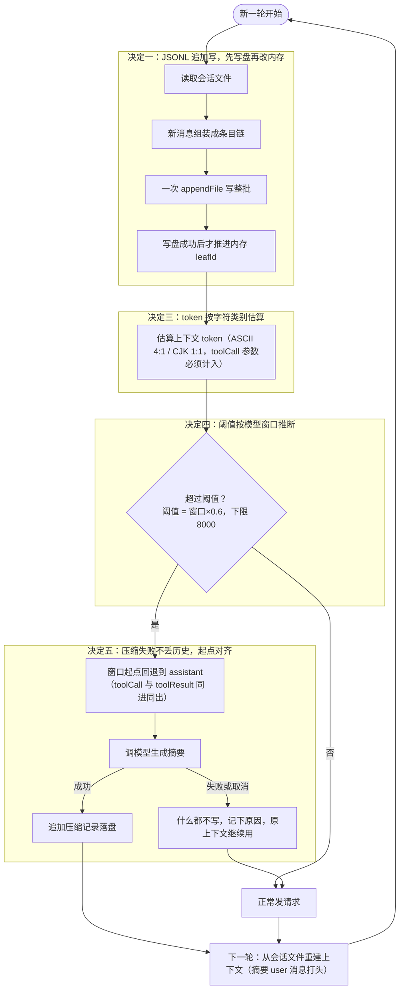

# 第 4 章 上下文与会话：把历史存好，把窗口守住

前三章把单轮对话做扎实了：Loop 转得动、工具守规矩、模型摔不坏。但还有一个一直被我们无视的问题——**历史**。这一轮聊完，消息就扔在内存里；聊得越久，历史越长；窗口一爆，API 直接 400，而你连「聊天记录」都找不回来。这一章就补两块地基：**会话落盘**（历史存得住、重开还在）和**上下文压缩**（窗口快满时自动把旧账誊成摘要）。

<!-- code-ref: packages/core/src/agent/sessionStore.ts#L1-L36 -->

## 1. 先搞懂三个词（What）

### 1.1 会话文件：一本只追加的账本

会话文件（session file）就是把这局对话**一行一行记下来**的账本。格式是 JSONL：一行一条记录，第一行是「头行」（记版本号和工作目录），后面每条消息占一行。

它有两个和普通文件不一样的脾气：

- **只追加，不重写**。写完的行永远不会改，新消息只往尾部接——所以进程崩溃最多弄脏最后一行，前面的历史都安全；
- **它是历史的唯一来源**。内存里的数组丢了可以从它重建，反过来不行。

<!-- code-ref: packages/core/src/agent/sessionStore.ts#L489-L508 -->

### 1.2 上下文窗口：桌子只有这么大

上下文窗口（context window）是模型一次请求能「看见」的最大 token 数。把消息历史想成摊在桌上的一叠纸，桌子就这么大——纸越叠越多，总有一刻放不下，API 直接返回 400。

「多大算快满了」用 **token** 估算。token 是模型计费和计量的基本单位：英文约 4 个字符 1 个 token，中文约 1 个字 1 个 token。注意是**估算**——它只用来回答「要不要压缩」这个yes/no问题，不参与计费。

### 1.3 压缩：把旧账誊成一页摘要

压缩（compaction）是快爆窗时的自救：把**较早的**历史交给模型，请它压成一段 200 字以内的摘要，然后上下文变成——

```
[摘要（以 user 消息打头）] + [保留的最近几条消息]
```

摘要是一条普通 user 消息，开头就写明「最近的消息优先级更高」。旧账没有凭空消失：会话文件里追加了一条**压缩记录**（记着摘要内容和「从哪条开始保留」），重开会话照样能还原出这个形状。

<!-- code-ref: packages/core/src/agent/sessionStore.ts#L704-L741 -->

## 2. 它怎么转 + 为什么非这么转（How）

整个生命周期是：**每轮消息先追加进会话文件 → 每次请求前估算 token → 超过阈值就触发压缩（窗口起点对齐 + 模型生成摘要 + 追加压缩记录）→ 下一轮上下文从会话文件重建（摘要打头）**。图里每个「决定 N」分区都对应下面 2.2~2.6 的一个决定：



人话版：消息先进账本；每次发请求前掂一掂桌子还放不放得下；放不下了，把旧纸誊成一页摘要（誊砸了就先不誊，绝不把原稿扔了），新请求带着「摘要 + 最近几条」继续聊。决定一~四对应 2.2~2.5，决定五对应 2.6；第 3 节的代码照这张图落地。

### 2.1 不这么设计的下场

- **历史说没就没。** 不落盘，进程一退聊天记录清零；或者更糟——落了盘但每次都整个文件重写，进程写到一半被杀，留下「头行在、消息全没」的残废文件。
- **窗口一爆，请求全 400。** 不估算 token、不压缩，长会话聊到一半所有请求开始报错，而且再也救不回来。
- **压完反而全崩。** 压缩时把「assistant 叫了工具」誊进摘要、却把「工具结果」留在上下文里——一条引用不存在 toolCall 的孤儿 toolResult，API 400。更糟的是这条非法序列已经落盘，之后每轮重建出同样的非法上下文，这个会话**永远发不出请求**。

### 2.2 决定一：JSONL 追加写，先写盘再改内存

会话文件只追加。每轮产生的一批消息组装成一条 `parentId` 链，**一次 `appendFile` 写完整批**，写盘成功后才推进内存里的链尾指针。

**代价**：批量写意味着一次要写整批 JSON，出错时「到底落了几条」的答案必须是「整批都没落」——内存状态和磁盘状态的推进顺序被焊死成「盘先、内存后」。换来的好处是：写失败时内存原样未动，调用方按「整批未落盘」重试，要么全有要么全无，不存在「写了一半、指针已走」的中间态。

**踩坑实录**：逐条 `await` 写有两个真实问题——一轮几十条消息就是几十次系统调用；更致命的是写到第 k 条失败时，前 k-1 条已经进磁盘、内存也已经推进，调用方无从知道落了几条，重试要么漏、要么重复。

<!-- code-ref: packages/core/src/agent/sessionStore.ts#L515-L557 -->

### 2.3 决定二：读时容错——单行坏了跳过那行，头行坏了只补不重建

JSONL 只追加不等于文件永远干净：进程被强杀会留下半行 JSON，手工编辑会弄坏头行。所以加载时逐行校验：

- **单行损坏只跳过该行**，记下警告，绝不让整份会话打不开；
- **文件末尾的残行要连着文件一起收拾**：内容完整只差换行的，补一个换行；写了一半的，从文件里截掉；
- **头行缺失时只补头行**，其余原始行原样保留，原子写回——绝不重建文件。

**代价**：要额外写结构校验（「合法 JSON 但缺字段」是 `JSON.parse` 兜不住的，比如缺 `id` 的行会在后面访问时抛 TypeError，而它在构造函数里被调用——等于整个 CLI 起不来）和残行判定逻辑。换来的是最坏情况也只是「丢一条已写坏的消息 + 一条警告」，绝不丢整份历史。

**踩坑实录（两桩，都在源码注释里）**：

1. **残行只跳过不截断 → 新消息凭空消失。** 半行留在磁盘上，下一次 `appendFile` 会紧贴它继续写，两条残缺 JSON 粘成一行——于是刚写下的那条**完整**消息也跟着解析失败。
2. **头行损坏时用 `"w"` 重写 → 整份历史截没。** 旧实现在头行缺失时清空内存再写头行，`"w"` 模式一开，刚解析出来的几十条消息全部被截断，用户看到「会话凭空清空」。而头行只承载版本号、工作目录这类语境，缺了它消息行照样可用——补上就行，不值得拿整份历史陪葬。

<!-- code-ref: packages/core/src/agent/sessionStore.ts#L303-L346 -->
<!-- code-ref: packages/core/src/agent/sessionStore.ts#L384-L404 -->

配套的**写入侧**也要原子：整份重写（补头行、截残行）必须先写同目录临时文件再 `rename`。`rename` 在同一文件系统内是原子的，最坏情况留下一个 `.tmp` 残骸，绝不会留下「写一半的正式文件」。

<!-- code-ref: packages/core/src/agent/sessionStore.ts#L15-L36 -->

### 2.4 决定三：token 按字符类别估算，toolCall 参数必须计入

估算函数按字符类别分别计价：ASCII（字母数字标点）约 4 字符 1 token；CJK 汉字与全角标点约 1 字符 1 token（略偏保守——早压缩比超窗安全）。仍然只是估算，只服务于「要不要压缩」。

**代价**：精确计 token 要引入 tokenizer，依赖重、速度慢；按类别估算对混排文本有偏差。换来的好处是零依赖、逐字符扫一遍就出结果，而且偏差方向可控（保守方向：宁可多估早压）。

**踩坑实录（两桩，都来自源码注释）**：

1. **`length / 2` 的一刀切（P2 #17）。** 旧实现对中英混排按「2 字符 1 token」统一折算：英文按真实比例约 4:1，于是英文内容被高估约一倍、中文反而略被低估——同一个数，两个方向都错。
2. **漏算 toolCall 参数 → 估算恒为 0 → 压缩永不触发。** 参数不在文本里，但会**原样发给模型**（`write_file` 的 `content` 可能上万字符）。实测一条带 20 万字符参数的消息估算为 0 token：上下文早爆了，压缩却永远不触发，请求直接被撑到 400。所以估算必须连 `toolCall` 的名字和参数一起算；反过来，`toolResult` 的 `details` 不发给模型，就不计。

<!-- code-ref: packages/core/src/agent/sessionStore.ts#L896-L949 -->

### 2.5 决定四：阈值按模型窗口推断（窗口 × 0.6，下限 8000），固定开销也要算

压缩阈值不是写死的数，是**按当前模型的窗口推出来的**：`阈值 = max(8000, 窗口 × 0.6)`。0.6 这个比例是给输出和工具结果留的余量；8000 下限是防小窗口配置退化成「每轮都压缩」。

**代价**：窗口**配大**了有真实风险——如果实际模型窗口更小（比如配了 128k 却用的是 16k 模型），可能在压缩触发之前请求就被 API 拒绝，所以这类模型必须显式设置真实窗口；按比例推断则要对「认不出的模型名」准备一个兜底窗口（128k，gpt-4o / deepseek 等主流量级）。

**踩坑实录**：旧实现硬编码 6000，与真实窗口脱节——对 128k 窗口而言小到等于每轮都调一次摘要模型（花钱又加延迟），对小窗口模型又可能来不及压。另外判定时还要把**固定开销**算进去：系统提示和工具定义不在消息历史里，但每次请求都会带上，只按历史估算会系统性低估真实请求大小。

<!-- code-ref: packages/core/src/context.ts#L30-L54 -->

### 2.6 决定五：压缩失败不落盘、不丢历史；窗口起点必须对齐

压缩要调一次模型，可能失败（模型挂了）、被取消（Ctrl+C）、输出被截断、甚至返回空内容。这四种情况的处置是同一条铁律：**什么都不写**——原上下文保持原样，只把失败原因记下来供展示。

**代价**：压缩可能一直不成功而用户毫无感知（上下文继续涨），所以失败原因必须显式暴露出来，否则用户只会看到「一直没压缩」，无从判断。另外窗口起点对齐会导致有些时候**主动放弃压缩**（整段历史都要保留才能维持配对时，压缩只会把上下文清空）——压缩是优化，不能反过来破坏可用的上下文。

**踩坑实录（两桩，性质都极恶劣）**：

1. **降级摘要 = 把真实历史换成统计数字，且已落盘。** 摘要模型失败时回退到「对话共 N 条消息」这类简单摘要——写进会话文件等于把真实历史换成一句废话，**而且已经落盘、不可恢复**。所以源码注释里写死：被取消**或失败**都抛出，绝不回退。
2. **窗口起点落在 toolResult 上 → 孤儿结果 → 400，且永久复发。** 压缩把「窗口之前」的消息换成摘要，所以窗口的**第一条**消息不能是 toolResult——它对应的 assistant toolCall 被摘要吞掉后，留下的就是一条引用不存在 toolCall 的孤儿 toolResult，OpenAI 直接 400；而这条非法序列已经落盘，之后每轮从会话文件重建出同样的非法上下文，该会话再也发不出请求。修法是把起点向前回退到第一个非 toolResult 的消息，保证「assistant(toolCalls) + 它的全部 toolResult」**同进同出**。

<!-- code-ref: packages/core/src/agent/sessionStore.ts#L860-L893 -->
<!-- code-ref: packages/core/src/agent/sessionStore.ts#L636-L678 -->

## 3. 实现：跟着写一个会话层

本章往 `harness/` 里加两个文件、一个驱动脚本：`context.js`（token 估算 + 阈值，**不依赖**存储）、`session.js`（JSONL 存储 + 压缩）、`run-session.js`（四出戏）。`loop.js` / `model.js` / `tools.js` 一行不动——会话层是包在 Loop 外面的记账员，Loop 本体不感知它（第 2 章的注册表同理，这又是 seam 的好处）。

### 3.0 落点：一套累积式代码

```
harness/
├── messages.js      # 第1章：消息形状
├── model.js         # 第1章：模型 seam（mock）
├── tools.js         # 第2章：工具注册表
├── loop.js          # 第1章：核心循环
├── context.js       # 本章新增：token 估算 + 压缩阈值
├── session.js       # 本章新增：JSONL 会话存储 + 压缩
└── run-session.js   # 本章新增：四出戏
```

### 3.1 `context.js` —— 估算与阈值的唯一口径

token 估算、压缩阈值、窗口起点对齐都放在这一个文件里——「上下文有多大、要不要压」全系列必须读到同一个数，各算一遍的结果不是更准确，而是同一时刻给用户看两个不同的刻度。

```js
// harness/context.js —— 第4章：token 估算与压缩阈值（唯一口径）
// 常量对齐 mini-pi packages/core/src/context.ts：
//   CONTEXT_BUDGET_RATIO=0.6 / MIN_CONTEXT_BUDGET=8_000 / KEEP_RECENT_MESSAGES=10
//   DEFAULT_CONTEXT_WINDOW=128_000（provider/context-window.ts）

/** 按字符类别计价：ASCII 约 4 字符 1 token，CJK/全角约 1 字符 1 token */
export function estimateTextTokens(text) {
  let ascii = 0;
  let wide = 0;
  for (const char of String(text)) {
    if ((char.codePointAt(0) ?? 0) < 0x80) ascii += 1;
    else wide += 1;
  }
  return Math.ceil(ascii / 4 + wide);
}

/**
 * 估算一条消息的 token。toolCall 的参数必须计入——参数会原样发给模型，
 * 漏算的后果不是「略有偏差」而是「恒为 0」（20 万字符参数 → 压缩永不触发 → 400）。
 */
export function estimateMessageTokens(message) {
  let tokens = 0;
  for (const block of message.content ?? []) {
    if (block.type === "text") tokens += estimateTextTokens(block.text);
    if (block.type === "toolCall") {
      tokens += estimateTextTokens(block.name);
      tokens += estimateTextTokens(JSON.stringify(block.arguments ?? {}));
    }
  }
  return tokens;
}

export function estimateTokens(messages) {
  return messages.reduce((sum, m) => sum + estimateMessageTokens(m), 0);
}

export const CONTEXT_BUDGET_RATIO = 0.6; // 给输出与工具结果留余量
export const MIN_CONTEXT_BUDGET = 8_000; // 窗口配得过小时不要退化成「每轮都压缩」
export const KEEP_RECENT_MESSAGES = 10;
export const DEFAULT_CONTEXT_WINDOW = 128_000;

/** 按模型窗口推导压缩阈值 */
export function resolveContextBudget(contextWindow) {
  const window =
    Number.isFinite(contextWindow) && contextWindow > 0
      ? contextWindow
      : DEFAULT_CONTEXT_WINDOW;
  return Math.max(MIN_CONTEXT_BUDGET, Math.floor(window * CONTEXT_BUDGET_RATIO));
}

/**
 * 压缩窗口起点对齐：第一条不能是 toolResult，否则 assistant toolCall 被摘要吞掉，
 * 留下的孤儿 toolResult 直接被 API 400。返回 0 表示整段都要保留（放弃压缩）。
 */
export function alignCompactionStart(roles, keepRecentMessages) {
  const keepRecent = Math.max(1, Math.floor(keepRecentMessages) || 1);
  let start = Math.max(0, roles.length - keepRecent);
  while (start > 0 && roles[start] === "toolResult") start -= 1;
  return start;
}
```

### 3.2 `session.js` —— JSONL 存储 + 压缩

这是本章的主文件。三个决定直接落在代码里：追加是「先写盘再改内存」（决定一），加载是逐行容错 + 只补头行（决定二），压缩失败什么都不写（决定五）。

```js
// harness/session.js —— 第4章：JSONL 会话存储（追加、容错加载、压缩）
// 铁律：会话文件是历史的唯一来源——宁可少压、宁可报警告，绝不静默丢用户的数据。

import { existsSync, readFileSync, appendFileSync, writeFileSync, renameSync, mkdirSync, rmSync } from "node:fs";
import { dirname } from "node:path";
import { textBlock } from "./messages.js";
import { estimateTokens, alignCompactionStart } from "./context.js";

/** 决定二：整份重写必须原子（先写临时文件再 rename）——进程写一半被杀也不留残缺文件 */
function writeFileAtomicSync(filePath, content) {
  mkdirSync(dirname(filePath), { recursive: true });
  const tmp = `${filePath}.${process.pid}.tmp`;
  try {
    writeFileSync(tmp, content, "utf8");
    renameSync(tmp, filePath);
  } catch (e) {
    try { rmSync(tmp, { force: true }); } catch { /* 清不掉不影响主流程 */ }
    throw e;
  }
}

/** 决定二：逐行结构校验——合法 JSON 但缺字段，JSON.parse 兜不住，必须单独验 */
function validateEntry(value) {
  if (typeof value !== "object" || value === null) return { reason: "不是 JSON 对象" };
  if (typeof value.type !== "string") return { reason: "缺少 type 字段" };
  if (value.type === "session")
    return typeof value.version === "number" && typeof value.id === "string"
      ? { entry: value } : { reason: "session 缺少 version/id" };
  if (value.type === "message") {
    if (typeof value.id !== "string") return { reason: "message 缺少 id" };
    if (!("parentId" in value)) return { reason: "message 缺少 parentId" };
    if (typeof value.message !== "object" || value.message === null)
      return { reason: "message 缺少 message" };
    const role = value.message.role;
    if (role !== "user" && role !== "assistant" && role !== "toolResult")
      return { reason: `message.role 非法：${String(role)}` };
    return { entry: value };
  }
  if (value.type === "compaction") {
    if (typeof value.id !== "string") return { reason: "compaction 缺少 id" };
    if (typeof value.summary !== "string") return { reason: "compaction 缺少 summary" };
    if (typeof value.firstKeptEntryId !== "string") return { reason: "compaction 缺少 firstKeptEntryId" };
    return { entry: value };
  }
  return { reason: `未知的条目类型：${value.type}` };
}

export function createSessionStore(filePath, { cwd = process.cwd() } = {}) {
  const entries = [];       // 全量条目（含头行与压缩记录）
  const byId = new Map();
  let leafId = null;
  let counter = 0;
  let lastCompactionError = null;
  const loadWarnings = [];

  const nextId = () => `entry_${++counter}`;

  // ---------- 加载（决定二：读时容错，绝不重建文件） ----------
  function loadOrCreate() {
    if (!existsSync(filePath)) {
      const header = { type: "session", version: 1, id: "harness-session", timestamp: new Date().toISOString(), cwd };
      entries.push(header);
      writeFileAtomicSync(filePath, `${JSON.stringify(header)}\n`);
      return;
    }
    const raw = readFileSync(filePath, "utf8");
    const lines = raw.split("\n");
    while (lines.length > 0 && lines.at(-1) === "") lines.pop();

    // 末尾残行：完整行补换行；半行从文件截掉——
    // 不截的话下次 append 会紧贴它写，两条残缺 JSON 粘成一行，新消息也跟着解析失败
    if (lines.length > 0 && !raw.endsWith("\n")) {
      const last = lines.at(-1);
      let ok = false;
      try { ok = !("reason" in validateEntry(JSON.parse(last))); } catch { ok = false; }
      if (ok) writeFileAtomicSync(filePath, `${raw}\n`);
      else {
        lines.pop();
        writeFileAtomicSync(filePath, lines.length > 0 ? `${lines.join("\n")}\n` : "");
        loadWarnings.push({ line: lines.length + 1, reason: "文件末尾是写了一半的消息行，已截断（该条无法恢复）" });
      }
    }

    for (let i = 0; i < lines.length; i++) {
      const line = lines[i];
      if (line === "") continue;
      let value;
      try { value = JSON.parse(line); } catch (e) {
        loadWarnings.push({ line: i + 1, reason: String(e?.message ?? e) });
        continue; // 决定二：单行损坏只跳过该行，不让整份会话打不开
      }
      const r = validateEntry(value);
      if ("reason" in r) { loadWarnings.push({ line: i + 1, reason: r.reason }); continue; }
      entries.push(r.entry);
      if (r.entry.type !== "session") {
        byId.set(r.entry.id, r.entry);
        leafId = r.entry.id;
        counter = Math.max(counter, Number(r.entry.id.replace("entry_", "")) || 0);
      }
    }

    // 头行损坏：只补头行，其余原始行原样保留——旧实现用 "w" 重写，把整份历史截没了
    if (!entries.some((e) => e.type === "session")) {
      const header = { type: "session", version: 1, id: "harness-session", timestamp: new Date().toISOString(), cwd };
      entries.unshift(header);
      const kept = loadWarnings.some((w) => w.line === 1) ? lines.slice(1) : lines;
      writeFileAtomicSync(filePath, [JSON.stringify(header), ...kept].join("\n") + "\n");
    }
  }

  // ---------- 追加（决定一：先写盘再改内存，一批一次 appendFile） ----------
  function appendMessages(messages) {
    if (messages.length === 0) return [];
    const written = [];
    let parentId = leafId;
    for (const message of messages) {
      const id = nextId();
      written.push({ type: "message", id, parentId, timestamp: new Date().toISOString(), message });
      parentId = id;
    }
    appendFileSync(filePath, written.map((e) => `${JSON.stringify(e)}\n`).join(""), "utf8");
    for (const e of written) { entries.push(e); byId.set(e.id, e); }
    leafId = parentId; // 写失败时内存保持原样，调用方按「整批未落盘」重试
    return written.map((e) => e.id);
  }

  // ---------- 上下文重建（决定五：摘要以 user 消息打头，最近消息优先级更高） ----------
  function pathToLeaf() {
    const reversed = [];
    let current = leafId ? byId.get(leafId) : undefined;
    while (current) { reversed.push(current); current = current.parentId ? byId.get(current.parentId) : undefined; }
    return reversed.reverse(); // push 后 reverse，O(n)（unshift 是 O(n²)）
  }

  function buildContext() {
    const path = pathToLeaf();
    let idx = -1;
    for (let i = path.length - 1; i >= 0; i--) if (path[i].type === "compaction") { idx = i; break; }
    if (idx === -1) return path.filter((e) => e.type === "message").map((e) => e.message);
    const compaction = path[idx];
    const messages = [{
      role: "user",
      content: [textBlock(`以下是旧的上下文摘要。后续回答必须参考它，但最近的消息优先级更高。\n\n${compaction.summary}`)],
      timestamp: Date.now(),
    }];
    let found = false;
    for (let i = 0; i < idx; i++) {
      if (path[i].id === compaction.firstKeptEntryId) found = true;
      if (found && path[i].type === "message") messages.push(path[i].message);
    }
    for (let i = idx + 1; i < path.length; i++) if (path[i].type === "message") messages.push(path[i].message);
    return messages;
  }

  // ---------- 压缩（决定五：失败不写盘不丢历史；决定四：窗口起点对齐） ----------
  function needsCompaction(maxTokens, keepRecent) {
    const msgs = pathToLeaf().filter((e) => e.type === "message");
    if (msgs.length <= Math.max(1, keepRecent)) return false;
    return estimateTokens(buildContext()) > maxTokens;
  }

  async function compactIfNeeded({ maxTokens, keepRecent, model, signal } = {}) {
    if (signal?.aborted) return undefined;
    if (!needsCompaction(maxTokens, keepRecent)) return undefined;
    const msgs = pathToLeaf().filter((e) => e.type === "message");
    const startIndex = alignCompactionStart(msgs.map((m) => m.role), keepRecent);
    if (startIndex <= 0) return undefined; // 整段都要保留才能维持配对：宁可不压

    const summarized = msgs.slice(0, startIndex);
    const kept = msgs.slice(startIndex);
    const tokensBefore = estimateTokens(buildContext());

    let summary;
    try {
      summary = model
        ? await summarizeEntries(summarized, model, signal)
        : `对话共 ${summarized.length} 条消息`; // 未配模型才允许简单摘要兜底
    } catch (e) {
      // 决定五：压缩失败保持原上下文、不写任何条目——降级摘要等于把真实历史换成统计数字
      lastCompactionError = String(e?.message ?? e);
      return undefined;
    }
    if (signal?.aborted) return undefined;

    const entry = {
      type: "compaction", id: nextId(), parentId: leafId,
      timestamp: new Date().toISOString(), summary,
      firstKeptEntryId: kept[0].id, tokensBefore,
    };
    appendFileSync(filePath, `${JSON.stringify(entry)}\n`, "utf8");
    entries.push(entry); byId.set(entry.id, entry); leafId = entry.id;
    lastCompactionError = null;
    return entry;
  }

  loadOrCreate();
  return {
    appendMessages,
    buildContext,
    needsCompaction,
    compactIfNeeded,
    getEntries: () => [...entries],
    getLoadWarnings: () => [...loadWarnings],
    getLastCompactionError: () => lastCompactionError,
    getFilePath: () => filePath,
  };
}

/** 用模型生成摘要：失败/截断/空回复都抛出，绝不回退到统计废话 */
async function summarizeEntries(summarized, model, signal) {
  const conversationText = summarized
    .map((e) => `${e.message.role === "user" ? "用户" : e.message.role === "assistant" ? "助手" : "工具"}: ${
      (e.message.content ?? []).filter((b) => b.type === "text").map((b) => b.text).join("\n") || "（无正文）"
    }`)
    .join("\n\n");
  const response = await model.complete({
    systemPrompt: "你是对话摘要助手。把对话历史压成 200 字以内的摘要，保留用户意图、关键结论与执行进度。",
    messages: [{ role: "user", content: [textBlock(`请为以下对话生成摘要：\n\n${conversationText}`)], timestamp: Date.now() }],
    tools: [],
    signal,
  });
  // 先看结束原因再看内容：失败时模型也返回一条 assistant（stopReason:"error"），当摘要写入等于用错误描述替换真实历史
  if (response.stopReason === "error") throw new Error(`摘要模型调用失败`);
  if (response.stopReason === "length") throw new Error("摘要被截断（stopReason=length），已放弃本次压缩");
  if (response.stopReason === "aborted") throw new Error("摘要模型调用已取消");
  const summary = (response.content ?? []).filter((b) => b.type === "text").map((b) => b.text).join("\n").trim();
  if (summary === "") throw new Error("摘要模型返回了空内容");
  return summary;
}
```

### 3.3 跑起来，看四出戏

```js
// harness/run-session.js —— 第4章 demo：四出戏
// 戏1 存档与重开  戏2 单行损坏只跳过  戏3 token 估算（toolCall 参数必须计入）
// 戏4 压缩触发与「压缩失败不丢历史」

import { rmSync, writeFileSync, readFileSync } from "node:fs";
import { textBlock, toolCallBlock } from "./messages.js";
import { createMockModel } from "./model.js";
import { estimateTextTokens, estimateMessageTokens, resolveContextBudget, KEEP_RECENT_MESSAGES } from "./context.js";
import { createSessionStore } from "./session.js";

// 注：源码真实阈值 = 窗口(128k) × 0.6 ≈ 76_800、下限 8_000、保留最近 10 条。
// demo 用小阈值（120）让肉眼看得见触发；resolveContextBudget 的 8000 下限会把 120 托底，故直接给定值。

// ---------- 戏 1：存档与重开 ----------
{
  const file = new URL("./session-demo-1.jsonl", import.meta.url).pathname.replace(/^\/([A-Za-z]:)/, "$1");
  rmSync(file, { force: true });
  const store = createSessionStore(file, { cwd: "/demo" });
  store.appendMessages([{ role: "user", content: [textBlock("帮我读一下 loop.js")], timestamp: Date.now() }]);
  store.appendMessages([
    { role: "assistant", content: [toolCallBlock("c1", "read_file", { path: "loop.js" })], timestamp: Date.now() },
    { role: "toolResult", toolCallId: "c1", toolName: "read_file", content: [textBlock("// loop.js 的内容……")], isError: false, timestamp: Date.now() },
  ]);

  // 模拟进程重启：同一份文件重新打开
  const reopened = createSessionStore(file, { cwd: "/demo" });
  console.log("【戏1】重开后恢复条目数 =", reopened.getEntries().length, "（1 头行 + 3 消息）");
  console.log("【戏1】重开后上下文条数 =", reopened.buildContext().length, "，加载警告 =", reopened.getLoadWarnings().length);
  rmSync(file, { force: true });
}

// ---------- 戏 2：单行损坏只跳过该行 ----------
{
  const file = new URL("./session-demo-2.jsonl", import.meta.url).pathname.replace(/^\/([A-Za-z]:)/, "$1");
  rmSync(file, { force: true });
  const store = createSessionStore(file, { cwd: "/demo" });
  store.appendMessages([{ role: "user", content: [textBlock("第一条：完好的消息")], timestamp: Date.now() }]);
  store.appendMessages([{ role: "user", content: [textBlock("第二条：完好的消息")], timestamp: Date.now() }]);

  // 手工塞进两种「损坏」：半行 JSON + 合法 JSON 但缺字段
  const raw = readFileSync(file, "utf8");
  writeFileSync(file, raw + '{"type":"message",id":"坏了\n' + JSON.stringify({ type: "message", message: { role: "user" } }) + "\n", "utf8");

  const reopened = createSessionStore(file, { cwd: "/demo" });
  console.log("\n【戏2】加载警告 =", JSON.stringify(reopened.getLoadWarnings()));
  console.log("【戏2】仍可用的消息 =", reopened.buildContext().length, "条，会话照常打开");
  rmSync(file, { force: true });
}

// ---------- 戏 3：token 估算 ----------
{
  console.log("\n【戏3】英文 'hello world, this is a test' =", estimateTextTokens("hello world, this is a test"), "token（29 字符 ≈ /4）");
  console.log("【戏3】中文「帮我读一下这个文件」 =", estimateTextTokens("帮我读一下这个文件"), "token（CJK 按 1 字符 1 token）");
  const big = { role: "assistant", content: [toolCallBlock("c1", "write_file", { content: "x".repeat(200_000) })], timestamp: Date.now() };
  console.log("【戏3】带 20 万字符参数的 toolCall =", estimateMessageTokens(big), "token —— 若漏算参数，这条恒为 0，压缩永不触发");
  console.log("【戏3】真实窗口 128k 的压缩阈值 =", resolveContextBudget(128_000), "token（128000×0.6）");
}

// ---------- 戏 4：压缩触发，以及压缩失败不丢历史 ----------
{
  const file = new URL("./session-demo-4.jsonl", import.meta.url).pathname.replace(/^\/([A-Za-z]:)/, "$1");
  rmSync(file, { force: true });
  const store = createSessionStore(file, { cwd: "/demo" });
  for (let i = 1; i <= 12; i++) {
    store.appendMessages([{ role: "user", content: [textBlock(`第${i}轮：请继续处理任务步骤 ${i}，这一步的结论是结论${i}。`)], timestamp: Date.now() }]);
  }
  const maxTokens = 120;
  const summarizer = createMockModel([
    { content: [textBlock("用户要求依次处理任务步骤 1~9；每轮请求继续下一步，并记录结论 1~9。")], stopReason: "stop" },
  ]);
  const entry = await store.compactIfNeeded({ maxTokens, keepRecent: 2, model: summarizer });
  console.log("\n【戏4】压缩触发：tokensBefore =", entry?.tokensBefore, "，摘要 =", entry?.summary);
  const ctx = store.buildContext();
  console.log("【戏4】压缩后上下文 =", ctx.length, "条（摘要 user 消息 1 条 + 保留的最近 2 条）");
  console.log("【戏4】上下文第 1 条 =", JSON.stringify(ctx[0].content[0].text.slice(0, 30) + "……"));

  // 压缩失败：摘要模型挂了 → 不写盘、不丢历史，只记原因
  const file2 = new URL("./session-demo-4b.jsonl", import.meta.url).pathname.replace(/^\/([A-Za-z]:)/, "$1");
  rmSync(file2, { force: true });
  const store2 = createSessionStore(file2, { cwd: "/demo" });
  for (let i = 1; i <= 12; i++) {
    store2.appendMessages([{ role: "user", content: [textBlock(`第${i}轮：请继续处理任务步骤 ${i}，这一步的结论是结论${i}。`)], timestamp: Date.now() }]);
  }
  const failing = createMockModel([{ content: [], stopReason: "error" }]);
  const r2 = await store2.compactIfNeeded({ maxTokens, keepRecent: 2, model: failing });
  console.log("【戏4】摘要失败 → compactIfNeeded 返回 =", r2, "；失败原因 =", store2.getLastCompactionError());
  console.log("【戏4】失败后上下文仍 =", store2.buildContext().length, "条 —— 一条没丢，宁可不压");
  rmSync(file, { force: true }); rmSync(file2, { force: true });
}

console.log(`\n（源码真实参数：窗口 128k / 阈值≈76800 / 下限 8000 / 保留最近 ${KEEP_RECENT_MESSAGES} 条 / 摘要输入下限 4000）`);
```

运行：

```bash
cd demos/harness && node run-session.js
```

预期输出（摘要内容为 mock 脚本台词；demo 参数均为缩小版，真实值见末行）：

```
【戏1】重开后恢复条目数 = 4 （1 头行 + 3 消息）
【戏1】重开后上下文条数 = 3 ，加载警告 = 0

【戏2】加载警告 = [{"line":4,"reason":"Expected double-quoted property name in JSON at position 18 (line 1 column 19)"},{"line":5,"reason":"message 缺少 id"}]
【戏2】仍可用的消息 = 2 条，会话照常打开

【戏3】英文 'hello world, this is a test' = 7 token（29 字符 ≈ /4）
【戏3】中文「帮我读一下这个文件」 = 9 token（CJK 按 1 字符 1 token）
【戏3】带 20 万字符参数的 toolCall = 50007 token —— 若漏算参数，这条恒为 0，压缩永不触发
【戏3】真实窗口 128k 的压缩阈值 = 76800 token（128000×0.6）；窗口 200 的 demo 阈值 = 8000

【戏4】压缩触发：tokensBefore = 291 ，摘要 = 用户要求依次处理任务步骤 1~9；每轮请求继续下一步，并记录结论 1~9。
【戏4】压缩后上下文 = 3 条（摘要 user 消息 1 条 + 保留的最近 2 条）
【戏4】上下文第 1 条 = "以下是旧的上下文摘要。后续回答必须参考它，但最近的消息优先级……"
【戏4】摘要失败 → compactIfNeeded 返回 = undefined ；失败原因 = 摘要模型调用失败
【戏4】失败后上下文仍 = 12 条 —— 一条没丢，宁可不压

（源码真实参数：窗口 128k / 阈值≈76800 / 下限 8000 / 保留最近 10 条 / 摘要输入下限 4000）
```

## 4. 配套 demo

demo 在仓库的 `demos/harness/`，与本章正文逐文件对应：`context.js` / `session.js` + 驱动脚本 `run-session.js`——就是 3.1~3.3 节那三份代码，可直接对照着抄，也可以先跑一遍看效果：

```bash
cd demos/harness && node run-session.js
```

后续每一章的 demo 都往这个目录里加文件（见第 0 章的搭建地图）。注意 `run.js`、`run-tools.js` 等旧脚本不受影响——本章只新增文件，没动任何旧 seam。

## 5. 小结与下一章

会话层的本质，是把「只追加落盘、读时容错、估算偏保守、阈值随窗口走、压缩失败宁可不压」这五个不变量焊在一起。其中**压缩失败不丢历史**最反直觉——直觉会说「压不成至少存个简单摘要吧」，但那等于把不可恢复的真实历史换成一句统计废话；会话文件一旦落盘就没有后悔药，所以源码在这里宁缺毋滥。

到这里，账本和窗口都守住了。但「问模型」那一行底下还藏着最后一层没拆的壳：我们一直假设「发一个 HTTP 请求就完事」，可真实世界里 OpenAI、Anthropic、DeepSeek、智谱……每家的**鉴权头、Base URL、上下文窗口表**都不一样。下一章（供应商抽象）就拆这层：**一个统一接口怎么把 N 家差异吸收掉**，以及为什么窗口表必须跟着供应商走——它正是本章压缩阈值的原料。
