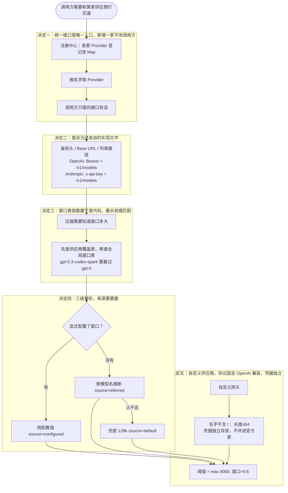

# 第 5 章 供应商抽象：一个接口，装下 N 家差异

前三章把「问模型」这行包上了可靠性壳（第 3 章），又让它背后的窗口和账本守了规矩（第 4 章）。但还有一个假设我们从第 1 章用到现在：**模型就是一家**。真实世界是 OpenAI、Anthropic、DeepSeek、智谱、Kimi……每家的鉴权头不一样、Base URL 形态不一样、模型窗口表也不一样。这一章就拆最后一层壳：**供应商抽象**——用一个统一接口把 N 家差异吸收掉，新增一家不改任何旧代码。

<!-- code-ref: packages/core/src/provider/index.ts#L11-L37 -->

## 1. 先搞懂三个词（What）

### 1.1 Provider：一家供应商的「身份证 + 说明书」

Provider 是描述「一家模型供应商怎么打交道」的对象。统一接口只问五件事：你叫什么（`getProviderName`）、走哪种 SDK 协议（`getSdkType`）、Base URL 是什么（`getBaseUrl`）、怎么拉模型列表（`getModelList`）、列表地址要不要特殊拼（`getModelsUrl`，可选）。

接口刻意这么小：**调用方（配置界面、CLI）只面向接口说话**，永远不写「如果是 Anthropic 就……」这种分叉。

### 1.2 鉴权头与 Base URL：同一件事，各家说法不同

同样是「证明我是谁」，OpenAI 用 `Authorization: Bearer <key>`，Anthropic 用 `x-api-key: <key>` 外加一个 `anthropic-version` 版本头。Base URL 也有形态差异：OpenAI 的地址自带 `/v1`，模型列表直接拼 `/models` 就行；Anthropic 的地址**不带** `/v1`（SDK 请求对话时自己拼），拉模型列表就必须显式写 `/v1/models`——直接拼 `/models` 会 404。

### 1.3 窗口表：模型名 → 上下文大小的对照表

第 4 章的压缩阈值 `max(8000, 窗口 × 0.6)` 里那个「窗口」，本章给出答案：它**不是用户手填的，是从窗口表里查出来的**。表按「模型名前缀 → 窗口大小」登记，拿模型名去匹配；认不出的回退到 128k 兜底。窗口估大估小都有代价——估大可能在压缩触发前就把请求发过窗口上限（API 400），估小只是提前多压缩几次（花钱加延迟），所以表的策略刻意保守。

<!-- code-ref: packages/core/src/provider/context-window.ts#L1-L22 -->

## 2. 它怎么转 + 为什么非这么转（How）

整个流程是：**注册中心登记各家 Provider → 用哪家就取哪家 → 差异（鉴权头/URL/列表路径）全在它自己的实现文件里 → 压缩阈值需要的窗口按「显式配置 > 模型名推断 > 默认兜底」三级解析出来**。图里每个「决定 N」分区对应下面 2.2~2.6 的一个决定：



人话版：把「和一家供应商打交道」做成一张身份证，注册中心按名字发牌；每家的怪癖（鉴权头、URL 形态）都锁在各自文件里；「窗口多大」这张压缩阈值要用的原料，按「配置 > 推断 > 兜底」查表得出；自建网关也有槽位，但名字和凭据都有底线。决定一~五对应 2.2~2.6；第 3 节代码照图落地。

### 2.1 不这么设计的下场

- **调用方长满 if。** 不做接口，每个用到「模型列表」「Base URL」的地方都要 `if (provider === "anthropic") … else if …`；新增一家供应商要改 N 个文件，漏一处就是线上 bug。
- **窗口猜错，请求全 400。** 不查表、拍脑袋给个大窗口，`gpt-4`（8k 窗口）拿着 128k 的配置狂发请求，压缩永远不触发（阈值按 128k 算），每一发都被 API 拒绝。
- **自定义网关把官方密钥顶掉。** 自定义供应商的 key 和官方 OpenAI 的存在同一个名字下，换个网关配置，官方那把密钥就被覆盖了——还得去重新找 key。

### 2.2 决定一：统一接口是唯一入口，新增一家不改调用方

所有供应商实现同一个 `Provider` 接口，注册进一张 `Map`；调用方按名字取，只面向接口说话。

**代价**：接口必须**小而稳**——每加一个方法，12 家实现都要跟着动。所以接口里只放所有家都有的东西；确有个别家不同的（比如模型列表路径），做成**可选方法**（`getModelsUrl?`），不实现就落到默认行为（`baseUrl + "/models"`），而不是逼每家都写一遍「默认实现」。

**为什么值得**：本章素材里有 12 家供应商，各自一个文件几十行，注册中心的注册区之外**没有任何一行代码知道某家的存在**。新增一家 = 新增一个文件 + 注册一行，调用方零改动——这就是第 1 章「模型层是独立 seam」在供应商维度上的再次兑现。

<!-- code-ref: packages/core/src/provider/index.ts#L39-L58 -->

### 2.3 决定二：鉴权头、Base URL、列表路径，差异全锁进各自的实现文件

对比 OpenAI 和 Anthropic 两个实现，差异一目了然：

| 差异点 | OpenAI | Anthropic |
| --- | --- | --- |
| 鉴权头 | `Authorization: Bearer <key>` | `x-api-key: <key>` + `anthropic-version: 2023-06-01` |
| Base URL | `https://api.openai.com/v1`（自带版本段） | `https://api.anthropic.com`（**不带** /v1，SDK 自己拼） |
| 模型列表 | `baseUrl + /models`（同源默认） | `baseUrl + /v1/models`（必须覆盖，拼默认会 404） |

**代价**：每家一个文件（素材里 12 家就是 12 份），有重复的样板代码（`getBaseUrl`/`getSdkType` 这些一行方法每家都要写）。换来的是任何一家的怪癖**只存在于它自己的文件里**，读 Anthropic 的实现就能完整知道和 Anthropic 打交道的一切，不用去别处找隐藏分支。

**踩坑实录**：Anthropic 的 Base URL 不带版本段是因为 SDK 请求对话时会自己拼 `/v1`——但模型列表不走 SDK，直接拼 `/models` 会 404，所以它必须覆盖可选方法 `getModelsUrl`。这正是「可选方法 + 默认行为」设计的由来：默认覆盖 12 家里的 10 家，剩下的 2 家显式声明自己的不同。

<!-- code-ref: packages/core/src/provider/anthropic.ts#L8-L40 -->
<!-- code-ref: packages/core/src/provider/openai.ts#L21-L34 -->

协议端点的**选择**也是差异的一部分：智谱同时提供 OpenAI Chat Completion、OpenAI Response、Anthropic Message 三种协议端点，实现文件里明确选了 Chat Completion——OpenAI 路径走得更久（流式 + 工具调用 + `stream_options` 降级都趟过），且模型列表与请求同源，不用像 Anthropic 那样单独映射路径。

<!-- code-ref: packages/core/src/provider/zhipu.ts#L4-L21 -->

### 2.4 决定三：窗口表是数据不是代码，最长前缀优先匹配

窗口表是**一张纯数据表**（前缀 → 窗口 → 出处备注），不是一串 if。匹配规则只有一条：**最长前缀优先**——`gpt-4o` 要赢过 `gpt-4`，`gpt-5.3-codex-spark`（128K）要赢过 `gpt-5`（400K）。

**代价**：表要持续维护——新模型要登记、下线模型要清理（素材注释里明确说「只登记在售模型：已下线的调用即 404，留着只会误导」），每条都要写出处。换来的是：加一家模型不改任何逻辑，改数据就行；每条规则的 `note` 字段写明出处，改表时同步维护，杜绝「不知道这个数哪来的」。

**踩坑实录**：Spark 是 128K 的小窗口型号，如果只有 `gpt-5 → 400K` 这一条规则，它会落进 400K——压缩阈值按 400K 算，实际 128K 窗口早就爆了，请求全 400。这类「同族里的小窗口型号」必须用**更长的前缀**单独登记。同理 `mimo-7b`（32K）也必须登记：它比 128k 兜底还小，不登记就会估大。

<!-- code-ref: packages/core/src/provider/context-window.ts#L51-L72 -->
<!-- code-ref: packages/core/src/provider/context-window.ts#L380-L394 -->

还有一层容易被忽略：**同一个模型名，经不同网关代销时窗口可能不同**。所以除全局表外还有一张供应商覆盖表——百炼代销的 MiniMax-M3 是 192K，原厂是 1M；匹配时先查覆盖表，未命中再落全局表。

<!-- code-ref: packages/core/src/provider/context-window.ts#L315-L349 -->

### 2.5 决定四：窗口三级解析（显式配置 > 模型名推断 > 默认兜底），来源要暴露

最终生效的窗口按三级解析：用户在 settings 里显式配置的 `contextWindow` 最优先；没配就按当前模型名查表推断；表也认不出就落 128k 兜底。整个解析是**纯函数**（不碰文件系统），各种组合都能直接单测。

**代价**：窗口**配大了有真实风险**——真实窗口更小的模型可能在压缩触发之前就把请求发过窗口上限，直接 400，所以小窗口模型必须显式配置；而「认不出模型名回退 128k」对更小的模型同样可能估大，这是兜底策略明知要付的代价（宁可提前压缩，不要超窗 400）。

**为什么「来源」也要返回**：`configured` / `inferred` / `default` 三种来源一并返回给展示层——用户看到「当前按默认值 128k」才知道该不该去显式配置。推断是猜的，猜的就要让人知道是猜的。

<!-- code-ref: packages/core/src/provider/context-window.ts#L396-L433 -->
<!-- code-ref: packages/core/src/provider/context-window.ts#L464-L480 -->

### 2.6 决定五：自定义供应商——协议固定 OpenAI 兼容，名字有底线，凭据独立

用户总有素材里没登记的网关（one-api、new-api、vLLM、Ollama 的 OpenAI 兼容层……）。自定义供应商槽位的三个边界：

1. **协议固定 OpenAI 兼容**，不接受自定义协议——自建网关的事实标准就是它（`GET /models` + `POST /chat/completions`），支持任意协议等于把 N 家差异从代码里搬进配置文件，抽象就漏了；
2. **名字有底线**：非空、不含 `/`（它是「供应商/模型」分隔符，名字里带它会把默认模型解析撕成三段）、长度 ≤ 64；
3. **凭据独立存放**：它存成自己名下的一条，绝不并进官方 openai 那把密钥——否则换个网关就把官方 OpenAI 的密钥顶掉了。

**代价**：协议不支持意味着某些非 OpenAI 兼容的私网站点接不进来；名字校验会挡住一些「看着没毛病」的名字。换来的是配置空间不爆炸、默认模型解析永远两段、密钥永不互相顶掉。

**还有一个诚实的小设计**：自定义供应商没有内置模型名单，`getDefaultModels()` 就返回**空数组**——拉不到列表就是拉不到，不编几个充数。

<!-- code-ref: packages/core/src/provider/custom.ts#L4-L48 -->

## 3. 实现：跟着写一个供应商层

本章往 `harness/` 里加两个文件、一个驱动脚本：`provider.js`（统一接口 + 三家实现 + 注册中心）、`context-window.js`（窗口表 + 三级解析）、`run-provider.js`（四出戏）。**所有旧文件一行不动**——供应商层站在 `model.js` 的 seam 后面，谁当模型、从哪来，Loop 与会话层都不感知。

### 3.0 落点：一套累积式代码

```
harness/
├── messages.js          # 第1章：消息形状
├── model.js             # 第1章：模型 seam（mock）
├── tools.js             # 第2章：工具注册表
├── loop.js              # 第1章：核心循环
├── context.js           # 第4章：token 估算 + 压缩阈值
├── session.js           # 第4章：JSONL 会话存储
├── provider.js          # 本章新增：统一 Provider 接口 + 三家实现 + 注册中心
├── context-window.js    # 本章新增：窗口表 + 三级解析（压缩阈值的原料）
└── run-provider.js      # 本章新增：四出戏
```

### 3.1 `provider.js` —— 统一接口与三家实现

demo 把「发请求」拆成纯函数 `buildModelRequest(apiKey)`（返回 url + headers），不真发网络请求就能看清各家差异；真实实现里它后面紧跟一个 `fetch`。

```js
// harness/provider.js —— 第5章：统一 Provider 接口
// 铁律：调用方只面向接口说话；每家的怪癖只存在于它自己的实现文件里。

/** 默认的模型列表地址：去掉结尾斜杠后拼 /models */
export function buildModelsUrl(baseUrl) {
  return `${baseUrl.replace(/\/+$/, "")}/models`;
}

/** 自定义供应商名的底线："/" 是「供应商/模型」分隔符，名字里带它会把解析撕成三段 */
export function assertCustomProviderName(name) {
  const trimmed = name.trim();
  if (trimmed.length === 0) throw new Error("自定义供应商名不能为空");
  if (trimmed.includes("/")) throw new Error(`自定义供应商名不能包含 "/"：${name}`);
  if (trimmed.length > 64) throw new Error("自定义供应商名太长（上限 64 个字符）");
}

// ---------- 每家一个实现文件：差异只出现在这里 ----------

/** OpenAI：Base URL 自带 /v1，模型列表与请求同源；鉴权用 Authorization: Bearer */
export function createOpenAIProvider({ baseUrl = "https://api.openai.com/v1" } = {}) {
  return {
    getProviderName: () => "openai",
    getSdkType: () => "OpenAI",
    getBaseUrl: () => baseUrl,
    getModelsUrl: (base) => buildModelsUrl(base),
    buildModelRequest: (apiKey) => ({
      url: buildModelsUrl(baseUrl),
      headers: { Authorization: `Bearer ${apiKey}`, "Content-Type": "application/json" },
    }),
  };
}

/**
 * Anthropic：鉴权头是 x-api-key + anthropic-version；Base URL 不带 /v1
 * （SDK 自己拼），模型列表要显式 /v1/models——直接拼 /models 会 404。
 */
export function createAnthropicProvider({ baseUrl = "https://api.anthropic.com" } = {}) {
  const ANTHROPIC_VERSION = "2023-06-01";
  return {
    getProviderName: () => "anthropic",
    getSdkType: () => "Anthropic",
    getBaseUrl: () => baseUrl,
    getModelsUrl: (base) => `${base.replace(/\/+$/, "")}/v1/models`,
    buildModelRequest: (apiKey) => ({
      url: `${baseUrl.replace(/\/+$/, "")}/v1/models`,
      headers: { "x-api-key": apiKey, "anthropic-version": ANTHROPIC_VERSION, "Content-Type": "application/json" },
    }),
  };
}

/** 自定义供应商：协议固定 OpenAI 兼容（自建网关的事实标准），凭据独立存放 */
export function createCustomProvider(name, baseUrl) {
  assertCustomProviderName(name);
  return {
    getProviderName: () => name,
    getSdkType: () => "OpenAI",
    getBaseUrl: () => baseUrl,
    getModelsUrl: (base) => buildModelsUrl(base),
    buildModelRequest: (apiKey) => ({
      url: buildModelsUrl(baseUrl),
      headers: { Authorization: `Bearer ${apiKey}`, "Content-Type": "application/json" },
    }),
    getDefaultModels: () => [], // 没有内置名单就是没有，不编几个充数
  };
}

/** 注册中心：新增一家 = 写一个实现文件 + 注册一行，调用方一行不改 */
export function createProviderService() {
  const providers = new Map();
  return {
    register(provider) { providers.set(provider.getProviderName(), provider); },
    get(name) { return providers.get(name) ?? null; },
    names: () => [...providers.keys()],
  };
}
```

### 3.2 `context-window.js` —— 窗口表与三级解析

第 4 章压缩阈值的「窗口」就是从这里来的。表是数据，匹配是纯函数，解析三级优先。

```js
// harness/context-window.js —— 第5章：上下文窗口的推断与解析
// 估大有代价（超窗 400）、估小也有代价（白花钱多压缩）→ 策略刻意保守。

export const DEFAULT_CONTEXT_WINDOW = 128_000;

/** 已知模型的窗口表（demo 只登记有代表性的几条）。最长前缀优先。 */
export const CONTEXT_WINDOW_RULES = [
  { prefix: "gpt-6", window: 1_050_000, note: "GPT-6 全系（1.05M）" },
  { prefix: "gpt-5.3-codex-spark", window: 128_000, note: "GPT-5.3-Codex-Spark（128K）——落在 gpt-5 的 400K 上会超窗 400" },
  { prefix: "gpt-5", window: 400_000, note: "GPT-5 系列（400K）" },
  { prefix: "gpt-4.1", window: 1_000_000, note: "GPT-4.1（1M）" },
  { prefix: "gpt-4o", window: 128_000, note: "gpt-4o / gpt-4o-mini" },
  { prefix: "gpt-4", window: 8_192, note: "裸 gpt-4（8k，最容易踩坑的一个）" },
  { prefix: "deepseek", window: 1_000_000, note: "DeepSeek V4 起 1M" },
  { prefix: "mimo-7b", window: 32_768, note: "MiMo-7B（32K，小于 128k 必须登记）" },
];

/** 供应商覆盖：同一模型名经不同网关代销时窗口可能不同 */
export const PROVIDER_CONTEXT_WINDOW_OVERRIDES = [
  { provider: "bailian", prefix: "minimax-m3", window: 196_608, note: "百炼代销 MiniMax-M3（192K；原厂 1M）" },
];

/** 规范化：去空白、转小写、去掉 settings 里带的「供应商/」前缀 */
export function normalizeModelName(modelName) {
  const trimmed = String(modelName ?? "").trim().toLowerCase();
  const slash = trimmed.lastIndexOf("/");
  return slash === -1 ? trimmed : trimmed.slice(slash + 1);
}

function longestPrefixMatch(name, rules) {
  let best = null;
  for (const rule of rules) {
    if (!name.startsWith(rule.prefix)) continue;
    if (!best || rule.prefix.length > best.prefix.length) best = rule;
  }
  return best;
}

/** 先查供应商覆盖表，未命中再落全局表——provider 缺省时行为与只有全局表完全一致 */
export function matchContextWindowRule(modelName, providerName) {
  const name = normalizeModelName(modelName);
  if (!name) return null;
  const provider = String(providerName ?? "").trim().toLowerCase() || null;
  if (provider) {
    const override = longestPrefixMatch(
      name,
      PROVIDER_CONTEXT_WINDOW_OVERRIDES.filter((r) => r.provider === provider),
    );
    if (override) return override;
  }
  return longestPrefixMatch(name, CONTEXT_WINDOW_RULES);
}

/** 三级解析：显式配置 > 按模型名推断 > 默认 128k。纯函数。 */
export function resolveContextWindow({ configured, modelName, providerName } = {}) {
  if (typeof configured === "number" && Number.isFinite(configured) && configured > 0) {
    return { window: Math.floor(configured), source: "configured" };
  }
  const rule = matchContextWindowRule(modelName, providerName);
  return rule
    ? { window: rule.window, source: "inferred" }
    : { window: DEFAULT_CONTEXT_WINDOW, source: "default" };
}
```

### 3.3 跑起来，看四出戏

```js
// harness/run-provider.js —— 第5章 demo：四出戏
// 戏1 同一接口、两家不同的请求组装  戏2 窗口推断（最长前缀 + 供应商覆盖 + 兜底）
// 戏3 三级解析  戏4 自定义供应商的底线；连回第4章的压缩阈值

import {
  createProviderService, createOpenAIProvider, createAnthropicProvider, createCustomProvider,
  assertCustomProviderName,
} from "./provider.js";
import { resolveContextWindow, matchContextWindowRule } from "./context-window.js";
import { resolveContextBudget } from "./context.js";

// ---------- 戏 1：一个接口，各家差异全在实现里 ----------
{
  const service = createProviderService();
  service.register(createOpenAIProvider());
  service.register(createAnthropicProvider());
  const oa = service.get("openai").buildModelRequest("sk-demo");
  const an = service.get("anthropic").buildModelRequest("sk-ant-demo");
  console.log("【戏1】openai    →", oa.url);
  console.log("        headers =", JSON.stringify(oa.headers));
  console.log("【戏1】anthropic →", an.url, "（Base URL 不带 /v1，模型列表要显式 /v1/models）");
  console.log("        headers =", JSON.stringify(an.headers));
  console.log("【戏1】注册中心里的供应商 =", service.names().join(", "), "—— 新增一家不用改调用方");
}

// ---------- 戏 2：窗口推断（最长前缀优先 + 供应商覆盖 + 兜底） ----------
{
  console.log("\n【戏2】gpt-4o-2024-08-06 →", matchContextWindowRule("gpt-4o-2024-08-06")?.window, "（gpt-4o 赢过 gpt-4：最长前缀优先）");
  console.log("【戏2】gpt-4             →", matchContextWindowRule("gpt-4")?.window, "（裸 gpt-4 是 8k，最容易踩坑）");
  console.log("【戏2】gpt-5.3-codex-spark →", matchContextWindowRule("gpt-5.3-codex-spark")?.window, "（128K 而非 gpt-5 的 400K，否则超窗 400）");
  console.log("【戏2】minimax-m3 @bailian →", matchContextWindowRule("minimax-m3", "bailian")?.window, "（百炼代销 192K；原厂 1M）");
  const unknown = resolveContextWindow({ modelName: "some-brand-new-model" });
  console.log("【戏2】some-brand-new-model →", unknown.window, `（认不出 → 兜底 ${unknown.source}；估大 400、估小只是多压几次，宁可保守）`);
}

// ---------- 戏 3：三级解析：显式配置 > 推断 > 兜底 ----------
{
  console.log("\n【戏3】显式配置 32000 →", JSON.stringify(resolveContextWindow({ configured: 32000, modelName: "gpt-6" })));
  console.log("【戏3】只给模型名    →", JSON.stringify(resolveContextWindow({ modelName: "gpt-6" })));
  console.log("【戏3】什么都没有    →", JSON.stringify(resolveContextWindow({})));
}

// ---------- 戏 4：自定义供应商的底线 + 连回第 4 章 ----------
{
  console.log("\n【戏4】自定义供应商（OpenAI 兼容网关）注册成功：", createCustomProvider("my-gateway", "https://my-gw.example/v1").getBaseUrl());
  for (const bad of ["", "a/b/c", "x".repeat(65)]) {
    try { assertCustomProviderName(bad); } catch (e) { console.log("【戏4】拒绝非法名字：", e.message); }
  }
  // 压缩阈值（第4章 resolveContextBudget）的原料就是这里的窗口：
  const gpt4 = resolveContextWindow({ modelName: "gpt-4" }).window; // 8192
  const gpt6 = resolveContextWindow({ modelName: "gpt-6" }).window; // 1050000
  console.log("【戏4】gpt-4（8k）的压缩阈值 =", resolveContextBudget(gpt4), "token（被下限 8000 托底）");
  console.log("【戏4】gpt-6（1.05M）的压缩阈值 =", resolveContextBudget(gpt6), "token（8000 下限只为小窗口防每轮都压）");
}
```

运行：

```bash
cd demos/harness && node run-provider.js
```

预期输出：

```
【戏1】openai    → https://api.openai.com/v1/models
        headers = {"Authorization":"Bearer sk-demo","Content-Type":"application/json"}
【戏1】anthropic → https://api.anthropic.com/v1/models （Base URL 不带 /v1，模型列表要显式 /v1/models）
        headers = {"x-api-key":"sk-ant-demo","anthropic-version":"2023-06-01","Content-Type":"application/json"}
【戏1】注册中心里的供应商 = openai, anthropic —— 新增一家不用改调用方

【戏2】gpt-4o-2024-08-06 → 128000 （gpt-4o 赢过 gpt-4：最长前缀优先）
【戏2】gpt-4             → 8192 （裸 gpt-4 是 8k，最容易踩坑）
【戏2】gpt-5.3-codex-spark → 128000 （128K 而非 gpt-5 的 400K，否则超窗 400）
【戏2】minimax-m3 @bailian → 196608 （百炼代销 192K；原厂 1M）
【戏2】some-brand-new-model → 128000 （认不出 → 兜底 default；估大 400、估小只是多压几次，宁可保守）

【戏3】显式配置 32000 → {"window":32000,"source":"configured"}
【戏3】只给模型名    → {"window":1050000,"source":"inferred"}
【戏3】什么都没有    → {"window":128000,"source":"default"}

【戏4】自定义供应商（OpenAI 兼容网关）注册成功： https://my-gw.example/v1
【戏4】拒绝非法名字： 自定义供应商名不能为空
【戏4】拒绝非法名字： 自定义供应商名不能包含 "/"：a/b/c
【戏4】拒绝非法名字： 自定义供应商名太长（上限 64 个字符）
【戏4】gpt-4（8k）的压缩阈值 = 8000 token（被下限 8000 托底）
【戏4】gpt-6（1.05M）的压缩阈值 = 630000 token（8000 下限只为小窗口防每轮都压）
```

## 4. 配套 demo

demo 在仓库的 `demos/harness/`，与本章正文逐文件对应：`provider.js` / `context-window.js` + 驱动脚本 `run-provider.js`——就是 3.1~3.3 节那三份代码：

```bash
cd demos/harness && node run-provider.js
```

老规矩：只新增文件，`run.js`、`run-session.js` 等旧脚本一行没动、照常能跑。

## 5. 小结与下一章

供应商抽象的本质，是把「接口小而稳、差异沉进实现、窗口表是数据、解析三级优先、自定义槽有底线」这五个不变量焊在一起。其中**最长前缀匹配 + 只登记有出处的模型**最不起眼却最致命——窗口错一个量级，第 4 章的压缩阈值就整个跟着错，请求 400 或者白烧钱，而且用户看到的每个数都是「系统算出来的」，无从怀疑。

至此，「简化 Harness」的内核齐了：Loop 转得动（第 1 章）、工具守规矩（第 2 章）、模型摔不坏（第 3 章）、历史存得住（第 4 章）、谁家的模型都能接（本章）。但它现在谁的话都听、谁的命令都执行——**模型说 `rm -rf build`，它就真跑**。下一章（安全模型）上最后一道护栏：**审批三档、风险分级、路径与凭据保护**——以及那条贯穿整个安全设计的核心原则：「路径守卫只是尽力而为，审批才是真正的防线」。
