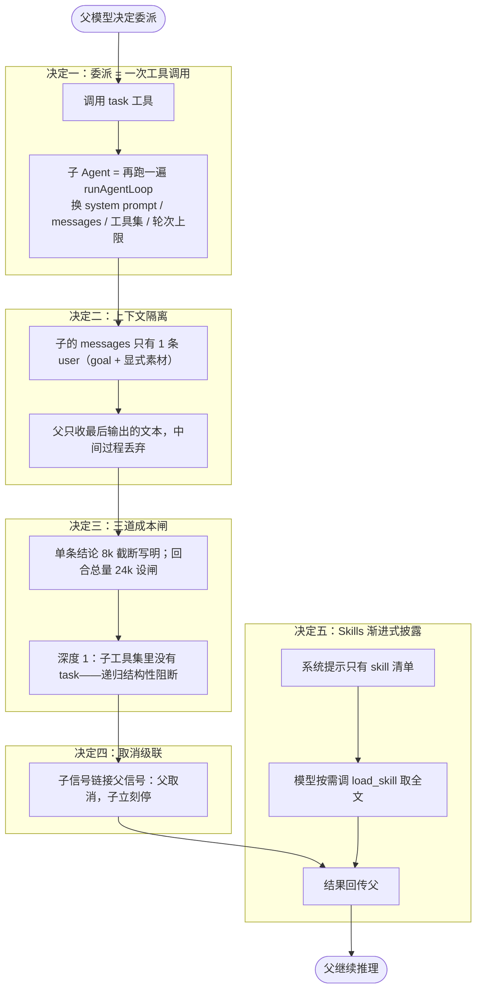

# 第 7 章 子 Agent 与 Skills：委派出去，收回来的是结论

到这里，「简化 Harness」的内核全齐了，但它有个天生的限制：**所有事都在一份上下文里干**。让它「读完这五个文件再总结」，五个文件的内容全部挤进同一张桌子，读第三个的时候前两个已经开始被挤出去。这一章给 Harness 装上两条扩展：**子 Agent**（把活儿委派出去，只收回结论）和 **Skills**（把操作手册放外面，用到再翻）。

<!-- code-ref: packages/core/src/agent/subagent.ts#L17-L62 -->

## 1. 先搞懂三个词（What）

### 1.1 委派：一次名叫 `task` 的工具调用

委派（delegation）是父 Agent 把一个自包含的子任务交给子 Agent 去做的动作。关键设计：**它对模型来说就是一个普通的工具调用**——模型写 `task(goal: "总结这五个文件")`，循环执行它，拿到一条 toolResult（结论），继续往下走。模型不需要知道「委派」是什么新概念，它只是又调了一个工具。

### 1.2 子 Agent：同一台循环机，换了一组配置

子 Agent（sub-agent）不是第二种 Agent——它就是第 1 章那个 `runAgentLoop` 又跑了一遍，只是换了四样东西：system prompt（告诉它「你是被委派的」）、messages（只有一条 user 消息）、工具集（父工具集的子集）、轮次上限（比主 Agent 小得多，默认 30）。主循环的全部护栏——按序归位、钩子、取消补占位——**免费继承**。

### 1.3 Skill：放在外面的操作手册

Skill 是一个目录里的一份 `SKILL.md`：frontmatter 写名称和描述，正文是完整的操作规程。系统提示里**只有清单**（名称 + 描述一句话），模型判断当前任务和哪个 skill 相关时，调用 `load_skill` 工具取回全文照着做。这样每次请求的固定开销只有一份清单，而不是所有手册的全文——这就是**渐进式披露**（progressive disclosure）。

<!-- code-ref: packages/core/src/agent/skillLoader.ts#L42-L46 -->

## 2. 它怎么转 + 为什么非这么转（How）

整个流程：**父模型调 `task` 工具 → supervisor 检查预算 → 组装子的 system prompt + 唯一一条 user 消息 → 用派生的工具集跑一遍完整 Loop → 截取最后的结论文本 → 截断写明后回传给父**。Skills 则在启动时把清单注入系统提示，模型按需用 `load_skill` 取全文。图里每个「决定 N」分区对应 2.2~2.6 的一个决定：



人话版：委派就是一个工具调用，调用「跑了一遍 Loop 的函数」；子 Agent 两眼一抹黑（看不到父历史），干完活只交一页结论；预算、深度、取消三条闸保证它烧不了钱也停得下来；Skills 让「会什么」不占桌子。决定一~五对应 2.2~2.6；第 3 节代码照图落地。

### 2.1 不这么设计的下场

- **上下文被委派吃回去。** 子 Agent 跑了 20 轮读文件，把 20 轮的中间过程全部塞回父上下文——委派本是为了省上下文，结果加倍还回去，还不如父自己读。
- **递归失控。** 子 Agent 也能委派、孙 Agent 也能委派，深度不受限，一次误调用就是一棵无限的委派树。
- **手册占满桌子。** 把所有 skill 全文都塞进系统提示，还没开始干活固定开销就吃掉大半窗口——skill 越多人越穷。

### 2.2 决定一：委派被建模成一次工具调用，不造第二套循环

子 Agent 不是新的执行机制，就是「一次新的 `runAgentLoop`，换了配置」。对模型暴露为一个普通的 `task` 工具（name/description/JSON Schema），走第 1 章循环的正常工具路径。

**代价**：`task` 这个工具本身要好好定义（描述里写清「只带回最终结论」），且它的实现函数比普通工具重得多——普通工具是纯函数，它是「包着一整个 Loop 的函数」。换来的是：**主循环的全部护栏免费继承**——结果按序归位、`beforeToolCall` 钩子（安全审批对子 Agent 同样生效）、取消补占位，一行都不用重写。反过来，如果为子 Agent 单写一套执行器，每一道护栏都要重做一遍，漏一道就是第 1 章踩过的坑在子 Agent 身上复发。

<!-- code-ref: packages/core/src/agent/subagent.ts#L17-L29 -->

### 2.3 决定二：上下文隔离——子只有一条 user 消息，父只收最后的结论

子的 `messages` 只有一条 user 消息：目标 + 父**显式**提供的素材。父想让孩子知道什么，就在委派参数里写什么。子跑完几十轮后，父拿到的只是**最后输出的那段文本**（再经截断），中间的读取、搜索、试错全部丢弃。

**代价**：父必须判断「给哪些素材」——给少了子干不了，给多了隔离名存实亡。这是把「上下文管理」从机制问题变成了委派质量问题。换来的是：子跑 20 轮读 5 个文件，父的桌子只多一页结论。

**踩坑实录（都写在源码注释里）**：

1. **图省事把父历史整段传进来 = 放弃隔离这个核心收益。** user 消息的注释原文就警告了这一点——隔离是靠「只传 goal + 素材」这个纪律撑着的，不是机制自动保证的。
2. **提示词必须写明「只有最后输出的文本会被带走」。** 子 Agent 看不到父历史，如果不知道这条规则，它会像普通 Agent 一样把结论分散在对话里、停在「我已经读完了」——父收回来一句空话。所以 system prompt 开头就写死：中间过程一概丢弃，把结论完整写在最终回复里。

<!-- code-ref: packages/core/src/agent/subagent.ts#L120-L185 -->
<!-- code-ref: packages/core/src/agent/subagent.ts#L187-L224 -->

### 2.4 决定三：三道成本闸——深度、次数、回传总量

委派省上下文，但每一道口子都可能被烧穿，所以三道闸缺一不可：

1. **深度闸（结构性阻断）**：`MAX_SUBAGENT_DEPTH = 1`——深度到达上限的 Agent，它的工具集里**根本没有** `task` 这个工具。递归不是被运行时拦下来，而是结构性不存在，没有「深度检查忘写了」这类 bug 的容身之处；
2. **次数闸**：每回合最多委派 8 次（并行最多 4 个）；拿不到名额返回**带原因的失败**（`budget_exhausted`），绝不静默放行——模型必须知道「委派没发生」，才不会干等一个永远不会到来的结论；
3. **总量闸**：单条结论上限 8k 字符（与 `read_file`/bash 同口径：要么完整、要么写明截断加收窄建议），**回合回传总量另设 24k**——单条上限挡不住总量，8 次 × 8k = 64k 字符灌回主上下文，委派省下的上下文被加倍吃回去，整个多 Agent 设计就失去意义了。

**代价**：合法的大批量委派（比如「把 20 个文件各审一遍」）会被次数闸挡住，得拆回合或改用文件交接。这是「防失控」对「吞吐量」的让步，宁可让模型多跑几轮，不让一次误调用烧穿桌子。

<!-- code-ref: packages/core/src/agent/subagent.ts#L225-L250 -->
<!-- code-ref: packages/core/src/agent/subagent.ts#L432-L461 -->

### 2.5 决定四：取消级联——父停，子立刻停

子 Agent 的取消信号**链接**到父信号：父被 Ctrl+C，子立刻收到中止。合并信号是手写的十几行，刻意不用 `AbortSignal.any`——它是 Node 20+ 的 API，而项目基线是 Node 18+，用了在 CI 和旧环境直接崩。

**代价**：手写合并要自己管监听器的清理时机（`dispose` 收尾函数负责解除全部监听与清计时器），漏了就是悬挂监听。换来零新依赖，以及一条硬保证：**取消在委派树里传播没有死角**——排队等名额的委派也在竞速之列，父取消后它们不会白等运行中的子 Agent 收尾。

**踩坑实录（源码注释点名的两个真实缺陷）**：等待必须与取消竞速，否则 Ctrl+C 之后排队者要干等；预算检查必须放在等待**之后**——等待者正是从排队中醒来的，检查放在排队之前，同一批并发申请会先后通过同一个检查，预算可被无限突破。

<!-- code-ref: packages/core/src/agent/subagent.ts#L64-L118 -->

### 2.6 决定五：Skills 渐进式披露——清单进提示，全文按需取

系统提示里只有 skill 的**元数据清单**（名称 + 一句话描述，按来源分组）；全文由模型判断相关后调用 `load_skill` 工具按需取用。加载结果带缓存：元数据扫一遍目录后缓存，全文按名称缓存。

**代价**：模型可能该加载而不加载（清单只有一句话，判断靠它自己），或者加载了无关的 skill（多花一次工具调用）。换来的是固定开销与 skill 数量解耦——100 个 skill 的系统提示和 10 个的一样大。

**两个配套规矩（都在源码里）**：

1. **同名覆盖**：多个 skill 目录按优先级排列，后加载的覆盖先加载的同名 skill——项目级 skill 可以精准覆盖全局默认；
2. **解析失败必须告警**：缺 name/description 的 SKILL.md 跳过时要打一条警告。静默跳过会让「写了 skill 却列表里没有」变成彻头彻尾的玄学问题——没有 name 就无法加载，用户连排查的抓手都没有。

<!-- code-ref: packages/core/src/agent/skillLoader.ts#L140-L158 -->
<!-- code-ref: packages/core/src/agent/skillLoader.ts#L200-L206 -->

## 3. 实现：跟着写一个委派层

本章往 `harness/` 里加三个文件：`subagent.js`（task 工具 + supervisor）、`skills.js`（Skill 加载器 + load_skill 工具）、`run-subagent.js`（四出戏），外加一个 `skills/` 样例目录。**旧文件一行不动**——委派层就是把第 1 章的 Loop 又包了一层。

### 3.0 落点：一套累积式代码

```
harness/
├── messages.js / model.js / tools.js / loop.js   # 第1章：核心循环
├── context.js / session.js                       # 第4章：估算与会话
├── provider.js / context-window.js               # 第5章：供应商与窗口
├── subagent.js        # 本章新增：task 工具 + supervisor（预算闸）
├── skills.js          # 本章新增：Skill 加载器 + load_skill 工具
├── skills/            # 本章新增：样例 skill（两个 SKILL.md）
└── run-subagent.js    # 本章新增：四出戏
```

### 3.1 `subagent.js` —— task 工具与三道闸

```js
// harness/subagent.js —— 第7章：子 Agent 运行时（委派 = 一次工具调用）
// 三条边界：上下文隔离（子只有一条 user 消息）、权限派生（子工具集是父的子集）、取消级联（链接父信号）。

import { runAgentLoop } from "./loop.js";
import { createToolRegistry } from "./tools.js";
import { textBlock } from "./messages.js";

// 常量对齐 subagent.ts：深度 1 / 子轮次 30 / 单条结论 8000 / 回合总量 24000（demo 为便于观察缩小，注释注明真实值）
export const MAX_SUBAGENT_DEPTH = 1;               // 达到该深度的 Agent 拿不到 task 工具：递归被结构性阻断
export const DEFAULT_SUBAGENT_MAX_TURNS = 30;      // 比主 Agent 的 100 小得多：它只被派去做一件事
export const SUBAGENT_RESULT_MAX_CHARS = 8_000;    // 单条结论上限：与 bash/read_file 同口径，写明截断
export const MAX_TURN_RESULT_CHARS = 24_000;       // 回合回传总量上限：单条上限挡不住总量，必须单独设闸
export const SUBAGENT_TOOL_NAME = "task";

/** 结论截断：要么完整返回，要么明确告知被截断以及如何收窄——静默截断会让父拿着残缺结论继续推理而不自知 */
export function capSubAgentResult(text, { limit = SUBAGENT_RESULT_MAX_CHARS, budgetExhausted = false } = {}) {
  if (text.length <= limit) return { summary: text, truncated: false };
  const hint = budgetExhausted
    ? "本回合回传总量已到上限，请把目标拆成更小的几次委派，或改用文件交接。"
    : "请让子 Agent 输出更聚焦的结论，或把完整结果写入文件后回传路径。";
  return {
    summary:
      `${text.slice(0, limit)}\n` +
      `...[已截断：结论共 ${text.length} 字符，仅返回前 ${limit} 字符。${hint}]`,
    truncated: true,
  };
}

/** 子 Agent 的 system prompt：必须写明「你看不到父历史」「只有最后输出的文本会被带走」 */
export function buildSubAgentSystemPrompt({ workspaceRoot = process.cwd(), canWrite = true, instructions } = {}) {
  const parts = [
    `你是一个被委派的子任务执行 Agent，工作目录：${workspaceRoot}。`,
    "你**看不到**调用方的对话历史，只有本次委派给出的目标与素材。",
    "调用方只会收到你最后输出的这段文本：中间的读取、搜索与分析过程一概丢弃，",
    "因此请把结论完整写在最终回复里，并带上必要的文件路径与关键符号。",
  ];
  if (!canWrite) parts.push("", "本次委派**没有写权限**：只能读取与分析，需要修改时请在结论里写清改哪里、怎么改。");
  if (instructions) parts.push("", instructions);
  return parts.join("\n");
}

/** 目标与显式素材组装成子的唯一一条 user 消息——不要图省事把父历史整段传进来 */
export function buildSubAgentUserMessage({ goal, context = [] }) {
  const lines = [`目标：${goal}`];
  const entries = context.filter((c) => typeof c === "string" && c.trim().length > 0);
  if (entries.length > 0) lines.push("", "以下是调用方提供的素材：", ...entries.map((c) => `- ${c}`));
  return textBlock(lines.join("\n"));
}

/** 回合级预算闸：单条 8k 挡不住「8 次 × 8k = 64k 灌回主上下文」，总量必须单独设闸 */
export function createSupervisor({ maxDelegations = 8, maxResultChars = MAX_TURN_RESULT_CHARS } = {}) {
  let delegations = 0;
  let resultCharsUsed = 0;
  return {
    get stats() { return { delegations, resultCharsUsed }; },
    get resultBudgetExhausted() { return resultCharsUsed >= maxResultChars; },
    // 拿不到名额返回**带原因的失败**而不是静默放行：模型知道「委派没发生」，才不会干等一个永不到来的结论
    acquire() {
      if (delegations >= maxDelegations) return { ok: false, reason: "budget_exhausted" };
      delegations += 1;
      return { ok: true };
    },
    recordResultChars(chars) { if (Number.isFinite(chars) && chars > 0) resultCharsUsed += Math.floor(chars); },
  };
}

/**
 * task 工具：委派被建模成一次工具调用——子 Agent 不需要第二套循环，
 * 它就是一次新的 runAgentLoop，只是换了 system prompt / messages / 工具集 / 轮次上限。
 * 主循环的全部护栏（按序归位 / 钩子 / 取消补占位）因此免费继承。
 */
export function createTaskTool(baseDefs, model, { supervisor, maxTurns = DEFAULT_SUBAGENT_MAX_TURNS, workspaceRoot, resultLimit = SUBAGENT_RESULT_MAX_CHARS } = {}) {
  return {
    name: SUBAGENT_TOOL_NAME,
    description: "把一个自包含的子任务委派给子 Agent；它只带回最终结论",
    concurrent: false, // 会跑完整循环，串行
    run: async ({ goal, context = [] }, signal) => {
      const acquire = supervisor?.acquire() ?? { ok: true };
      if (!acquire.ok) {
        return { text: `委派未发生（${acquire.reason}）：预算已用完，请把目标拆成更小的几次委派。`, isError: true };
      }

      // 权限派生 + 结构性阻断：深度到达上限的子工具集里**没有** task——递归不是被拦下，而是根本不存在
      const subDefs = baseDefs.filter((d) => d.name !== SUBAGENT_TOOL_NAME);
      const subTools = createToolRegistry(subDefs);

      const { newMessages } = await runAgentLoop({
        systemPrompt: buildSubAgentSystemPrompt({ workspaceRoot }),
        messages: [buildSubAgentUserMessage({ goal, context })],
        tools: subTools,
        model,
        maxTurns,
        signal,
      });

      // 父只收最后的结论文本；中间过程一概丢弃
      let finalText = "";
      for (let i = newMessages.length - 1; i >= 0; i--) {
        const m = newMessages[i];
        if (m.role === "assistant") {
          finalText = m.content.filter((b) => b.type === "text").map((b) => b.text).join("\n").trim();
          break;
        }
      }
      const capped = capSubAgentResult(finalText, { limit: resultLimit, budgetExhausted: supervisor?.resultBudgetExhausted ?? false });
      supervisor?.recordResultChars(capped.summary.length);
      return { text: capped.summary, isError: false };
    },
  };
}
```

### 3.2 `skills.js` —— Skill 加载器与 load_skill 工具

```js
// harness/skills.js —— 第7章：Skill 加载器（渐进式披露）
// 渐进式披露：系统提示里只有元数据清单（名称+描述），全文由模型经 load_skill 工具按需取用。

import { existsSync, readFileSync, readdirSync } from "node:fs";
import { join } from "node:path";

/** 从 SKILL.md 解析 frontmatter（--- 包裹的 name/description） */
export function parseFrontmatter(content) {
  const m = /^---\r?\n([\s\S]*?)\r?\n---/.exec(content);
  if (!m) return null;
  const name = /^name:\s*(.+)$/m.exec(m[1])?.[1]?.trim();
  const description = /^description:\s*(.+)$/m.exec(m[1])?.[1]?.trim();
  if (!name || !description) return null; // 没有 name 就无法按需加载
  return { name, description };
}

export function createSkillLoader(dirs) {
  // 同名 skill 后加载者覆盖先加载者：目录列表按优先级从低到高排列
  let metadataCache = null;
  const contentCache = new Map();

  function scanSkillDir(dirPath) {
    if (!existsSync(dirPath)) return [];
    const results = [];
    for (const entry of readdirSync(dirPath, { withFileTypes: true })) {
      if (!entry.isDirectory()) continue;
      const skillFile = join(dirPath, entry.name, "SKILL.md");
      if (!existsSync(skillFile)) continue;
      const content = readFileSync(skillFile, "utf8");
      const meta = parseFrontmatter(content);
      if (meta) results.push({ ...meta, skillFile });
      // 解析失败必须告警：静默跳过会让「写了 skill 却列表里没有」变成玄学问题
      else console.warn(`跳过无法解析的 skill：${skillFile}（缺少 name/description 字段）`);
    }
    return results;
  }

  function loadAllMetadata() {
    if (metadataCache) return [...metadataCache];
    const byName = new Map();
    for (const dir of dirs) for (const s of scanSkillDir(dir)) byName.set(s.name, s);
    metadataCache = [...byName.values()];
    return [...metadataCache];
  }

  function loadSkill(skillName) {
    if (contentCache.has(skillName)) return contentCache.get(skillName);
    const meta = loadAllMetadata().find((s) => s.name === skillName);
    if (!meta) return null;
    const skill = { ...meta, content: readFileSync(meta.skillFile, "utf8") };
    contentCache.set(skillName, skill);
    return skill;
  }

  /** 注入 system prompt 的清单：只有元数据，没有全文 */
  function generateSkillSummary() {
    const metadata = loadAllMetadata();
    if (metadata.length === 0) return "";
    const lines = ["## 可用 Skills", "", "当用户的请求与某个 skill 相关时，调用 load_skill 工具加载它的完整内容再执行；不要询问用户，直接加载。", ""];
    for (const s of metadata) lines.push(`- **${s.name}**: ${s.description}`);
    return lines.join("\n");
  }

  return { loadAllMetadata, loadSkill, generateSkillSummary };
}

/** load_skill 工具：渐进式披露的另一半——全文按需取用 */
export function createLoadSkillTool(loader) {
  return {
    name: "load_skill",
    description: "按名称加载一个 skill 的完整内容",
    concurrent: true, // 只读
    run: ({ name }) => {
      const skill = loader.loadSkill(name);
      if (!skill) return { text: `未找到 skill：${name}`, isError: true };
      return { text: skill.content };
    },
  };
}
```

### 3.3 跑起来，看四出戏

```js
// harness/run-subagent.js —— 第7章 demo：四出戏
// 戏1 委派=一次工具调用（子 loop 真的跑，父只收结论；子试图再委派被结构性阻断）
// 戏2 结论截断写明 + 回合总量闸  戏3 委派预算闸（带原因的失败）  戏4 Skills 渐进式披露

import { textBlock, toolCallBlock } from "./messages.js";
import { createMockModel } from "./model.js";
import { createToolRegistry, readFileTool } from "./tools.js";
import { createTaskTool, createSupervisor, MAX_SUBAGENT_DEPTH } from "./subagent.js";
import { createSkillLoader, createLoadSkillTool } from "./skills.js";
import { fileURLToPath } from "node:url";
import { join, dirname } from "node:path";

const here = dirname(fileURLToPath(import.meta.url));

/** 静音包装：demo 只看结果，不要流式吐字干扰输出 */
const silent = (model) => ({ complete: (p) => model.complete({ ...p, onDelta: undefined }) });

// ---------- 戏 1：委派 = 一次工具调用 ----------
{
  // 子 Agent 的模型脚本：先读文件，再给出结论
  const subModel = createMockModel([
    { content: [toolCallBlock("s1", "read_file", { path: "messages.js" })], stopReason: "toolUse" },
    { content: [textBlock("结论：messages.js 定义了 text/toolCall/toolResult 三种块；铁律是每个 toolCall 必须有顺序一致的 toolResult 对应。")], stopReason: "stop" },
  ]);
  // 父 Agent 的模型脚本：直接委派
  const parentModel = createMockModel([
    { content: [toolCallBlock("p1", "task", { goal: "总结 messages.js 里定义了什么", context: ["工作目录里有 messages.js"] })], stopReason: "toolUse" },
    { content: [textBlock("收到结论，任务完成。")], stopReason: "stop" },
  ]);

  const taskTool = createTaskTool([readFileTool], silent(subModel), { supervisor: createSupervisor(), maxTurns: 10 });
  const parentTools = createToolRegistry([readFileTool, taskTool]);
  const { newMessages } = await import("./loop.js").then(({ runAgentLoop }) =>
    runAgentLoop({ systemPrompt: "你是主 Agent。", messages: [], tools: parentTools, model: silent(parentModel), maxTurns: 10 }),
  );

  const taskResult = newMessages.find((m) => m.role === "toolResult" && m.toolName === "task");
  console.log("【戏1】父收到的 task 结果 =", taskResult.content[0].text);
  console.log("【戏1】父的消息流里只有这一条结论——子的读取过程（read_file 等）一概不在其中");
}

// ---------- 戏 1b：子 Agent 拿不到 task 工具（结构性阻断递归） ----------
{
  const greedySubModel = createMockModel([
    { content: [toolCallBlock("g1", "task", { goal: "再委派一层" })], stopReason: "toolUse" },
    { content: [textBlock("没有 task 工具，我自己做。")], stopReason: "stop" },
  ]);
  const taskTool = createTaskTool([readFileTool], silent(greedySubModel), { supervisor: createSupervisor(), maxTurns: 10 });
  // 子工具集在 task.run 内部派生（已剔除 task）；这里直接构造同款子注册表验证
  const { createToolRegistry: reg } = await import("./tools.js");
  const subTools = reg([readFileTool, taskTool].filter((d) => d.name !== "task"));
  const res = await subTools.execute({ id: "g1", name: "task", arguments: { goal: "x" } }, undefined);
  console.log("\n【戏1b】深度", MAX_SUBAGENT_DEPTH, "的子 Agent 调 task →", res.content[0].text, "（递归不是被拦下，而是根本不存在）");
}

// ---------- 戏 2：结论截断写明 + 回合总量闸 ----------
{
  const longTail = "结论细节。".repeat(80); // 400 字符
  const subModel = createMockModel([
    { content: [textBlock(longTail)], stopReason: "stop" },
    { content: [textBlock(longTail)], stopReason: "stop" }, // 第二次委派也要有剧本（mock 按次消耗）
  ]);
  const taskTool = createTaskTool([readFileTool], silent(subModel), {
    supervisor: createSupervisor({ maxResultChars: 200 }),
    maxTurns: 10,
    resultLimit: 200, // demo 缩小（真实 8000）
  });
  const tools = createToolRegistry([taskTool]);
  const r1 = await tools.execute({ id: "t1", name: "task", arguments: { goal: "给个长结论" } }, undefined);
  console.log("\n【戏2】第一次委派，截断尾部 =", JSON.stringify(r1.content[0].text.slice(-60)));
  const r2 = await tools.execute({ id: "t2", name: "task", arguments: { goal: "再来一个长结论" } }, undefined);
  console.log("【戏2】回传总量（真实 24000）耗尽后，提示切换 =", JSON.stringify(r2.content[0].text.slice(-75)));
}

// ---------- 戏 3：委派预算闸（带原因的失败） ----------
{
  const subModel = createMockModel([
    { content: [textBlock("结论：完成。")], stopReason: "stop" },
    { content: [textBlock("结论：完成。")], stopReason: "stop" },
    { content: [textBlock("结论：完成。")], stopReason: "stop" },
  ]);
  const taskTool = createTaskTool([readFileTool], silent(subModel), { supervisor: createSupervisor({ maxDelegations: 2 }), maxTurns: 10 });
  const tools = createToolRegistry([taskTool]);
  for (let i = 1; i <= 3; i++) {
    const r = await tools.execute({ id: `d${i}`, name: "task", arguments: { goal: `委派 ${i}` } }, undefined);
    console.log(`【戏3】第${i}次委派 →`, r.isError ? `isError: ${r.content[0].text}` : "成功");
  }
}

// ---------- 戏 4：Skills 渐进式披露 ----------
{
  const loader = createSkillLoader([join(here, "skills")]);
  console.log("\n【戏4】注入 system prompt 的清单（只有元数据，没有全文）：");
  console.log(loader.generateSkillSummary().split("\n").slice(0, 5).join("\n"));
  const loadSkill = createLoadSkillTool(loader);
  const full = await loadSkill.run({ name: "commit-style" }, undefined);
  const body = full.text.replace(/^---\r?\n[\s\S]*?\r?\n---\r?\n/, "").trim().split("\n");
  console.log("【戏4】load_skill 取回全文，正文前两行 =", JSON.stringify(body.slice(0, 2)));
  const miss = await loadSkill.run({ name: "no-such" }, undefined);
  console.log("【戏4】加载不存在的 skill →", JSON.stringify(miss.text), "isError =", miss.isError);
}
```

运行：

```bash
cd demos/harness && node run-subagent.js
```

预期输出（demo 参数均为缩小版：子轮次 10、单条 200、总量 200、委派 2 次；真实值 30 / 8000 / 24000 / 8）：

```
【戏1】父收到的 task 结果 = 结论：messages.js 定义了 text/toolCall/toolResult 三种块；铁律是每个 toolCall 必须有顺序一致的 toolResult 对应。
【戏1】父的消息流里只有这一条结论——子的读取过程（read_file 等）一概不在其中

【戏1b】深度 1 的子 Agent 调 task → 未知工具: task （递归不是被拦下，而是根本不存在）

【戏2】第一次委派，截断尾部 = "：结论共 400 字符，仅返回前 200 字符。请让子 Agent 输出更聚焦的结论，或把完整结果写入文件后回传路径。]"
【戏2】回传总量（真实 24000）耗尽后，提示切换 = "细节。结论细节。
...[已截断：结论共 400 字符，仅返回前 200 字符。本回合回传总量已到上限，请把目标拆成更小的几次委派，或改用文件交接。]"
【戏3】第1次委派 → 成功
【戏3】第2次委派 → 成功
【戏3】第3次委派 → isError: 委派未发生（budget_exhausted）：预算已用完，请把目标拆成更小的几次委派。

【戏4】注入 system prompt 的清单（只有元数据，没有全文）：
## 可用 Skills

当用户的请求与某个 skill 相关时，调用 load_skill 工具加载它的完整内容再执行；不要询问用户，直接加载。

- **commit-style**: 本项目的提交信息规范：一行标题说清改了什么，正文解释为什么
【戏4】load_skill 取回全文，正文前两行 = ["# 提交信息规范",""]
【戏4】加载不存在的 skill → "未找到 skill：no-such" isError = true
```

## 4. 配套 demo

demo 在仓库的 `demos/harness/`，与本章正文逐文件对应：`subagent.js` / `skills.js` + `skills/` 样例目录 + 驱动脚本 `run-subagent.js`：

```bash
cd demos/harness && node run-subagent.js
```

老规矩：只新增文件，旧脚本一行没动、照常能跑。

## 5. 小结与下一章

委派层的本质，是把「委派即工具调用、上下文隔离靠纪律、三道闸缺一不可、取消级联无死角、手册渐进披露」这五件事焊在一起。其中**三道成本闸**最容易被新手省掉——demo 里不设闸也跑得好好的，但在真实模型上，「8 次委派 × 8k 结论」就能把委派省下的上下文加倍吃回去，而深度闸的缺失会让一次误调用变成一棵烧钱的委派树。结构性阻断（子工具集里根本没有 task）比运行时检查便宜得多，也可靠得多。

至此 Harness 已经很能干了，但「能干」和「可靠」之间还差最后一课：你怎么知道改了一版提示词、换了一个模型之后，它**没有变笨**？凭感觉在终端里聊两句是测不出来的。下一章（评测：给 Agent 上门禁）讲怎么给 Agent 建一套任务集、跑基线对比、把「不许变笨」变成 CI 里一道自动的门禁。
