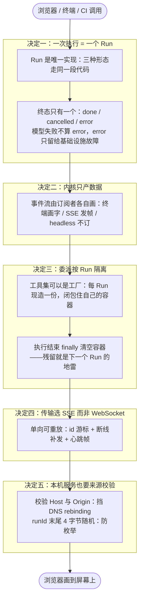

# 第 9 章 多形态交付：同一内核，N 张脸

八章下来，这个 Harness 在终端里已经很完整了。但用户不会永远住在终端里：有人想把它塞进 CI 管道（headless，只要 JSON 结论），有人想给它套个网页界面（事件流推到浏览器）。看起来这是三个产品，实际上是**一个内核的三张脸**。这一章讲交付形态怎么变——以及为什么变来变去，内核一行都不用重写。

<!-- code-ref: packages/core/src/run.ts#L1-L18 -->

## 1. 先搞懂三个词（What）

### 1.1 Run：一次执行的唯一实现

Run 是「跑一次」的封装：终端里一个回合、headless 一次 `exec`、服务端一个任务，**走的是同一段代码**。区别只在两件外围的事：谁订阅事件流、谁来回答审批。Run 自带 runId、私有取消信号、状态机，执行完返回一个结构化结论（新增消息、耗时、状态）。

### 1.2 事件流：内核只产数据，画不画随你

内核**不打印、不着色、不读 TTY**。它把执行过程产出一串事件（模型吐了一个字、要调工具了、工具回来了……），谁订阅谁自己画：终端加前缀着色，服务端打包成 SSE 帧推给浏览器，headless 干脆不订。

### 1.3 SSE：单向、可重放的事件推送

SSE（Server-Sent Events）是 HTTP 上的一条单向流：服务端不断往连接里写「帧」（带序号 `id:`、事件类型、JSON 数据），浏览器端自动重连。跟 WebSocket 的区别后面讲——简单说：Agent 的输出只有一个方向，反向操作（取消、审批）用普通 POST 就够了。

<!-- code-ref: packages/client/src/server/sse.ts#L1-L14 -->

## 2. 它怎么转 + 为什么非这么转（How）

服务端形态的完整链路：**浏览器 POST 创建 Run → Run 在内核里跑（事件被订阅进 buffer）→ 浏览器 GET 事件流（SSE：先补发游标之后的事件，再实时推）→ 反向的取消/审批走普通 POST**。图里每个「决定 N」分区对应 2.2~2.6 的一个决定：



人话版：所有形态共用一台发动机（Run）；发动机只喷油不装表盘（事件流给谁谁画）；每个 Run 的油路自己一份（委派隔离）；仪表盘的传输线用单向可重放的 SSE；整台机器虽然只听本机的，门禁一样不省。决定一~五对应 2.2~2.6；第 3 节代码照图落地。

### 2.1 不这么设计的下场

- **三套执行器三份 bug。** 终端一套循环、headless 一套、服务端一套，第 1~7 章焊进去的护栏（按序归位、取消补占位、委派闸）每套都要重做——漏一道，就是某个形态里 Agent 又开始产残缺存档。
- **两个任务并行互相覆盖。** 取消信号、委派监督者挂在全局容器上，两个 Run 一并行就互相踩——这是「多任务」唯一的地雷。
- **WebSocket 白背双向。** 用 WebSocket 推事件，断线重连、断点续传、心跳全要自己发明；而事件明明只有一个方向。

### 2.2 决定一：一次执行 = 一个 Run，终态只有一个

Run 是「跑一次」的**唯一实现**。它有三条不变量（后来的客户端都靠它们活着）：

1. **本次执行私有**：runId、取消信号、委派监督者、委派运行时全都是本次执行私有的。此前监督者与运行时挂在 REPL 的全局容器上，两个 Run 并行会互相覆盖——那是「多任务」唯一的地雷；
2. **终态只有一个**：done / cancelled / error。注意**模型调用失败不算 error**——循环自己会把失败写成一条 assistant 消息，执行本身是完整走完的；error 只留给基础设施故障（注册表造不出来、落盘钩子抛出这类）。所以 `execute()` 的调用方拿到的永远是「这次执行的结论」，不需要再猜；
3. **配对同序**：`toolCallId` 的配对由 `runAgentLoop` 保证，Run 不碰——每层只管自己那层的不变量。

**代价**：Run 这层要管状态机、信号转发、容器清理，比「直接调循环」多几十行。换来的是三种形态共享全部护栏，且并发多任务时不互相踩。

**外部取消是转发不是另起**：Ctrl+C、HTTP 取消、父 Run 取消都从外部信号进来，Run 内部把它转发到自己的 controller 上——因此取消单个 Run 不牵连别人，取消父任务却能一次收掉整棵子树（各起一个信号的结果就是「取消父任务，子 Agent 还在跑」）。

<!-- code-ref: packages/core/src/run.ts#L32-L48 -->
<!-- code-ref: packages/core/src/run.ts#L152-L167 -->
<!-- code-ref: packages/core/src/run.ts#L186-L198 -->

### 2.3 决定二：内核不打印——产出数据，订阅者各自画

Run 循环里没有任何 `console.log`。所有过程信息以**事件**形式发出（`onDelta`、工具调用、回合结束……），订阅者决定画成什么样：终端订阅 delta 自己逐字画（想加前缀着色随意）；服务端订阅后打包成 SSE 帧；headless 根本不订阅，只要 `execute()` 的 JSON 结论。

**代价**：每个形态要自己写渲染（终端的流式输出、网页的气泡列表都是订阅者代码）。换来的是内核与展示彻底解耦——第 1 章换模型层不用改 Loop，这一章换交付形态同样不用改内核，是同一条 seam 哲学打穿到底。

### 2.4 决定三：委派按 Run 隔离——工具集用工厂，容器用完即清

`task` 工具的执行器要从一个容器里取「当次执行」的监督者、模型与取消信号，而注册表往往是一次性构建的。解法：`RunInput.tools` 可以是**工厂**——每 Run 现造一份注册表，让工具闭包住自己那一个容器。

**代价**：每 Run 多构造一次注册表（微不足道）。换来的是并行 Run 的委派互不干扰。配套两个细节：

1. **`finally` 里清空容器**：无论怎么结束都要置空——残留的运行时会让下一次之外的委派连到一个已经作废的取消信号上；
2. **关委派时是「看不见」不是「报错」**：关闭委派不是注销 `task` 工具，而是给它一个**过滤后的子集**让模型这次看不到它。靠「调用时报错」的话，模型每次都会先试着派一次、收到报错、再退回来——白白多一轮。

<!-- code-ref: packages/core/src/run.ts#L99-L119 -->
<!-- code-ref: packages/core/src/run.ts#L276-L280 -->

### 2.5 决定四：传输选 SSE 而非 WebSocket——单向、可重放

选 SSE 的理由一句话：**事件是单向的、可重放的**。一次执行的输出只有服务端往客户端这一个方向；反方向的取消、审批裁决都是普通 POST。而 SSE 自带 `id:` 游标与浏览器端自动重连——断流之后前端不必自己实现「从第几条开始补」，服务端按游标补发就行。

**代价**：SSE 帧格式要自己伺候（express 的流式响应只是「不调 `res.end()`」）：JSON 序列化后每个换行都要单独带 `data:`，否则第一行之后的内容会被当成新字段而**静默丢弃**；还要定期发心跳帧（`: ping` 注释行，不触发前端事件，只用来把「连接已死」尽早暴露成写失败）。换来的是零新依赖（不用 WebSocket 库）、断线补发免费。

<!-- code-ref: packages/client/src/server/sse.ts#L16-L45 -->

### 2.6 决定五：本机服务也要来源校验；runId 不可猜

服务只监听 `127.0.0.1`，但**仍要校验 `Host` 与 `Origin`**——挡的是 DNS rebinding：恶意网页把自己的域名解析到 127.0.0.1，就能以「同源」身份打这个服务。判断三项：`Host` 必须存在且是本机（攻击者无法伪造这一项，因为它来自攻击者自己的域名）；`Origin` 若存在必须同属本机且**端口与 Host 一致**（`127.0.0.1:9999` 是另一个本地服务——攻击者常常就在本机跑一个）；`Origin: null`（沙箱 iframe、file:// 页面）没有可核对的来源，同样拒绝。这一步不向用户要任何东西（不用贴令牌），所以不该省。

**配套**：runId 也防着一手——「时间戳 + 自增序号」能被直接枚举，本机其它进程按格式试几轮就能读到别人的 `/api/runs/<id>/events`。末尾带 4 字节随机数，枚举成本从「试几次」变成「撞 2^32 次」；前缀与时间戳仍保留，日志里照样一眼看出先后。

**代价**：校验要写对（端口也要比），偶尔挡住真正无辜的非浏览器客户端。换来的是「没有令牌门禁」的本地服务也有可信的边界——安全口径与第 6 章一脉相承：栅栏尽力而为，边界必须明确。

<!-- code-ref: packages/client/src/server/http.ts#L1-L14 -->
<!-- code-ref: packages/client/src/server/http.ts#L20-L48 -->
<!-- code-ref: packages/core/src/run.ts#L121-L134 -->

## 3. 实现：跟着写一个 Run 与三种入口

本章往 `harness/` 里加两个文件：`run-core.js`（Run + SSE 帧编码 + 来源校验）和 `run-delivery.js`（四出戏），并给 `loop.js` 做一次**最小升级**（`onDelta` 可注入、新增 `onTurnEnd` 回合钩子——默认行为不变，第 1 章的用法原样能跑）。

### 3.0 落点：一套累积式代码

```
harness/
├── messages.js / model.js / tools.js / loop.js   # 第1章（loop.js 本章升级：onDelta 可注入 + onTurnEnd）
├── context.js / session.js                       # 第4章
├── provider.js / context-window.js               # 第5章
├── subagent.js / skills.js                       # 第7章
├── run-core.js        # 本章新增：Run（唯一实现）+ SSE 帧 + 来源校验
└── run-delivery.js    # 本章新增：同一 Run 的三张脸
```

`loop.js` 的升级只有两处（完整文件见 `demos/harness/loop.js`）：

```js
// 参数新增（默认行为不变）：
onDelta = (text) => process.stdout.write(text),  // 内核不打印：由调用方注入；默认仍写终端
onTurnEnd,                                       // 每轮结束钩子：落盘/压缩由调用方决定；
                                                 // 返回新上下文则循环立即替换（压缩后模型必须立刻看到摘要）

// 每轮收尾处（取消补占位之后）：
if (onTurnEnd) {
  const next = await onTurnEnd([...context]);
  if (next) { context.length = 0; context.push(...next); }
}
```

### 3.1 `run-core.js` —— Run 与传输细节

```js
// harness/run-core.js —— 第9章：Run（一次执行的唯一实现）+ 服务端传输细节
// 内核不打印、不着色、不读 TTY：这里产出的是**数据**，事件流由订阅者各自去画。

import { randomBytes } from "node:crypto";
import { runAgentLoop } from "./loop.js";

/** 终态：pending / running / done / cancelled / error——终态只有一个 */
export const RUN_STATUSES = ["pending", "running", "done", "cancelled", "error"];

/**
 * 生成 runId：可读、进程内唯一，并且**不可猜**。
 * 时间戳 + 自增序号能被直接枚举；末尾 4 字节随机数把枚举成本变成「撞 2^32 次」。
 */
let runSeq = 0;
export function newRunId(prefix = "run") {
  runSeq += 1;
  return `${prefix}_${Date.now().toString(36)}_${runSeq.toString(36)}_${randomBytes(4).toString("hex")}`;
}

/**
 * Run——「跑一次」的唯一实现：终端一个回合、headless 一次 exec、服务端一个任务，
 * 走同一段代码。区别只在谁订阅事件、谁来回答审批。
 */
export class Run {
  #status = "pending";
  #listeners = new Set();
  #controller = new AbortController();
  #externalAbort = null;
  runId;
  signal;

  constructor({ systemPrompt, messages, tools, model, maxTurns = 100, signal } = {}) {
    this.runId = newRunId();
    this.signal = this.#controller.signal;
    this.#input = { systemPrompt, messages, tools, model, maxTurns };
    // 外部取消源**转发进来**而不是另起一个：取消父任务必须一次收掉整棵子树
    if (signal) {
      const forward = () => this.cancel();
      if (signal.aborted) this.#controller.abort();
      else {
        signal.addEventListener("abort", forward, { once: true });
        this.#externalAbort = () => signal.removeEventListener("abort", forward);
      }
    }
  }
  #input;

  getStatus() { return this.#status; }

  /** 订阅事件流；返回取消订阅的函数 */
  subscribe(listener) {
    this.#listeners.add(listener);
    return () => this.#listeners.delete(listener);
  }

  /** 取消本次执行；已结束的 Run 再取消是无操作 */
  cancel() {
    if (["done", "cancelled", "error"].includes(this.#status)) return;
    this.#controller.abort();
  }

  /**
   * 执行。抛错只在基础设施故障时发生——模型调用失败由循环自己消化成一条消息，
   * 不算 error，因此调用方拿到的永远是「这次执行的结论」，不需要再猜。
   */
  async execute(hooks = {}) {
    const startedAt = Date.now();
    this.#status = "running";
    const emit = (event) => { hooks.onEvent?.(event); for (const l of this.#listeners) l(event); };
    try {
      // 工具集可以是注册表，也可以是「按 Run 现造」的工厂——委派按 Run 隔离的关键
      const tools = typeof this.#input.tools === "function" ? this.#input.tools() : this.#input.tools;
      const { newMessages } = await runAgentLoop({
        systemPrompt: this.#input.systemPrompt,
        messages: this.#input.messages,
        tools,
        model: this.#input.model,
        maxTurns: this.#input.maxTurns,
        beforeToolCall: hooks.beforeToolCall,
        signal: this.signal,
        onDelta: (text) => emit({ type: "delta", text }),
        onTurnEnd: hooks.onTurnEnd,
      });
      this.#status = this.signal.aborted ? "cancelled" : "done";
      return { runId: this.runId, status: this.#status, newMessages, elapsedMs: Date.now() - startedAt };
    } catch (error) {
      this.#status = this.signal.aborted ? "cancelled" : "error";
      return {
        runId: this.runId, status: this.#status, newMessages: [],
        elapsedMs: Date.now() - startedAt,
        ...(this.#status === "error" ? { error: String(error?.message ?? error) } : {}),
      };
    } finally {
      this.#externalAbort?.(); // 无论怎么结束都要解除外部监听：残留就是下一个 Run 的地雷
    }
  }
}

// ---------- 服务端传输细节 ----------

/** SSE 帧编码：每个换行都要单独带 data:，否则第一行之后的内容被当成新字段静默丢弃 */
export function encodeSseFrame(seq, event) {
  const body = JSON.stringify(event) ?? "{}";
  const lines = body.split("\n").map((line) => `data: ${line}`);
  return `id: ${seq}\nevent: ${event.type}\n${lines.join("\n")}\n\n`;
}

/** 心跳：注释行不触发前端事件，只用来把「连接已死」尽早暴露成写失败 */
export const HEARTBEAT_FRAME = ": ping\n\n";

function isLocalHost(host) {
  return /^(localhost|127\.0\.0\.0\/8|\[::1\]|127\.\d+\.\d+\.\d+)(:\d+)?$/i.test(host);
}

/**
 * 只接受本机来源：挡 DNS rebinding。Origin 若存在，端口必须与 Host 一致；
 * Origin: null（沙箱 iframe、file:// 页面）没有可核对的来源，同样拒绝。
 */
export function assertLocalRequest({ host, origin } = {}) {
  if (!host) throw new Error("403：请求缺少 Host 头，只接受本机浏览器的同源请求");
  if (!isLocalHost(host)) throw new Error(`403：Host 非本机：${host}`);
  if (origin && origin !== "null") {
    const originHost = origin.replace(/^https?:\/\//, "");
    if (!isLocalHost(originHost)) throw new Error(`403：Origin 非本机：${origin}`);
    if (host && originHost.split(":")[1] !== host.split(":")[1]) {
      throw new Error(`403：Origin 端口与 Host 不一致：${origin}`);
    }
  }
}
```

### 3.2 跑起来，看四出戏

驱动脚本见 `run-delivery.js`：戏 1 在**同一个进程里**起了一个真实的 `node:http` 服务（监听 127.0.0.1 随机端口），用 `fetch` 创建 Run、消费 SSE 事件流——三种形态跑在同一个 Run 上。运行：

```bash
cd demos/harness && node run-delivery.js
```

预期输出（runId 与耗时每次不同）：

```
【戏1·终端】
▸messages.js 定义了三种内容块，铁律是 toolCall 与 toolResult 配对同序。
           （status=done；终端自己决定怎么画：加前缀、着色都行）

【戏1·headless】status=done，结论="messages.js 定义了三种内容块，铁……"，elapsed=0ms

【戏1·服务端】POST /api/runs → run_mvyvj0d1_3_4b0cb813，SSE 事件流：
           id: 1
           event: delta
           data: {"type":"delta","text":"messages.js 定义了三种内容块，铁律是 toolCall 与 toolResult 配对同序。"}
           id: 2
           event: done
           data: {"type":"done","status":"done"}

【戏2】模型调用失败 → status=done（循环自己把它消化成一条消息，执行本身是完成的）
【戏2】基础设施故障   → status=error，error="注册表构造失败"

【戏3】runId 样例 = run_mvyvig79_6_71d1ffa5（时间戳+序号可读，末尾 4 字节随机防枚举）
【戏3】外部取消 → status=cancelled；终态后再 cancel 是无操作，status 仍是 cancelled

【戏4】SSE 帧（每个换行都要单独带 data:）：
       id: 3
       event: delta
       data: {"type":"delta","text":"第一行\n第二行"}
       心跳帧 = ": ping\n\n" （注释行不触发前端事件，只尽早暴露死连接）
       拒绝: {"host":"127.0.0.1:3000","origin":"http://evil.example"} → 403：Origin 非本机：http://evil.example
       拒绝: {"host":"127.0.0.1:3000","origin":"http://127.0.0.1:9999"} → 403：Origin 端口与 Host 不一致：http://127.0.0.1:9999
       拒绝: {} → 403：请求缺少 Host 头，只接受本机浏览器的同源请求
       放行: {"host":"127.0.0.1:3000","origin":"http://127.0.0.1:3000"}
```

## 4. 配套 demo

demo 在仓库的 `demos/harness/`，与本章正文逐文件对应：`run-core.js` + `run-delivery.js`（`loop.js` 升级了 `onDelta`/`onTurnEnd` 两个参数，默认行为不变）：

```bash
cd demos/harness && node run-delivery.js
```

## 5. 小结与下一章

多形态交付的本质，是把「一次执行一个 Run、终态只有一个、内核只产数据、委派按 Run 隔离、传输单向可重放、本机也要校验来源」这六件事焊在一起。其中**「模型失败不算 error」**最容易写反——直觉会把一切失败都当成异常抛出去，但那样调用方拿到的是一堆栈而不是「这次执行的结论」，取消与模型失败这两种「正常的不顺利」就再也没法和其他失败区分开了。

到这里，整条路线走完了：从第 1 章一台会回灌的最小 Loop，到第 9 章一个能上终端、能进管道、能接网页的完整 Harness。回头看第 0 章那张搭建地图——每一章加的那几个文件，拼起来就是它。接下来你可以把这套骨架接上真实模型（第 5 章的 Provider 接口直接可用），把它挂进 CI（第 8 章的评测门禁），或者套上你自己的客户端——内核已经不需要再改了。
